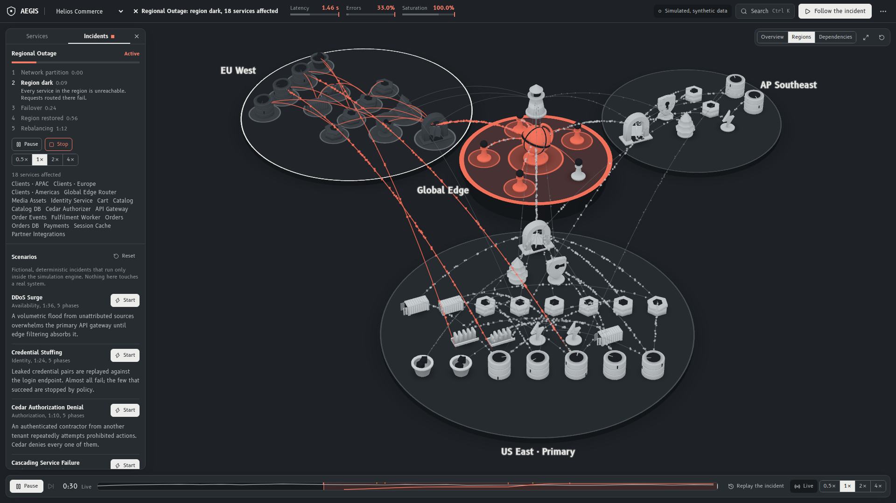
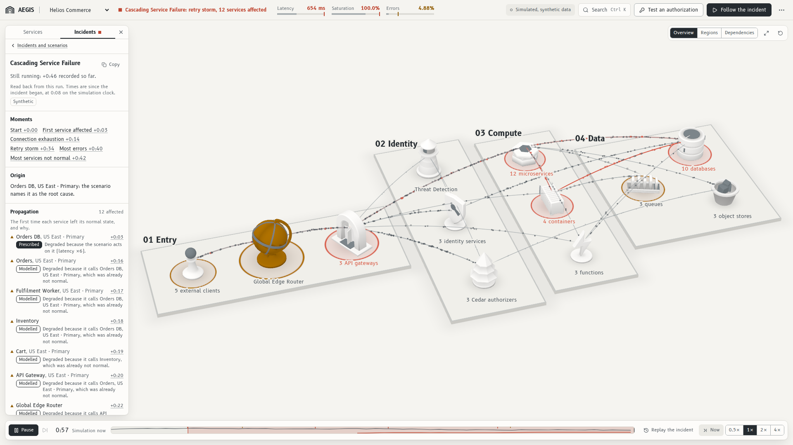
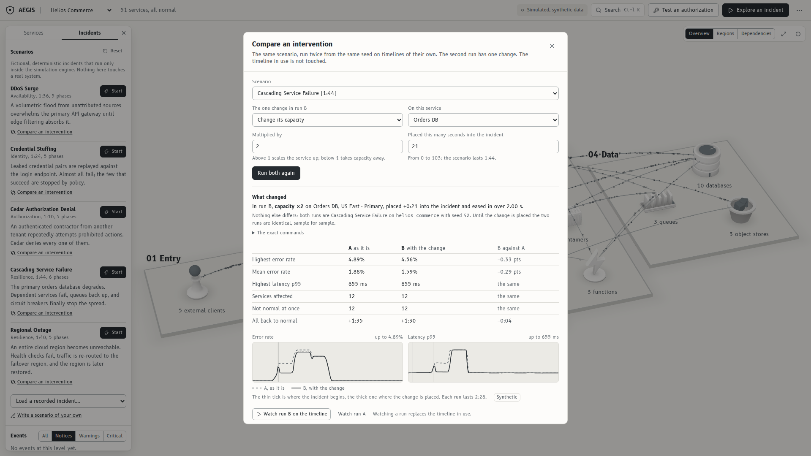
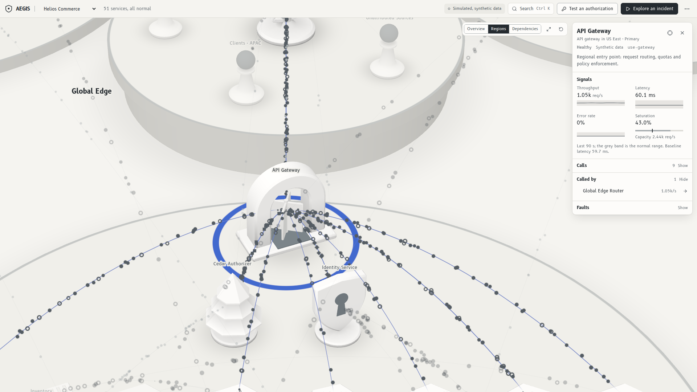
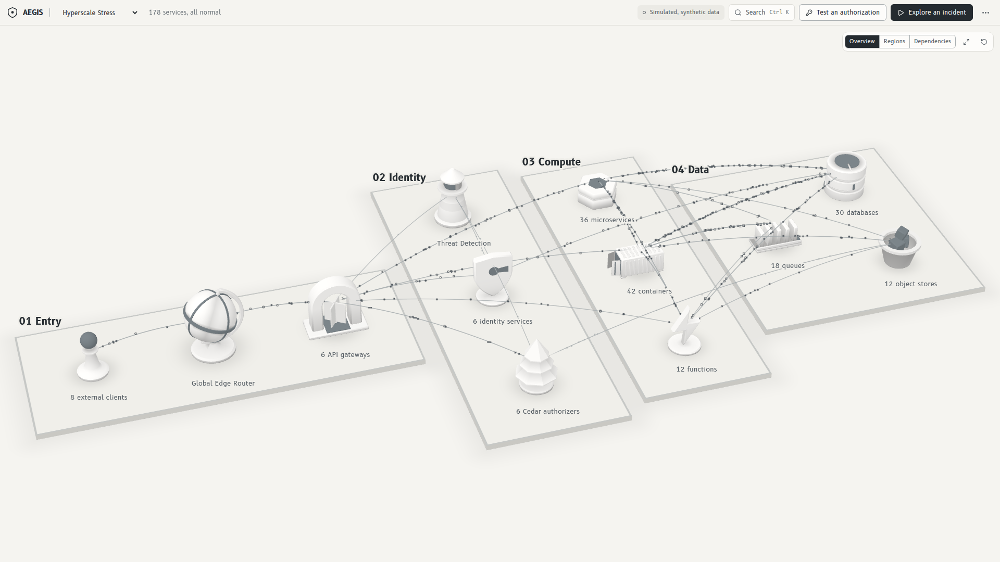
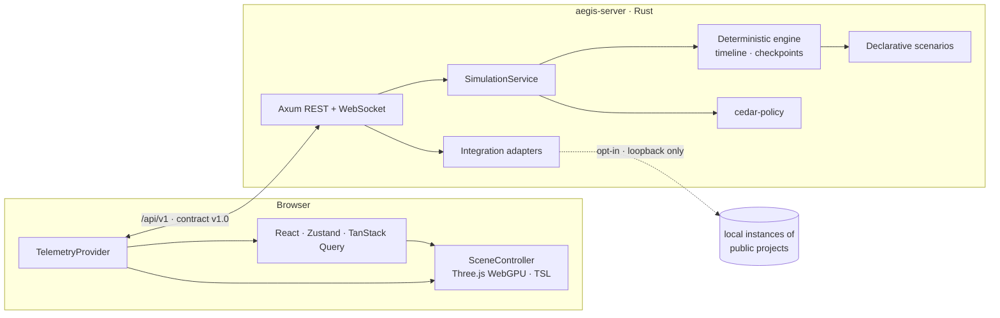

<div align="center">


# AEGIS

### Interactive Cloud Security Digital Twin

**See your infrastructure. Understand every connection. Watch threats unfold.**

A scale model of a distributed platform that you can walk around: services as
pieces on plates, requests as beads on wires, incidents you can launch, pause,
rewind and replay. Driven by a deterministic Rust simulation and real Cedar
policy decisions. Everything normal is drawn in neutral tones; the only colour
on the screen is a problem.

[](https://github.com/cleissonbarbosa/csdt/actions/workflows/ci.yml)


<sub>A fictional DDoS surge at 2× speed: flood, saturation, mitigation.
Recorded from the running application. <a href="docs/assets/demo.mp4">Full clip (MP4)</a></sub>

</div>

---

> **Everything you see is synthetic.** AEGIS simulates a fictional platform. It
> observes no real system, scans no network and attacks nothing. See the
> [security model](docs/SECURITY.md).

## What it is

AEGIS is a digital twin of a cloud platform that does not exist: _Helios
Commerce_, 51 services across three regions and a global edge. A Rust engine
simulates it tick by tick (load, saturation, queues, cascading failure) and
streams the result to a WebGPU scene you can walk around.

It is built to be inspected. The numbers on screen are derived from the model,
not scripted. Authorization outcomes come from the real
[Cedar](https://www.cedarpolicy.com) policy engine. Every past moment can be
revisited exactly, because the engine is deterministic and history is
event-sourced.

<p align="center">
  
</p>

## Two rules

The interface is a **signal field**: a scale model on a quiet porcelain field.

**Overview first, then one path, then the detail.** It opens on the platform
reduced to its twelve kinds of service, in the four layers a request crosses.
Selecting a piece, tracing a request or starting an incident brings one path
forward. Opening a service goes to the arrangement where all fifty-one stand
on their own.

**Normal is silent, and hue is an answer.** A healthy service has no colour,
no dot and no badge. Blue answers the viewer: what is selected, the request
being followed. Amber, red and magenta answer the data, and exist only for
things that deviate, so when something fails there is nothing else for the eye
to go to.

<table>
  <tr>
    <td width="50%"></td>
    <td width="50%"></td>
  </tr>
  <tr>
    <td align="center"><sub>A DDoS surge in the overview. Nothing else on the screen has a hue.</sub></td>
    <td align="center"><sub>Night theme, by region: the plate of the region that failed goes dark.</sub></td>
  </tr>
</table>

The reasoning, the sources it draws on and what was deliberately left out are
in [docs/DESIGN.md](docs/DESIGN.md).

## Features

**A model you can walk around**

- Twelve kinds of service, each a modelled piece with its own silhouette: an
  arch for a gateway, a shield with a keyhole for authentication, a cedar for
  the authorizer, a stack of platters for a database, a lighthouse for the
  threat monitor. The pieces are built in Blender by a script in the
  repository, with ambient occlusion baked per vertex.
- Two levels of one model. The overview draws one piece per kind of service,
  each with the figures of every service it stands for, and stays twelve
  pieces at 51 services or at 178. The detailed arrangements show every
  service, by cloud region or by dependency tier.
- Deterministic layout; readable at 178 services and 648 connections.
- Orbit, zoom, pan, click to inspect a kind, a service or a connection,
  double-click to move in. Search, and filter by kind, state, region or
  incident.
- Light and night themes with the same rules. Names keep one size on screen,
  like the names on a map, and appear as you get closer. They are drawn at
  the display's own resolution whatever the scene's is, and never across
  each other: where there is not room for all of them the more important
  come first, and the rest return when you move in or select their piece.

**Quiet until asked**

- At rest the screen holds the model and one bar: what this is, a sentence
  saying how the platform is, and three things to do: find something, test
  an authorization, follow an incident. A card comes with a selection and
  leaves with it, lists come when asked for, and the timeline is on screen
  only while there is something on it.
- A first visit is told once what this is for and offered three ways in:
  understand the platform, investigate a failure, test an authorization.
  Taken or dismissed, the card does not come back.
- A traced request and an incident's traffic are each one route across the
  model: the route stays in front while the rest recedes, a badge marks where
  it was stopped, and among every service the camera moves in on it.
- <kbd>Ctrl</kbd> <kbd>K</kbd> reaches any service, region, scenario or
  action by name.
- In English or Brazilian Portuguese, following the browser or the
  settings. What a file or the engine wrote is shown as it was written.
- Every piece has a part that works, at the pace of its service's traffic:
  the gateway's door turns, the queue's line moves up, the database's
  platters spin, and each stands still when nothing passes. How it moves is
  the service's state: it hesitates when degraded, jams when critical, and
  hangs crooked and still when the service is down. Everything else
  that moves happens once and answers something: the model assembles as it
  loads, pieces walk when the arrangement changes, a selection lifts its
  piece and pushes the rest back. Reduced-motion preferences switch all of
  it off.

**Traffic as beads**

- Thousands of stateless beads in a single draw call. A bead stores only
  which connection it rides and four seeds; everything that changes lives in a
  tiny per-connection data texture and is resolved in the vertex shader.
- Eight kinds of traffic. Ordinary traffic is told apart by shape (request,
  response, authentication, authorization, queue message); only traffic that
  went wrong has a colour (error, rejected, suspicious).
- WebGPU first, with a WebGL 2 fallback that runs the **same** TSL shaders,
  and an accessible table view when there is no 3D at all.

**Five incident scenarios**

DDoS surge, credential stuffing, Cedar authorization denial, cascading service
failure and regional outage. Each is declarative data (phases, effects and
scripted events) run by the engine. Start, pause, resume, stop, restart,
change speed, inspect every event, see what was affected. When a fault
spreads, the log folds the consequences so the cause stays visible.

**Why it happened**

An incident can be read back from its own record. Select a phase or an event
and the engine says what the scenario prescribed there, what followed from
it in the model and what was observed, each line tagged with which of the
three it is: "Orders became degraded at +0:16 because it calls Orders DB,
which was already not normal" is _modelled_; "latency ×6 on Orders DB" is
_prescribed_. What it cannot account for it reports as not explained. When
the incident ends the same record becomes a summary: origin, propagation,
peak impact, recovery, Cedar's decisions, and the moments to go back to,
with a text to take away. Every figure in it is one the run produced.

**The same incident twice**

Because the engine is deterministic, a scenario run again from the same seed
is the same incident. **Compare an intervention** runs it twice on timelines
of their own, the second time with one change (more capacity here, a service
taken out there, at a moment you choose), and lays the runs side by side:
errors, latency, services affected, time to recover. It says exactly what
changed, down to the one command the runs differ by, and either run can be
put on the timeline to watch.

One figure is one answer, so the same change can be run at several: up to
eight values of its one number (a capacity of ×0.5, ×1, ×1.5, ×2, ×3), each
a run of its own from the same seed, tabled and charted against the incident
as it is, with the figure at which the highest error rate was lowest said in
a sentence.

A fault can be tried before it is placed. **Try one first** simulates the
platform at rest twice, once with the fault, and lists the services that
would leave normal and when, with the rest of the model set back; nothing is
put on the timeline until you place it.

A report also says for how long the platform was outside its two objectives
(error rate, p95 latency). They are the thresholds the engine's own
detection rules alert on, and the time is its samples, counted.

<table>
  <tr>
    <td width="50%"></td>
    <td width="50%"></td>
  </tr>
  <tr>
    <td align="center"><sub>An incident read back from its record: what was prescribed, what followed, and when.</sub></td>
    <td align="center"><sub>The same incident twice, the second time with twice the capacity on one service.</sub></td>
  </tr>
</table>

**Real Cedar authorization**

Build a request (principal, action, resource, context) and watch it travel
client → gateway → authentication → Cedar → resource. The decision, the
determining policy ids and the diagnostics are what `cedar-policy` returned.
Switch policies off to see the outcome change.

A decision is shown with the context and the policies it was evaluated
under, and the moment the form beside it changes it is marked as the answer
to something else, with what changed. Keep one result and evaluate again to
set two side by side: the decision on each, the policies that determine it,
and in what the two configurations differ.

- **Why not?** Under a decision, every policy in force has a line: it holds,
  it is about this request but its condition does not hold, or it is not
  about this request at all. Cedar names no policy for a denial by default,
  so each policy is put to the request by itself, as it is and with its
  conditions left out; the lines are Cedar's answers, and the permit that
  came nearest is said first.
- **Who can do what.** The access matrix asks Cedar every request the
  catalogue describes, principals down and actions across, under a context
  and with any policies switched off, and marks the cells that changed.
  Any cell opens in the tracer.
- **Edit the policies.** The policies in force open as Cedar text. As you
  write they are checked by the engine, and what Cedar would decide
  differently is listed before anything is applied. Applied, they are an
  import like any other, undone with a click.
- **Exposure.** A service's card follows its connections all the way:
  everything it could open a connection toward, the shortest way to it from
  outside, and how Cedar answers the requests that end at it. It is what
  the topology allows, not a claim that an attack would succeed.

**Time travel**

A virtual clock with play, pause, step, seek, 0.5×–4× and replay. Seeking
restores topology, metrics, health and incident state exactly; replay
re-simulates recorded history bit for bit. Prerecorded incidents load as a
seed plus a command list.

**Sessions**

What is on screen can be saved and opened again, or handed to someone else:
the platform, the seed, the commands issued, the moment and the view, as a
file or, when it is small, as a link. Opening one has the engine simulate
it again; no figure travels with it, and a link is shown before it is
opened. The address also follows the arrangement and the selection, so it is
always a link to the view.

**Guided challenges**

A question about the platform, answered by using it: find where a cascade
begins, find where a flood is stopped, make Cedar allow an export it denied,
find the rule that stops a contractor, the region that goes dark, the
deletion nobody may make. The answer is checked against the model itself
(the incident's record, Cedar's decision), and so is the hint a wrong answer
gets. The card keeps count of the ones you have answered, in your browser
and nowhere else, and each has a link that opens the application on it.

**Your own platform**

Your own files replace the bundled platform, incidents and policies, from
the interface (**Import or export files**, with a check before anything is
applied) or from a workspace directory the server starts with: topologies and scenarios as JSON files, Cedar
policies as JSON or in Cedar's own syntax, an optional Cedar schema they must
validate against. `aegis-server export-workspace` writes the bundled set out as
a starting point and `check-workspace` validates a directory and says why a
scenario cannot run on a topology. Replace only the policies and the same
platform shows what the new set permits and denies; `diff-workspace` lists
every request Cedar decides differently between two sets and which simulated
flows stop because of it, and can fail a pipeline when a decision changes; the
import dialog asks the same of the files you staged, against the ones in use,
before anything is applied. A scenario can also be written in the interface:
phases, effects placed by role, region or service, the events it announces,
checked by the engine as you write and saved as the file it is. A
`docker-compose.yml` is read as a topology too: its services, what each
depends on and what is published, with the traffic and latency figures the
file does not hold filled in by defaults that say so. It is still a simulation:
the figures on your topology are computed, and labelled synthetic. See
[docs/WORKSPACE.md](docs/WORKSPACE.md) and the six-service
[example](examples/corner-shop).
Versioned [JSON Schemas](schemas/README.md) provide editor completion and
file validation; the incident console explains why an incompatible scenario
cannot run on the selected topology.

**No server needed**

The whole application also builds as a static site. The engine (the server's
own routes, simulation, Cedar decision point and workspace checks) is
compiled to WebAssembly and runs in the tab, in a worker; the page requests
nothing but its own files, so it can be served from any path of any static
host. It answers as the server does: a test drives the module through the
sequence that produced the contract samples and requires the same output,
value for value. Importing your own files works there too, and stays in the
tab. What needs a network stays with the server: the live adapters, a
simulation shared between viewers and a workspace read at start-up.

Once opened, the site is kept by the browser and opens again with no network
at all. It can also be shown inside another page: `?embed=1` leaves out the
bar and says in one line what this is, and `&scenario=ddos-surge` starts an
incident in it.

**Cloud incident replay**

Open **More → Cloud incident replay** to scrub the public Google Cloud
outage of 12 June 2025, or load a capture from an AWS application. The
capture uses observed CloudWatch topology and metrics in a separate
timeline. The static viewer reads the file in the tab. See
[Cloud incident replay](docs/CLOUD-REPLAY.md) for the local exporter.

**Signals with their range**

Traffic, latency, error rate and saturation, each drawn on a scale with its
normal band, all computed from the simulation state of the same tick. They
live in the platform overview; in the top bar a signal appears only while it
is outside its range. Every figure says whether it is _synthetic_,
_recorded_ or _live_.

<table>
  <tr>
    <td width="50%"></td>
    <td width="50%"></td>
  </tr>
  <tr>
    <td align="center"><sub>Up close: pieces, beads, the selection ring</sub></td>
    <td align="center"><sub>A Cedar denial: the path in blue, the stop in red</sub></td>
  </tr>
  <tr>
    <td></td>
    <td></td>
  </tr>
  <tr>
    <td align="center"><sub>178 services are still twelve kinds</sub></td>
    <td align="center"><sub>The same 178, each on its own, in six regions</sub></td>
  </tr>
  <tr>
    <td></td>
    <td></td>
  </tr>
  <tr>
    <td align="center"><sub>The same services by dependency tier</sub></td>
    <td align="center"><sub>The non-3D table view</sub></td>
  </tr>
  <tr>
    <td></td>
    <td></td>
  </tr>
  <tr>
    <td align="center"><sub>A frame read back from the WebGPU backend</sub></td>
    <td></td>
  </tr>
</table>

<sub>All screenshots are of the running application and can be regenerated
with <code>./scripts/capture-docs.sh</code>.</sub>

## Quick start

```bash
git clone https://github.com/cleissonbarbosa/csdt.git aegis
cd aegis
docker compose up --build
```

Open **http://localhost:8080**. No credentials, accounts, tokens or external
services are involved.

A [released version](#releases) runs from its published images, with nothing
to build:

```bash
export AEGIS_SERVER_IMAGE=ghcr.io/cleissonbarbosa/aegis-server:latest
export AEGIS_WEB_IMAGE=ghcr.io/cleissonbarbosa/aegis-web:latest
docker compose up --no-build
```

Without Docker (Rust stable, Node ≥ 22.12, pnpm):

```bash
cargo run --release -p aegis-server     # API on http://127.0.0.1:8787
pnpm install
pnpm dev:web                            # UI on http://localhost:5173
```

Without a server at all (adds the `wasm32-unknown-unknown` Rust target):

```bash
rustup target add wasm32-unknown-unknown
pnpm install
pnpm build:static                          # the engine as WebAssembly and the site around it
pnpm --filter @aegis/web preview:static    # http://localhost:4173
```

`apps/web/dist-static` is then plain files that run the simulation in the
browser.

Then follow the five-minute tour in [docs/DEMO.md](docs/DEMO.md).

To run it on a platform of your own:

```bash
cargo run -p aegis-server -- check-workspace examples/corner-shop
AEGIS_WORKSPACE=examples/corner-shop cargo run --release -p aegis-server
```

| Key              | Action                           | Key          | Action              |
| ---------------- | -------------------------------- | ------------ | ------------------- |
| <kbd>Space</kbd> | Play / pause                     | <kbd>/</kbd> | Search services     |
| <kbd>R</kbd>     | Reset camera                     | <kbd>L</kbd> | Next arrangement    |
| <kbd>F</kbd>     | Focus selection                  | <kbd>T</kbd> | 3D / table view     |
| <kbd>Esc</kbd>   | Clear selection                  | <kbd>P</kbd> | Performance overlay |
| <kbd>← →</kbd>   | Step the timeline (when focused) | <kbd>?</kbd> | Help and legend     |

## Architecture



| Layer                | Responsibility                                                                   |
| -------------------- | -------------------------------------------------------------------------------- |
| `domain`             | Versioned data contracts and ports. No I/O.                                      |
| `simulation`         | Flow-propagation model, effect channels, the pure `step` function, the timeline. |
| `incidents`          | Scenario definitions and prerecorded incidents, as data.                         |
| `authorization`      | Embedded Cedar policy decision point.                                            |
| `integrations`       | Adapters for local instances, behind a target guard.                             |
| `application`        | Use cases; owns the single mutable timeline.                                     |
| `workspace`          | Reads an operator's topologies, scenarios and policies from a directory, once.   |
| `api`                | HTTP and WebSocket shell: validation, limits, error mapping.                     |
| `apps/wasm`          | The same routes and service as a WebAssembly module, for the static site.        |
| `packages/contracts` | The same contract as zod schemas, verified against real server output.           |
| `apps/web`           | Rendering engine, interface, stores, provider.                                   |

Three ideas carry the design:

1. **The step function is pure.** `(topology, scenarios, decisions, state,
commands) → events`. No clock, no global counters, randomness only from a
   generator stored in the state. Time travel is restoring a checkpoint and
   stepping.
2. **Metrics are properties of the model.** Latency percentiles come from an
   analytic mixture of log-normals over client populations, so p50 < p95 < p99
   always holds and nothing is sampled or invented.
3. **Draw calls follow object classes, not object counts.** One instanced
   mesh per service type, one for connections, one for beads, one for
   everything that lies on the plates: 28 draw calls for 51 services, 34 for 178.
   Names are drawn over the scene, on a canvas of their own.

More in [docs/ARCHITECTURE.md](docs/ARCHITECTURE.md).

## Technology

|              |                                                                                                                                                                                             |
| ------------ | ------------------------------------------------------------------------------------------------------------------------------------------------------------------------------------------- |
| **Backend**  | Rust · Axum 0.8 · Tokio · Serde · Tower · Tracing · cedar-policy 4.14 · reqwest                                                                                                             |
| **Frontend** | React 19 · TypeScript 6 (strict) · Vite 8 · Three.js r187 (WebGPU renderer, TSL) · React Three Fiber 9 · Tailwind CSS 4 · Radix UI · Zustand · TanStack Query · zod 4 · B612 typeface (OFL) |
| **Tests**    | cargo test · Vitest · Testing Library · Playwright                                                                                                                                          |
| **Tooling**  | pnpm workspaces · Clippy · rustfmt · ESLint · Prettier · Docker Compose · GitHub Actions                                                                                                    |

## Verified public integrations

AEGIS works fully on its own. Integrations are opt-in adapters for public
projects by the same author, each built against an interface that was read in
the repository and tested. Details and limitations:
[docs/INTEGRATIONS.md](docs/INTEGRATIONS.md).

| Project                                                                     | Kind         | What AEGIS does with it                                                                 | Verified how                                                                                 |
| --------------------------------------------------------------------------- | ------------ | --------------------------------------------------------------------------------------- | -------------------------------------------------------------------------------------------- |
| [cedar-agent](https://github.com/cleissonbarbosa/cedar-agent)               | Live adapter | Evaluates Authorization Explorer requests with a local agent (`POST /v1/is_authorized`) | Against a locally built agent: decisions match the embedded engine for all 15 request shapes |
| [rinha-backend-2026](https://github.com/cleissonbarbosa/rinha-backend-2026) | Live adapter | Read-only `GET /ready` probes; reports only what it measures                            | Against an in-process double of the interface; not run against a live stack                  |

Not integrated: [ferrousDB](https://github.com/cleissonbarbosa/ferrousDB) (no
network interface to adapt to) and OpenTelemetry (no inspected project exports
it). Neither is faked.

## Performance

Measured on an RTX 3050 / Ryzen 5 5600G in Chrome 157.0.8103.78 (headless, offscreen) at 1920 × 1080,
quality ultra, light theme, production build, interface in its default state.

| Scene                    | Services / connections | WebGPU | WebGL 2 | Draw calls |
| ------------------------ | ---------------------: | -----: | ------: | ---------: |
| Helios · steady state    |                51 / 75 | 2.3 ms |  9.0 ms |         28 |
| Helios · DDoS surge      |                51 / 75 | 3.1 ms |  9.7 ms |         28 |
| Stress · steady state    |              178 / 648 | 2.5 ms |  9.3 ms |         34 |
| Stress · regional outage |              178 / 648 | 2.8 ms |  9.7 ms |         34 |

<sub>Mean time to produce one frame with the frame-rate limit off.</sub>

- Both backends produce a 1080p frame well inside the 16.7 ms a 60 Hz display
  allows; 3.5× the services and 8.6× the connections add 6 draw calls and a
  few tenths of a millisecond.
- With Chrome's default 60 Hz pacing, the whole page held
  60.0–60.1 frames/s in every scene on both backends.
- Names are drawn over the scene at the display's resolution, not in it.
  Placing and drawing them is 0.02–0.15 ms of script per frame; a
  frame with names takes 0.3–1.1 ms longer than one without.
- GPU geometry and texture counts are identical after 12 full scene
  rebuilds. The JS heap stayed between 15.4 and 18.3 MB, rising about 0.2 MB
  per rebuild; a run this short cannot rule out a slow leak.
- One engine tick costs 26 µs for 51 services and 41 µs for 178.
- The benchmark earned its keep: on an earlier design it showed that
  `backdrop-filter` blur on the panels cost several times more than the 3D
  scene. The current design has no blur, no bloom and no post-processing.
- **Not measured:** a visible window on a monitor. Headless Chrome has no
  display; `./scripts/benchmark.sh --headed` measures it on yours.

Method, raw data and caveats: [docs/PERFORMANCE.md](docs/PERFORMANCE.md).

## Security model

- **Simulation only.** Scenarios change numbers inside the engine; the
  simulation modules perform no I/O.
- **Offline by default.** Demo Mode opens no outbound connection. Integrations
  need server configuration _and_ an explicit click, and accept loopback
  targets only.
- **Provenance everywhere.** Synthetic, recorded and live data are labelled
  from the server to the pixel.
- **Your files are data.** A workspace is read from one directory before the
  server listens, or imported through the interface: checked first, held in
  memory, never written to disk and undone with a click. Either way a
  scenario file can only change numbers inside the model. On a shared server
  `AEGIS_IMPORT=off` switches importing off.
- **Hardened edges.** Typed input validation, per-client rate limits,
  origin-checked WebSockets, bounded buffers and history, strict CSP,
  distroless non-root containers with read-only filesystems.
- **No secrets.** None are needed to build, test or run; none are in the
  repository.

AEGIS has no authentication: run it locally or behind something that provides
access control. Full detail in [docs/SECURITY.md](docs/SECURITY.md).

## Tests

```bash
cargo test --workspace      # engine, timeline, Cedar, API, stream, adapters, workspaces, diff
pnpm test                   # contracts, stores, layout, stream client, interface
pnpm e2e                    # Playwright against the real stack
pnpm engine:build           # the engine as WebAssembly, for the two below
pnpm test:engine            # the module against the server's own output
pnpm e2e:static             # Playwright against the static site, no server
```

| Suite       | Tests | Covers                                                                                                                                                                                                                                                                                                                                                                                                                                                                                                                                                                                                                                                                                                                                                                                                                                                                                                                      |
| ----------- | ----: | --------------------------------------------------------------------------------------------------------------------------------------------------------------------------------------------------------------------------------------------------------------------------------------------------------------------------------------------------------------------------------------------------------------------------------------------------------------------------------------------------------------------------------------------------------------------------------------------------------------------------------------------------------------------------------------------------------------------------------------------------------------------------------------------------------------------------------------------------------------------------------------------------------------------------- |
| Rust        |   223 | Flow model, determinism and replay, scenarios and their file format, Cedar decisions, REST and WebSocket behaviour, limits, integration adapters, workspaces, importing them and comparing them, incident reports and what each line of one rests on, comparing an intervention, sessions, the boundary of the engine built for the browser, a request explained policy by policy and the access matrix, a fault tried before it is placed, how long the objectives were not met, Compose files read as topologies and the two bounds on their YAML                                                                                                                                                                                                                                                                                                                                                                         |
| Contracts   |    71 | Every zod schema against samples exported by the server binary; what a report, a comparison and a session may and may not carry; the published JSON Schemas against the bundled files and the examples; an explanation, an access matrix and a trial                                                                                                                                                                                                                                                                                                                                                                                                                                                                                                                                                                                                                                                                        |
| Web         |   455 | Layout, the overview and its arithmetic, palette rules, the piece file, quality tiers, placing names without overlap, stores, stream client, event folding, command search, stale Cedar results, report wording, scenario files, challenges, session links, interface, the engine's client and transport, policy standings, the access matrix, policies as Cedar text, exposure, the same change at several figures, objectives, embedding, every interface text written as a phrase and every phrase translated with its placeholders                                                                                                                                                                                                                                                                                                                                                                                      |
| End to end  |    29 | Load, the overview and every service, select a kind and open a service, start an incident, pause, rewind, reset, Cedar trace, a fault placed by hand, filters, table view and command palette, scene controls, theme, stress topology, importing a platform, the first visit, a stale Cedar result and two side by side, the playback bar on a phone, the bar and a challenge on a phone, the overview upright on a phone and in the picture under a card, names that never overlap, an incident explained and summarised, an intervention compared, a session saved and brought back, the address following the view, a scenario written in the editor, a guided challenge, policies compared before they are applied, a denial taken policy by policy with the access matrix and policies edited in the page, a fault tried before it is placed, a challenge opened from a link and a service's exposure, no-GPU fallback |
| Engine      |    35 | The built WebAssembly module, loaded in Node: 30 contract samples reproduced value for value, the event replay, the provider list, every route called, and an empty import section                                                                                                                                                                                                                                                                                                                                                                                                                                                                                                                                                                                                                                                                                                                                          |
| Static site |     9 | The static build in a browser with no server: only its own files requested and its policy never violated, an incident, a Cedar trace, importing a platform, the integrations it offers, what it shows when the engine cannot load, and an incident compared with an intervention and read back, and opening again with no network on the files the browser kept, and the interface in Portuguese and back in English                                                                                                                                                                                                                                                                                                                                                                                                                                                                                                        |

All 822 pass locally. The end-to-end suite runs the real server and a production
build; nothing is mocked. It also reads the rendered frame back and checks the
design's central rule: no hue on screen while the platform is healthy and
nothing is selected, hue with a selection or a traced request, and hue once an
incident is under way. The same suite passes on a real GPU through WebGPU (28
tests; the fallback test does not apply there). The last two suites need the
engine module (`pnpm engine:build`) and run in their own CI job. One more Rust
test compares the embedded engine with a real `cedar-agent` binary and is
skipped unless `AEGIS_TEST_CEDAR_AGENT_BIN` is set.

## Releases

A release is made by changing the version, and by nothing else:

```bash
./scripts/version.sh set 0.2.0    # every manifest, the lockfile and the health sample
```

Once that commit has passed CI on `main`, the
[release workflow](.github/workflows/release.yml) builds the two images from
the commit CI tested, starts them together and asks the server for its
version, and only then pushes them to the GitHub Container Registry as
`ghcr.io/cleissonbarbosa/aegis-server` and `ghcr.io/cleissonbarbosa/aegis-web`,
tagged with the version, its `MAJOR.MINOR` and `latest`. Last, it tags the
commit `v0.2.0` and publishes a
[GitHub release](https://github.com/cleissonbarbosa/csdt/releases) that lists
each image's digest and the commits since the release before. A version with a
suffix (`0.2.0-rc.1`) is published as a pre-release under its own tag and
moves neither `latest` nor `0.2`. A push that leaves the version alone
publishes nothing.

## Project layout

```
apps/server         Rust backend (domain · simulation · incidents · authorization
                    · integrations · application · api)
apps/wasm           The engine for the browser: the server's routes behind a
                    function-call boundary, compiled to WebAssembly
apps/web            React client (graphics · features · stores · providers · engine)
packages/contracts  Shared contract: zod schemas + samples exported by the server
fixtures            The bundled topology, scenarios, recordings and Cedar files, laid
                    out as a workspace
examples            A small workspace to copy from
docs                Design, architecture, integrations, security, performance, demo
scripts             Screenshot and benchmark runners
```

## Roadmap

- Generic OpenTelemetry provider (OTLP traces → topology and edge metrics).
- Merge live probe data into the scene as its own clearly-labelled region.
- A topology editor in the interface, and injected flows in the scenario
  editor (both are files today, read from a [workspace](docs/WORKSPACE.md)).
- True orthographic projection as an option, with its own picking and zoom.
- The bundled platform's own text (scenario descriptions, event messages,
  the catalogue's labels) in Portuguese; the interface is translated, what
  the server and its files say is in English.
- Sessions that carry the decisions asked for by hand, re-evaluated on
  opening instead of left out.

## License

[GNU AFFERO GENERAL PUBLIC LICENSE](LICENSE) © Cleisson Barbosa
