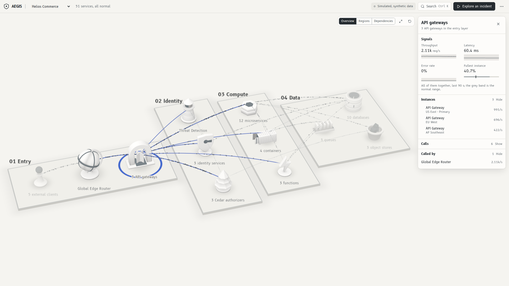
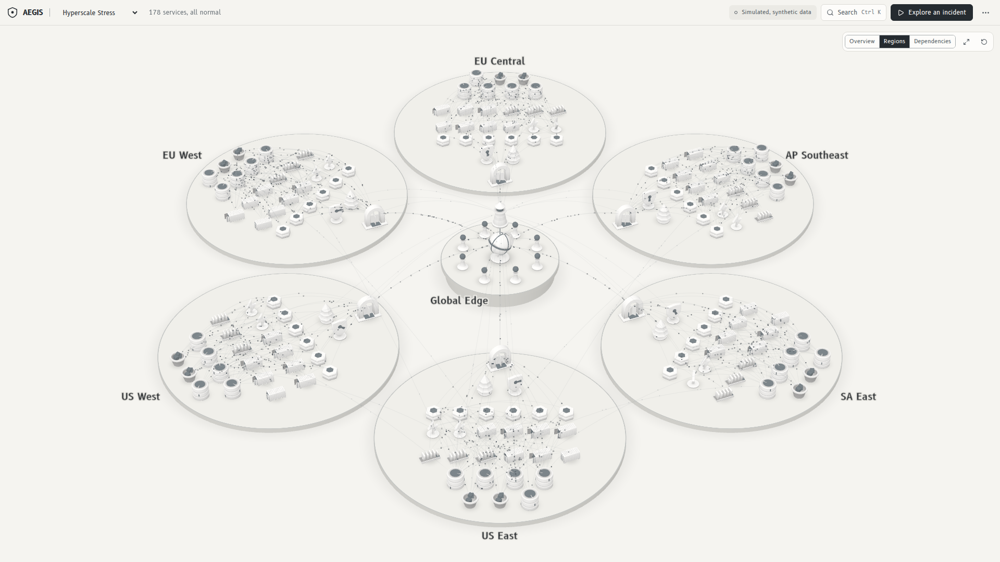
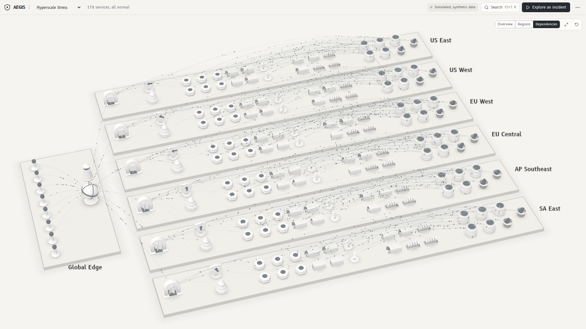
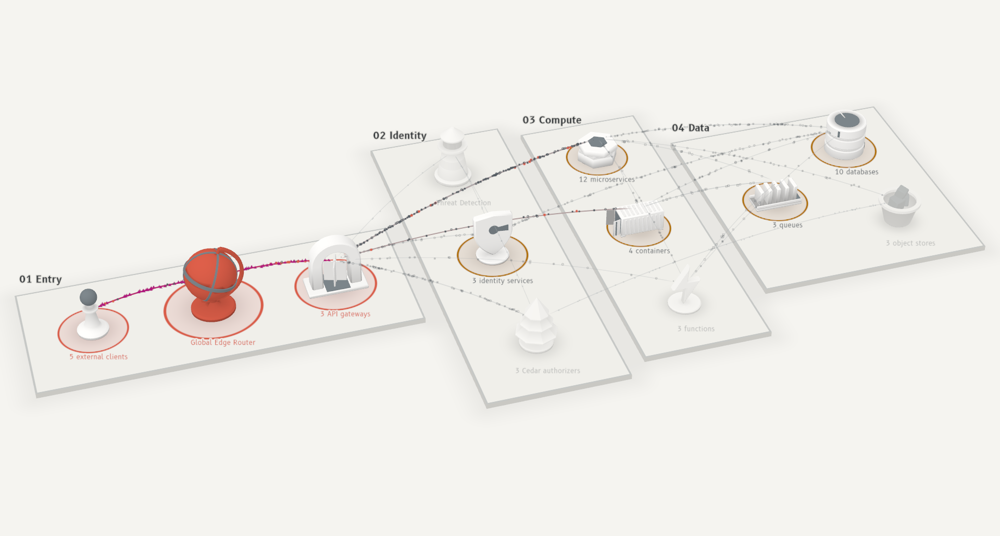
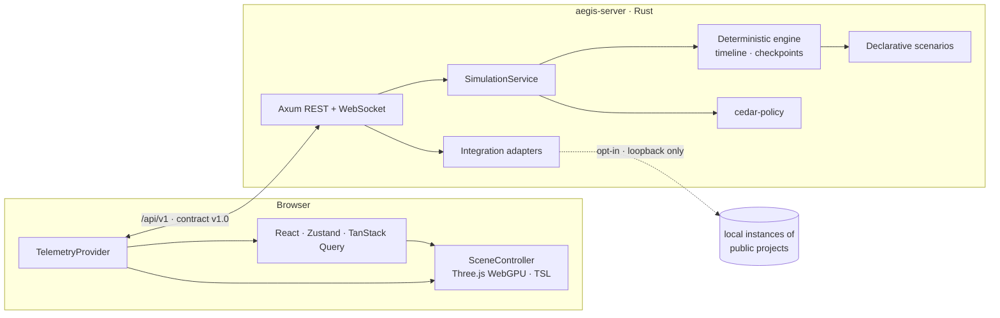

<div align="center">


# AEGIS

### Interactive Cloud Security Digital Twin

**See your infrastructure. Understand every connection. Watch threats unfold.**

A scale model of a distributed platform that you can walk around: services as
pieces on plates, requests as beads on wires, incidents you can launch, pause,
rewind and replay. Driven by a deterministic Rust simulation and real Cedar
policy decisions. Everything normal is drawn in neutral tones; the only colour
on the screen is a problem.

[](https://github.com/cleissonbarbosa/csdt/actions/workflows/ci.yml)


<sub>A fictional DDoS surge at 2× speed: flood, saturation, mitigation.
Recorded from the running application. <a href="docs/assets/demo.mp4">Full clip (MP4)</a></sub>

</div>

---

> **Everything you see is synthetic.** AEGIS simulates a fictional platform. It
> observes no real system, scans no network and attacks nothing. See the
> [security model](docs/SECURITY.md).

## What it is

AEGIS is a digital twin of a cloud platform that does not exist: _Helios
Commerce_, 51 services across three regions and a global edge. A Rust engine
simulates it tick by tick (load, saturation, queues, cascading failure) and
streams the result to a WebGPU scene you can walk around.

It is built to be inspected. The numbers on screen are derived from the model,
not scripted. Authorization outcomes come from the real
[Cedar](https://www.cedarpolicy.com) policy engine. Every past moment can be
revisited exactly, because the engine is deterministic and history is
event-sourced.

<p align="center">
  
</p>

## Two rules

The interface is a **signal field**: a scale model on a quiet porcelain field.

**Overview first, then one path, then the detail.** It opens on the platform
reduced to its twelve kinds of service, in the four layers a request crosses.
Selecting a piece, tracing a request or starting an incident brings one path
forward. Opening a service goes to the arrangement where all fifty-one stand
on their own.

**Normal is silent, and hue is an answer.** A healthy service has no colour,
no dot and no badge. Blue answers the viewer: what is selected, the request
being followed. Amber, red and magenta answer the data, and exist only for
things that deviate, so when something fails there is nothing else for the eye
to go to.

<table>
  <tr>
    <td width="50%"></td>
    <td width="50%"></td>
  </tr>
  <tr>
    <td align="center"><sub>A DDoS surge in the overview. Nothing else on the screen has a hue.</sub></td>
    <td align="center"><sub>Night theme, by region: the plate of the region that failed goes dark.</sub></td>
  </tr>
</table>

The reasoning, the sources it draws on and what was deliberately left out are
in [docs/DESIGN.md](docs/DESIGN.md).

## Features

**A model you can walk around**

- Twelve kinds of service, each a modelled piece with its own silhouette: an
  arch for a gateway, a shield with a keyhole for authentication, a cedar for
  the authorizer, a stack of platters for a database, a lighthouse for the
  threat monitor. The pieces are built in Blender by a script in the
  repository, with ambient occlusion baked per vertex.
- Two levels of one model. The overview draws one piece per kind of service,
  each with the figures of every service it stands for, and stays twelve
  pieces at 51 services or at 178. The detailed arrangements show every
  service, by cloud region or by dependency tier.
- Deterministic layout; readable at 178 services and 648 connections.
- Orbit, zoom, pan, click to inspect a kind, a service or a connection,
  double-click to move in. Search, and filter by kind, state, region or
  incident.
- Light and night themes with the same rules. Names keep one size on screen,
  like the names on a map, and appear as you get closer.

**Quiet until asked**

- At rest the screen holds the model and one bar: what this is, a sentence
  saying how the platform is, and two things to do. A card comes with a
  selection and leaves with it, lists come when asked for, and the timeline
  is on screen only while there is something on it.
- A traced request and an incident's traffic are each one route across the
  model: the route stays in front while the rest recedes, a badge marks where
  it was stopped, and among every service the camera moves in on it.
- <kbd>Ctrl</kbd> <kbd>K</kbd> reaches any service, region, scenario or
  action by name.
- Every piece has a part that works, at the pace of its service's traffic:
  the gateway's door turns, the queue's line moves up, the database's
  platters spin, and each stands still when nothing passes. How it moves is
  the service's state: it hesitates when degraded, jams when critical, and
  hangs crooked and still when the service is down. Everything else
  that moves happens once and answers something: the model assembles as it
  loads, pieces walk when the arrangement changes, a selection lifts its
  piece and pushes the rest back. Reduced-motion preferences switch all of
  it off.

**Traffic as beads**

- Thousands of stateless beads in a single draw call. A bead stores only
  which connection it rides and four seeds; everything that changes lives in a
  tiny per-connection data texture and is resolved in the vertex shader.
- Eight kinds of traffic. Ordinary traffic is told apart by shape (request,
  response, authentication, authorization, queue message); only traffic that
  went wrong has a colour (error, rejected, suspicious).
- WebGPU first, with a WebGL 2 fallback that runs the **same** TSL shaders,
  and an accessible table view when there is no 3D at all.

**Five incident scenarios**

DDoS surge, credential stuffing, Cedar authorization denial, cascading service
failure and regional outage. Each is declarative data (phases, effects and
scripted events) run by the engine. Start, pause, resume, stop, restart,
change speed, inspect every event, see what was affected. When a fault
spreads, the log folds the consequences so the cause stays visible.

**Real Cedar authorization**

Build a request (principal, action, resource, context) and watch it travel
client → gateway → authentication → Cedar → resource. The decision, the
determining policy ids and the diagnostics are what `cedar-policy` returned.
Switch policies off to see the outcome change.

**Time travel**

A virtual clock with play, pause, step, seek, 0.5×–4× and replay. Seeking
restores topology, metrics, health and incident state exactly; replay
re-simulates recorded history bit for bit. Prerecorded incidents load as a
seed plus a command list.

**Signals with their range**

Traffic, latency, error rate and saturation, each drawn on a scale with its
normal band, all computed from the simulation state of the same tick. They
live in the platform overview; in the top bar a signal appears only while it
is outside its range. Every figure says whether it is _synthetic_,
_recorded_ or _live_.

<table>
  <tr>
    <td width="50%"></td>
    <td width="50%"></td>
  </tr>
  <tr>
    <td align="center"><sub>Up close: pieces, beads, the selection ring</sub></td>
    <td align="center"><sub>A Cedar denial: the path in blue, the stop in red</sub></td>
  </tr>
  <tr>
    <td></td>
    <td></td>
  </tr>
  <tr>
    <td align="center"><sub>178 services are still twelve kinds</sub></td>
    <td align="center"><sub>The same 178, each on its own, in six regions</sub></td>
  </tr>
  <tr>
    <td></td>
    <td></td>
  </tr>
  <tr>
    <td align="center"><sub>The same services by dependency tier</sub></td>
    <td align="center"><sub>The non-3D table view</sub></td>
  </tr>
  <tr>
    <td></td>
    <td></td>
  </tr>
  <tr>
    <td align="center"><sub>A frame read back from the WebGPU backend</sub></td>
    <td></td>
  </tr>
</table>

<sub>All screenshots are of the running application and can be regenerated
with <code>./scripts/capture-docs.sh</code>.</sub>

## Quick start

```bash
git clone https://github.com/cleissonbarbosa/csdt.git aegis
cd aegis
docker compose up --build
```

Open **http://localhost:8080**. No credentials, accounts, tokens or external
services are involved.

Without Docker (Rust stable, Node ≥ 22.12, pnpm):

```bash
cargo run --release -p aegis-server     # API on http://127.0.0.1:8787
pnpm install
pnpm dev:web                            # UI on http://localhost:5173
```

Then follow the five-minute tour in [docs/DEMO.md](docs/DEMO.md).

| Key              | Action                           | Key          | Action              |
| ---------------- | -------------------------------- | ------------ | ------------------- |
| <kbd>Space</kbd> | Play / pause                     | <kbd>/</kbd> | Search services     |
| <kbd>R</kbd>     | Reset camera                     | <kbd>L</kbd> | Next arrangement    |
| <kbd>F</kbd>     | Focus selection                  | <kbd>T</kbd> | 3D / table view     |
| <kbd>Esc</kbd>   | Clear selection                  | <kbd>P</kbd> | Performance overlay |
| <kbd>← →</kbd>   | Step the timeline (when focused) | <kbd>?</kbd> | Help and legend     |

## Architecture



| Layer                | Responsibility                                                                   |
| -------------------- | -------------------------------------------------------------------------------- |
| `domain`             | Versioned data contracts and ports. No I/O.                                      |
| `simulation`         | Flow-propagation model, effect channels, the pure `step` function, the timeline. |
| `incidents`          | Scenario definitions and prerecorded incidents, as data.                         |
| `authorization`      | Embedded Cedar policy decision point.                                            |
| `integrations`       | Adapters for local instances and fixture parsers, behind a target guard.         |
| `application`        | Use cases; owns the single mutable timeline.                                     |
| `api`                | HTTP and WebSocket shell: validation, limits, error mapping.                     |
| `packages/contracts` | The same contract as zod schemas, verified against real server output.           |
| `apps/web`           | Rendering engine, interface, stores, provider.                                   |

Three ideas carry the design:

1. **The step function is pure.** `(topology, scenarios, decisions, state,
commands) → events`. No clock, no global counters, randomness only from a
   generator stored in the state. Time travel is restoring a checkpoint and
   stepping.
2. **Metrics are properties of the model.** Latency percentiles come from an
   analytic mixture of log-normals over client populations, so p50 < p95 < p99
   always holds and nothing is sampled or invented.
3. **Draw calls follow object classes, not object counts.** One instanced
   mesh per service type, one for connections, one for beads, one for labels,
   one for everything that lies on the plates: 29 draw calls for 51 services, 35 for 178.

More in [docs/ARCHITECTURE.md](docs/ARCHITECTURE.md).

## Technology

|              |                                                                                                                                                                                             |
| ------------ | ------------------------------------------------------------------------------------------------------------------------------------------------------------------------------------------- |
| **Backend**  | Rust · Axum 0.8 · Tokio · Serde · Tower · Tracing · cedar-policy 4.14 · reqwest                                                                                                             |
| **Frontend** | React 19 · TypeScript 6 (strict) · Vite 8 · Three.js r187 (WebGPU renderer, TSL) · React Three Fiber 9 · Tailwind CSS 4 · Radix UI · Zustand · TanStack Query · zod 4 · B612 typeface (OFL) |
| **Tests**    | cargo test · Vitest · Testing Library · Playwright                                                                                                                                          |
| **Tooling**  | pnpm workspaces · Clippy · rustfmt · ESLint · Prettier · Docker Compose · GitHub Actions                                                                                                    |

## Verified public integrations

AEGIS works fully on its own. Integrations are opt-in adapters for public
projects by the same author, each built against an interface that was read in
the repository and tested. Details and limitations:
[docs/INTEGRATIONS.md](docs/INTEGRATIONS.md).

| Project                                                                           | Kind         | What AEGIS does with it                                                                 | Verified how                                                                                 |
| --------------------------------------------------------------------------------- | ------------ | --------------------------------------------------------------------------------------- | -------------------------------------------------------------------------------------------- |
| [cedar-agent](https://github.com/cleissonbarbosa/cedar-agent)                     | Live adapter | Evaluates Authorization Explorer requests with a local agent (`POST /v1/is_authorized`) | Against a locally built agent: decisions match the embedded engine for all 15 request shapes |
| [rinha-backend-2026](https://github.com/cleissonbarbosa/rinha-backend-2026)       | Live adapter | Read-only `GET /ready` probes; reports only what it measures                            | Against an in-process double of the interface; not run against a live stack                  |
| [network-scanner](https://github.com/cleissonbarbosa/network-scanner)             | Fixture      | Parses a report in the scanner's text format onto the timeline                          | Parser tests on the format read from the source; AEGIS never scans                           |
| [telegram-security-bot](https://github.com/cleissonbarbosa/telegram-security-bot) | Fixture      | Parses advisories in the NVD shape the bot consumes; all fictional                      | Parser tests; AEGIS never contacts NVD or Telegram                                           |

Not integrated: [ferrousDB](https://github.com/cleissonbarbosa/ferrousDB) (no
network interface to adapt to) and OpenTelemetry (no inspected project exports
it). Neither is faked.

## Performance

Measured on an RTX 3050 / Ryzen 5 5600G in Chrome 157.0.8103.78 (headless, offscreen) at 1920 × 1080,
quality ultra, light theme, production build, interface in its default state.

| Scene                    | Services / connections | WebGPU | WebGL 2 | Draw calls |
| ------------------------ | ---------------------: | -----: | ------: | ---------: |
| Helios · steady state    |                51 / 75 | 1.7 ms |  7.0 ms |         29 |
| Helios · DDoS surge      |                51 / 75 | 1.9 ms |  7.3 ms |         29 |
| Stress · steady state    |              178 / 648 | 1.9 ms |  7.5 ms |         35 |
| Stress · regional outage |              178 / 648 | 1.9 ms |  8.1 ms |         35 |

<sub>Mean time to produce one frame with the frame-rate limit off.</sub>

- Both backends produce a 1080p frame well inside the 16.7 ms a 60 Hz display
  allows; 3.5× the services and 8.6× the connections add 6 draw calls and no
  measurable frame time.
- With Chrome's default 60 Hz pacing, the whole page held
  60.0–60.1 frames/s in every scene on both backends.
- GPU geometry and texture counts are identical after 12 full scene
  rebuilds. The JS heap stayed between 15.0 and 16.6 MB, rising about 0.1 MB
  per rebuild; a run this short cannot rule out a slow leak.
- One engine tick costs 26 µs for 51 services and 41 µs for 178.
- The benchmark earned its keep: on an earlier design it showed that
  `backdrop-filter` blur on the panels cost several times more than the 3D
  scene. The current design has no blur, no bloom and no post-processing.
- **Not measured:** a visible window on a monitor. Headless Chrome has no
  display; `./scripts/benchmark.sh --headed` measures it on yours.

Method, raw data and caveats: [docs/PERFORMANCE.md](docs/PERFORMANCE.md).

## Security model

- **Simulation only.** Scenarios change numbers inside the engine; the
  simulation modules perform no I/O.
- **Offline by default.** Demo Mode opens no outbound connection. Integrations
  need server configuration _and_ an explicit click, and accept loopback
  targets only.
- **Provenance everywhere.** Synthetic, recorded and live data are labelled
  from the server to the pixel.
- **Hardened edges.** Typed input validation, per-client rate limits,
  origin-checked WebSockets, bounded buffers and history, strict CSP,
  distroless non-root containers with read-only filesystems.
- **No secrets.** None are needed to build, test or run; none are in the
  repository.

AEGIS has no authentication: run it locally or behind something that provides
access control. Full detail in [docs/SECURITY.md](docs/SECURITY.md).

## Tests

```bash
cargo test --workspace      # engine, timeline, Cedar, API, stream, adapters
pnpm test                   # contracts, stores, layout, stream client, interface
pnpm e2e                    # Playwright against the real stack
```

| Suite      | Tests | Covers                                                                                                                                                                                                                         |
| ---------- | ----: | ------------------------------------------------------------------------------------------------------------------------------------------------------------------------------------------------------------------------------ |
| Rust       |   115 | Flow model, determinism and replay, scenarios, Cedar decisions, REST and WebSocket behaviour, limits, integration adapters                                                                                                     |
| Contracts  |    28 | Every zod schema against samples exported by the server binary                                                                                                                                                                 |
| Web        |   231 | Layout, the overview and its arithmetic, palette rules, the piece file, quality tiers, stores, stream client, event folding, command search, interface                                                                         |
| End to end |    11 | Load, the overview and every service, select a kind and open a service, start an incident, pause, rewind, reset, Cedar trace, filters, table view and command palette, scene controls, theme, stress topology, no-GPU fallback |

All 385 pass locally. The end-to-end suite runs the real server and a production
build; nothing is mocked. It also reads the rendered frame back and checks the
design's central rule: no hue on screen while the platform is healthy and
nothing is selected, hue with a selection or a traced request, and hue once an
incident is under way. The same suite passes on a real GPU through WebGPU (10
tests; the fallback test does not apply there). One more Rust test compares the
embedded engine with a real `cedar-agent` binary and is skipped unless
`AEGIS_TEST_CEDAR_AGENT_BIN` is set.

## Project layout

```
apps/server         Rust backend (domain · simulation · incidents · authorization
                    · integrations · application · api)
apps/web            React client (graphics · features · stores · providers)
packages/contracts  Shared contract: zod schemas + samples exported by the server
fixtures            Topology, Cedar policies and entities, recordings, fixtures
docs                Design, architecture, integrations, security, performance, demo
scripts             Screenshot and benchmark runners
```

## Roadmap

- Compile the engine to WebAssembly so the demo runs as a static site with no
  backend.
- Generic OpenTelemetry provider (OTLP traces → topology and edge metrics).
- Merge live probe data into the scene as its own clearly-labelled region.
- Topology and scenario editors; import a topology from a file.
- True orthographic projection as an option, with its own picking and zoom.
- Persist timelines to disk and share them as replayable files.

## License

[MIT](LICENSE) © Cleisson Barbosa
