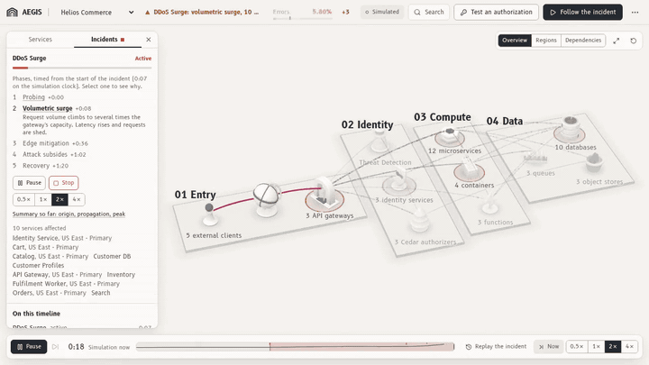
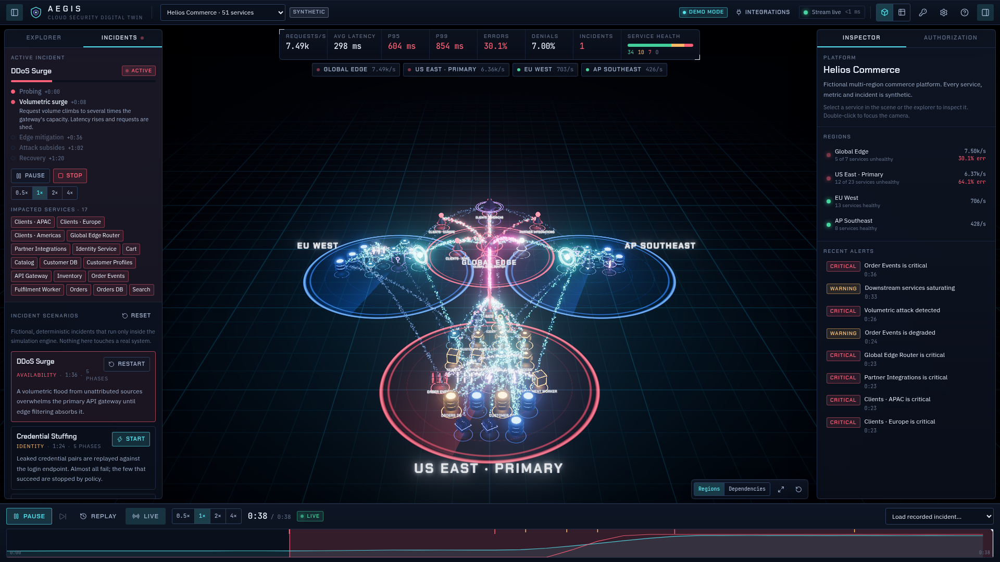
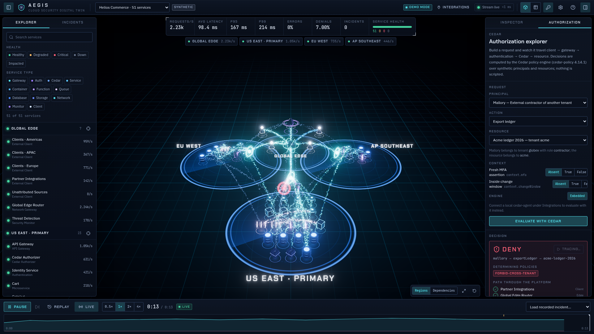
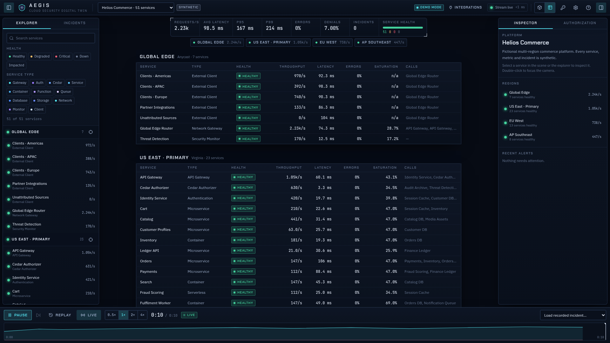
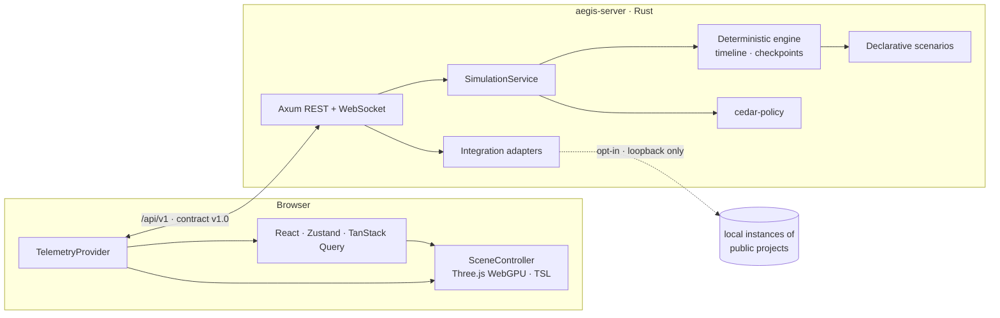

<div align="center">


# AEGIS

### Interactive Cloud Security Digital Twin

**See your infrastructure. Understand every connection. Watch threats unfold.**

A living 3D model of a distributed platform: services as luminous objects,
requests as particles, incidents you can launch, pause, rewind and replay —
driven by a deterministic Rust simulation and real Cedar policy decisions.

[](https://github.com/cleissonbarbosa/csdt/actions/workflows/ci.yml)




<sub>A fictional DDoS surge at 2× speed: flood, saturation, mitigation.
Recorded from the running application. <a href="docs/assets/demo.mp4">Full clip (MP4)</a></sub>

</div>

---

> **Everything you see is synthetic.** AEGIS simulates a fictional platform. It
> observes no real system, scans no network and attacks nothing. See the
> [security model](docs/SECURITY.md).

## What it is

AEGIS is a digital twin of a cloud platform that does not exist: _Helios
Commerce_, 51 services across three regions and a global edge. A Rust engine
simulates it tick by tick — load, saturation, queues, cascading failure — and
streams the result to a WebGPU scene you can fly through.

It is built to be inspected. The numbers on screen are derived from the model,
not scripted. Authorization outcomes come from the real
[Cedar](https://www.cedarpolicy.com) policy engine. Every past moment can be
revisited exactly, because the engine is deterministic and history is
event-sourced.

<p align="center">
  
</p>

## Features

**A living topology**

- Twelve service types, each with its own procedural silhouette: portal
  gateways, shield-and-keyhole identity services, cedar-tree authorizers,
  platter-stack databases, rail-mounted queues…
- Deterministic layout by cloud region or by dependency tier; readable at
  178 services and 648 connections.
- Orbit, zoom, pan, click to inspect services and connections, double-click to
  fly to one. Search and filter by type, health, region or incident impact.

**GPU traffic**

- Up to 26 000 stateless particles in a single draw call. A particle stores
  only which connection it rides and four seeds; everything that changes lives
  in a tiny per-connection data texture and is resolved in the vertex shader.
- Eight visible categories: requests, responses, authentication,
  authorization, queue messages, errors, rejected and suspicious traffic.
- WebGPU first, with a WebGL 2 fallback that runs the **same** TSL shaders,
  and an accessible table view when there is no 3D at all.

**Five incident scenarios**

DDoS surge · credential stuffing · Cedar authorization denial · cascading
service failure · regional outage. Each is declarative data — phases, effects
and scripted events — run by the engine. Start, pause, resume, stop, restart,
change speed, inspect every event, see what was impacted.

**Real Cedar authorization**

Build a request (principal, action, resource, context) and watch it travel
client → gateway → authentication → Cedar → resource. The decision, the
determining policy ids and the diagnostics are what `cedar-policy` returned.
Switch policies off to see the outcome change.

**Time travel**

A virtual clock with play, pause, step, seek, 0.5×–4× and replay. Seeking
restores topology, metrics, health and incident state exactly; replay
re-simulates recorded history bit for bit. Prerecorded incidents load as a
seed plus a command list.

**An honest HUD**

Requests/s, average, p95 and p99 latency, error rate, authorization denial
rate, active incidents, service health and per-region status — all computed
from the simulation state of the same tick. Every figure is labelled
_synthetic_, _recording_ or _live_.

<table>
  <tr>
    <td width="50%"></td>
    <td width="50%"></td>
  </tr>
  <tr>
    <td align="center"><sub>DDoS surge saturating the primary gateway</sub></td>
    <td align="center"><sub>A Cedar denial, traced through the platform</sub></td>
  </tr>
  <tr>
    <td></td>
    <td></td>
  </tr>
  <tr>
    <td align="center"><sub>Regional outage and failover</sub></td>
    <td align="center"><sub>178 services, dependency layout</sub></td>
  </tr>
  <tr>
    <td></td>
    <td></td>
  </tr>
  <tr>
    <td align="center"><sub>Six regions, 648 connections</sub></td>
    <td align="center"><sub>The non-3D table view</sub></td>
  </tr>
</table>

<sub>All screenshots are of the running application and can be regenerated
with <code>./scripts/capture-docs.sh</code>.</sub>

## Quick start

```bash
git clone https://github.com/cleissonbarbosa/csdt.git aegis
cd aegis
docker compose up --build
```

Open **http://localhost:8080**. No credentials, accounts, tokens or external
services are involved.

Without Docker (Rust stable, Node ≥ 22.12, pnpm):

```bash
cargo run --release -p aegis-server     # API on http://127.0.0.1:8787
pnpm install
pnpm dev:web                            # UI on http://localhost:5173
```

Then follow the five-minute tour in [docs/DEMO.md](docs/DEMO.md).

| Key              | Action                         | Key          | Action                      |
| ---------------- | ------------------------------ | ------------ | --------------------------- |
| <kbd>Space</kbd> | Play / pause                   | <kbd>/</kbd> | Search services             |
| <kbd>R</kbd>     | Reset camera                   | <kbd>L</kbd> | Regions / dependencies      |
| <kbd>F</kbd>     | Focus selection                | <kbd>T</kbd> | 3D / table view             |
| <kbd>Esc</kbd>   | Clear selection                | <kbd>P</kbd> | Performance overlay         |
| <kbd>← →</kbd>   | Step the timeline (when focused) | <kbd>?</kbd> | Help and legend             |

## Architecture



| Layer | Responsibility |
| --- | --- |
| `domain` | Versioned data contracts and ports. No I/O. |
| `simulation` | Flow-propagation model, effect channels, the pure `step` function, the timeline. |
| `incidents` | Scenario definitions and prerecorded incidents, as data. |
| `authorization` | Embedded Cedar policy decision point. |
| `integrations` | Adapters for local instances and fixture parsers, behind a target guard. |
| `application` | Use cases; owns the single mutable timeline. |
| `api` | HTTP and WebSocket shell: validation, limits, error mapping. |
| `packages/contracts` | The same contract as zod schemas, verified against real server output. |
| `apps/web` | Rendering engine, interface, stores, provider. |

Three ideas carry the design:

1. **The step function is pure.** `(topology, scenarios, decisions, state,
   commands) → events`. No clock, no global counters, randomness only from a
   generator stored in the state. Time travel is restoring a checkpoint and
   stepping.
2. **Metrics are properties of the model.** Latency percentiles come from an
   analytic mixture of log-normals over client populations, so p50 < p95 < p99
   always holds and nothing is sampled or invented.
3. **Draw calls follow object classes, not object counts.** One instanced
   mesh per service type, one for connections, one for particles, one for
   labels: 41 draw calls for 51 services, 47 for 178.

More in [docs/ARCHITECTURE.md](docs/ARCHITECTURE.md).

## Technology

| | |
| --- | --- |
| **Backend** | Rust · Axum 0.8 · Tokio · Serde · Tower · Tracing · cedar-policy 4.14 · reqwest |
| **Frontend** | React 19 · TypeScript 6 (strict) · Vite 8 · Three.js r187 (WebGPU renderer, TSL) · React Three Fiber 9 · Tailwind CSS 4 · Radix UI · Zustand · TanStack Query · zod 4 |
| **Tests** | cargo test · Vitest · Testing Library · Playwright |
| **Tooling** | pnpm workspaces · Clippy · rustfmt · ESLint · Prettier · Docker Compose · GitHub Actions |

## Verified public integrations

AEGIS works fully on its own. Integrations are opt-in adapters for public
projects by the same author, each built against an interface that was read in
the repository and tested. Details and limitations:
[docs/INTEGRATIONS.md](docs/INTEGRATIONS.md).

| Project | Kind | What AEGIS does with it | Verified how |
| --- | --- | --- | --- |
| [cedar-agent](https://github.com/cleissonbarbosa/cedar-agent) | Live adapter | Evaluates Authorization Explorer requests with a local agent (`POST /v1/is_authorized`) | Against a locally built agent: decisions match the embedded engine for all 15 request shapes |
| [rinha-backend-2026](https://github.com/cleissonbarbosa/rinha-backend-2026) | Live adapter | Read-only `GET /ready` probes; reports only what it measures | Against an in-process double of the interface; not run against a live stack |
| [network-scanner](https://github.com/cleissonbarbosa/network-scanner) | Fixture | Parses a report in the scanner's text format onto the timeline | Parser tests on the format read from the source; AEGIS never scans |
| [telegram-security-bot](https://github.com/cleissonbarbosa/telegram-security-bot) | Fixture | Parses advisories in the NVD shape the bot consumes; all fictional | Parser tests; AEGIS never contacts NVD or Telegram |

Not integrated: [ferrousDB](https://github.com/cleissonbarbosa/ferrousDB) (no
network interface to adapt to) and OpenTelemetry (no inspected project exports
it). Neither is faked.

## Performance

PERFORMANCE_SECTION

## Security model

- **Simulation only.** Scenarios change numbers inside the engine; the
  simulation modules perform no I/O.
- **Offline by default.** Demo Mode opens no outbound connection. Integrations
  need server configuration _and_ an explicit click, and accept loopback
  targets only.
- **Provenance everywhere.** Synthetic, recorded and live data are labelled
  from the server to the pixel.
- **Hardened edges.** Typed input validation, per-client rate limits,
  origin-checked WebSockets, bounded buffers and history, strict CSP,
  distroless non-root containers with read-only filesystems.
- **No secrets.** None are needed to build, test or run; none are in the
  repository.

AEGIS has no authentication: run it locally or behind something that provides
access control. Full detail in [docs/SECURITY.md](docs/SECURITY.md).

## Tests

```bash
cargo test --workspace      # engine, timeline, Cedar, API, stream, adapters
pnpm test                   # contracts, stores, layout, stream client, interface
pnpm e2e                    # Playwright against the real stack
```

TESTS_SECTION

## Project layout

```
apps/server         Rust backend (domain · simulation · incidents · authorization
                    · integrations · application · api)
apps/web            React client (graphics · features · stores · providers)
packages/contracts  Shared contract: zod schemas + samples exported by the server
fixtures            Topology, Cedar policies and entities, recordings, fixtures
docs                Architecture, integrations, security, performance, demo
scripts             Screenshot and benchmark runners
```

## Roadmap

- Compile the engine to WebAssembly so the demo runs as a static site with no
  backend.
- Generic OpenTelemetry provider (OTLP traces → topology and edge metrics).
- Merge live probe data into the scene as its own clearly-labelled region.
- Topology and scenario editors; import a topology from a file.
- GPU-compute particle collisions and trails on WebGPU, with the current
  stateless path kept for WebGL 2.
- Persist timelines to disk and share them as replayable files.

## License

[MIT](LICENSE) © Cleisson Barbosa
