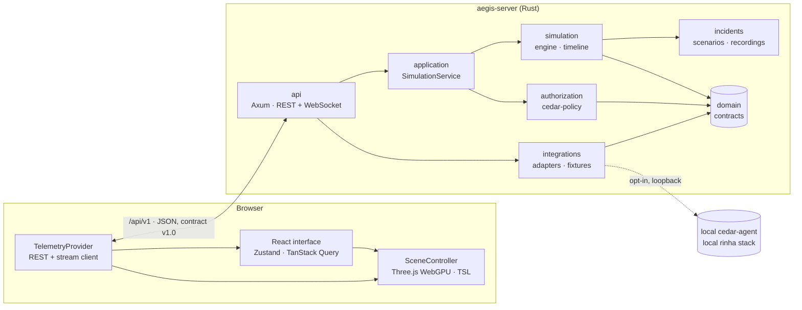
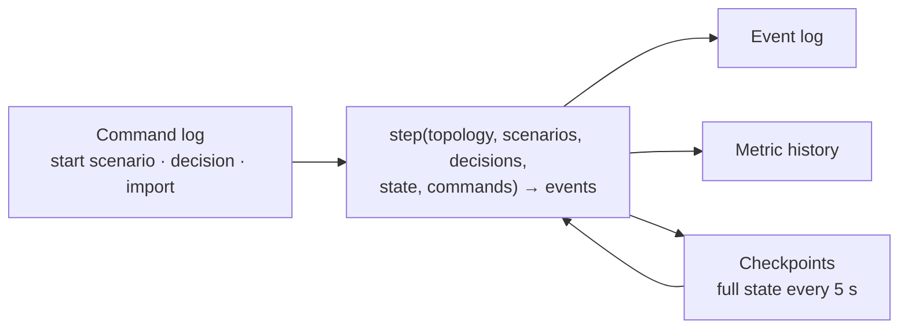

# Architecture

AEGIS is two programs and one shared contract:

- **`apps/server`** — a Rust service that owns a deterministic simulation of a
  distributed platform, evaluates Cedar policies and streams telemetry.
- **`apps/web`** — a React client that renders that telemetry as a WebGPU
  scene with an instrument-panel interface around it.
- **`packages/contracts`** — the versioned JSON contract between them, as zod
  schemas checked against real server output.



## Repository layout

```
apps/
  server/src/
    domain/          versioned data contracts and ports; no I/O
    simulation/      model, channels, engine (pure step), timeline, rng
    incidents/       declarative scenarios and prerecorded incidents
    authorization/   embedded Cedar policy decision point
    integrations/    live adapters, fixture parsers, target guard
    application/     use cases; owns the single mutable timeline
    api/             Axum routes, WebSocket, rate limiting, errors
  web/src/
    graphics/        layout, geometries, TSL materials, SceneController
    features/        scene, explorer, inspector, timeline, scenarios, …
    stores/          telemetry, interface state, persisted settings
    providers/       REST client, stream client, TelemetryProvider
    components/ui/   buttons, badges, dialog, fields, sparkline
packages/contracts/  zod schemas + samples exported by the server
fixtures/            topology, Cedar policies/entities, recordings, fixtures
```

Dependencies point inward: `api → application → simulation/authorization →
domain`. The simulation and scenario modules perform no I/O at all.

---

## The simulation

### Model

A topology is a directed acyclic graph. Edges carry a `weight` (calls per
request handled by the source) and a relationship that says whether the call
is synchronous. `SimTopology::compile` validates a topology, orders it
topologically and derives capacities and baselines from nominal load.

Each tick runs one propagation pass (`simulation/model.rs`):

1. **Forward (load).** Demand enters at external clients and fans out along
   edges. A node handles at most its capacity and sheds the rest. Queues are
   pull-based: consumers drain them as fast as their own capacity and health
   allow, and what they cannot take accumulates as backlog.
2. **Reverse (experience).** A node's own latency follows an M/M/1-shaped
   congestion curve. Failure and latency of _synchronous_ dependencies
   propagate to callers, scaled by call probability and criticality; routing
   edges are averaged instead (each request takes one of them). Asynchronous
   edges do not propagate failure, which is what lets a queue absorb a
   database outage until it overflows.

Health is derived from those figures with dwell times so a blip does not flap
a node.

### Metrics are a property of the model

Nothing on the HUD is scripted. Client-experienced latency is modelled as a
mixture of log-normal distributions, one component per client population
weighted by its demand. Mean, p50, p95 and p99 are computed from that mixture
analytically (bisection on its CDF), so percentiles are consistent with each
other and with the node figures of the same tick, and carry no sampling noise.

| Figure      | Definition                                                    |
| ----------- | ------------------------------------------------------------- |
| Requests/s  | client demand plus injected flows arriving at the edge        |
| Error rate  | demand-weighted share of client requests that fail end to end |
| Denial rate | Cedar `Deny` decisions ÷ authorization checks                 |
| Latency     | mean / quantiles of the client latency mixture                |

### Scenarios are data

A scenario (`incidents/catalog.rs`) is a list of phases on a virtual timeline.
Each phase declares the complete set of effects that hold during it; anything
it omits ramps back to nominal. Effects compile to **channels**: single
scalars (a capacity factor, an injected error rate, a flow rate…) that ease
from their current value to a target. Channels live in the simulation state,
so a checkpoint captures an effect mid-ramp.

Scenarios name topology _roles_ (`primaryGateway`, `outageRegion`) rather than
node ids, so the same five definitions run on both bundled topologies.

Hostile or probing traffic is modelled as **path flows**: a rate injected
along explicit hops, with a rejection fraction at each node it arrives at
(edge filtering, rate limiting, failed authentication, policy denial).

### Cedar decisions are real

At start-up every request shape the simulation will ever show is evaluated
once by the `cedar-policy` engine against the fixture policies and entities
(`DecisionTable::build`). The engine only looks results up, which keeps it
pure and deterministic while every outcome stays genuine:

- the baseline denial rate **is** the denied share of the evaluated mix;
- a scenario flow is blocked at the authorizer **if and only if** Cedar denied
  its request, and its events carry Cedar's determining policy ids.

On-demand evaluations from the Authorization Explorer go to the engine
directly and are recorded on the timeline as commands.

### Determinism and time travel



`engine::step` is a pure function. It never reads a clock, draws randomness
only from a generator stored in the state, and iterates only ordered
collections. History is therefore _derivable_: the timeline keeps the command
log (the only non-derivable input), periodic checkpoints, and the events and
samples already produced.

- **Seek** restores the nearest earlier checkpoint and re-steps to the target.
- **Replay** keeps stepping from there; it reproduces recorded history exactly
  and re-announces nothing.
- **Branch**: issuing a command in the past discards the future beyond the
  cursor and continues live.
- **Recordings** are a seed plus a command list. Loading one re-simulates it.

Tests assert bit-for-bit equality of the state digest after arbitrary seeks,
equality of regenerated events, and that history stays bounded (30 minutes of
virtual time, 8 000 events).

---

## The API

`/api/v1`, JSON, camelCase. Contracts live in `apps/server/src/domain` and
are mirrored in `packages/contracts`.

|                                                        |                                              |
| ------------------------------------------------------ | -------------------------------------------- |
| `GET /health`                                          | versions, uptime, active topology            |
| `GET /topology` · `/topologies`                        | nodes and edges with current metrics         |
| `GET /metrics`                                         | current platform metrics and history         |
| `GET /events?afterSeq&limit&nodeId&minSeverity`        | timeline events                              |
| `GET /incidents` · `/scenarios` · `/recordings`        | incident data                                |
| `GET /providers` · `POST /providers/{id}/(dis)connect` | integrations                                 |
| `POST /demo/scenarios/start` · `/reset`                | scenario control                             |
| `POST /demo/playback/control`                          | play, pause, step, seek, speed, replay, live |
| `POST /demo/authorization/evaluate`                    | evaluate a Cedar request                     |
| `GET /demo/authorization/catalog` · `/decisions`       | policies and decisions                       |
| `POST /demo/topology/select` · `/demo/recordings/load` | switch context                               |
| `WS /stream`                                           | telemetry and events                         |

### Stream protocol

Server → client messages are tagged by `type`: `hello`, `snapshot`, `events`,
`timeline`, `lagged`, `pong`. Client → server: `ping` and `resync`.

Snapshots are **columnar**: per-node and per-edge metrics are parallel arrays
aligned index-for-index with the topology, which is compact on the wire and
maps directly onto the typed arrays the renderer uses.

**Backpressure.** Each message is serialised once and fanned out through one
bounded broadcast buffer. A subscriber that falls behind does not slow the
simulation: it receives `lagged` with the number of dropped messages and a
fresh snapshot, and can ask for missed events with `resync`. Events carry
gapless sequence numbers, so a client always knows what it has.

### Contract testing

`cargo run -p aegis-server --bin export-contract-samples` drives the real
router through a fixed scenario and writes its responses to
`packages/contracts/samples/`. The TypeScript tests parse every sample with
the zod schemas and require the parsed value to equal the input, which catches
drift in both directions. CI regenerates the samples and fails on any diff.

---

## The web client

### Rendering

React Three Fiber owns the canvas, its size, the pixel ratio and the frame
loop. Everything inside the canvas is owned by one imperative
`SceneController`; state reaches it through store subscriptions, so telemetry
never re-renders a component.

Draw calls follow the number of object classes, not the number of objects (41
for 51 services, 47 for 178, bloom passes included):

| What         | How                                                             |
| ------------ | --------------------------------------------------------------- |
| Services     | one instanced mesh per service type, procedural geometry        |
| Health rings | one instanced mesh                                              |
| Connections  | one instanced mesh of camera-facing ribbons along Bézier curves |
| Traffic      | one instanced mesh of stateless sprites                         |
| Labels       | one instanced mesh sampling a canvas text atlas                 |

**Traffic particles** own only static data: which edge they live on and four
random seeds. Everything that changes (how many an edge shows, how fast they
move, what share is errors, rejections or suspicious) lives in a small float
texture with one column per edge. The CPU updates that texture, never the
particles; position, category, colour and size are derived in the vertex
shader from `time`.

All materials are written in **TSL**, which compiles to WGSL on the WebGPU
backend and to GLSL ES 3.0 on the WebGL 2 backend. Nothing depends on compute
shaders or storage buffers, so the fallback is a different backend running the
same code rather than a second implementation. If neither API yields a
renderer, the application shows an accessible table view instead.

**Adaptive quality** watches frame time and steps between four tiers
(resolution, particle density, bloom, label range). A tier that proved too
expensive becomes the ceiling so the scene does not oscillate.

### Layout

`graphics/layout.ts` is a pure function of the topology: no randomness, no
iteration to convergence. _Regions_ mode arranges cloud regions as platforms
on a ring around a central pillar holding the global edge; inside a region,
tiers run outward and step downward, so traffic visibly cascades from the edge
into data stores. _Dependencies_ mode is a layered left-to-right graph.

### State

| Store                  | Holds                                             |
| ---------------------- | ------------------------------------------------- |
| `telemetry`            | topology, latest snapshot, events, metric history |
| `ui`                   | selection, filters, panels, layout and view mode  |
| `settings` (persisted) | quality, bloom, motion, renderer preference       |

TanStack Query holds request/response data (scenarios, providers, policy
catalogue). The client talks to the server only through the
`TelemetryProvider` interface from `@aegis/contracts`.

### Accessibility

Every control is reachable by keyboard and has a name; colour never carries
meaning alone (health and severity are always spelled out); the timeline is an
ARIA slider; dialogs trap focus. Reduced motion (from the OS or the in-app
setting) stops camera animation, spinning and pulsing. The table view presents
the whole topology without 3D.
