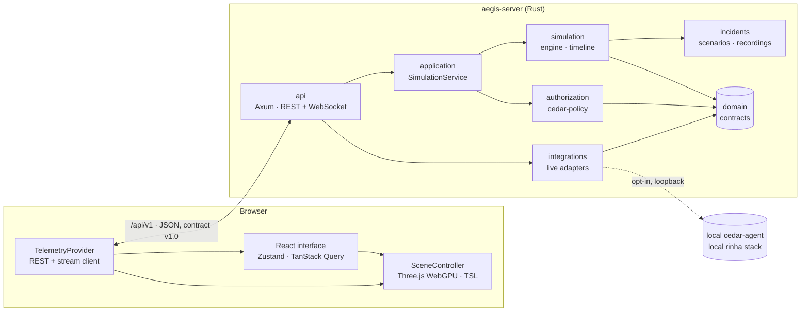
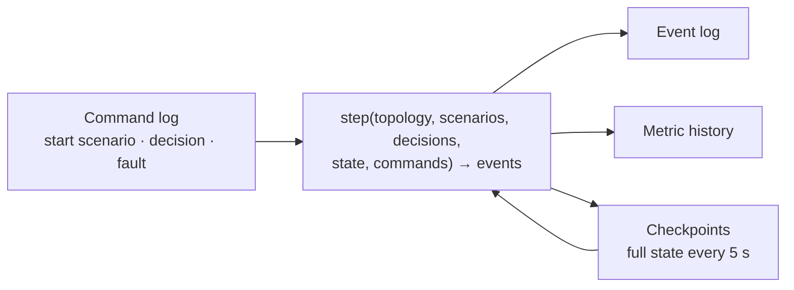

# Architecture

AEGIS is two programs and one shared contract:

- **`apps/server`** — a Rust service that owns a deterministic simulation of a
  distributed platform, evaluates Cedar policies and streams telemetry.
- **`apps/web`** — a React client that renders that telemetry as a WebGPU
  scene with an instrument-panel interface around it.
- **`packages/contracts`** — the versioned JSON contract between them, as zod
  schemas checked against real server output.



## Repository layout

```
apps/
  server/src/
    domain/          versioned data contracts and ports; no I/O
    simulation/      model, channels, engine (pure step), timeline, rng
    incidents/       declarative scenarios and prerecorded incidents
    authorization/   embedded Cedar policy decision point
    integrations/    live adapters, target guard
    application/     use cases; owns the single mutable timeline
    workspace.rs     reads an operator's own files from a directory at start-up
    workspace/       a Compose file and a cloud inventory, each read as a topology
    api/             Axum routes, WebSocket, rate limiting, errors
  wasm/src/          the same routes and service as a WebAssembly module
  web/src/
    graphics/        layout, modelled pieces, TSL materials, SceneController
    features/        scene, explorer, inspector, timeline, scenarios, capture, …
    stores/          telemetry, interface state, persisted settings, capture
    providers/       REST client, stream client, TelemetryProvider
    engine/          the module's binding, its worker and the transport to it
    components/ui/   buttons, badges, dialog, fields, sparkline
packages/contracts/  zod schemas + samples exported by the server
fixtures/            the bundled topology, scenarios, recordings and Cedar
                     files, laid out as a workspace
examples/            a small workspace to copy from
scripts/             screenshots, benchmarks, the version, the incident capture scripts
```

Dependencies point inward: `api → application → simulation/authorization →
domain`. The simulation and scenario modules perform no I/O at all; the only
file access is `workspace`, once, before the server listens.

---

## The simulation

### Model

A topology is a directed acyclic graph. Edges carry a `weight` (calls per
request handled by the source) and a relationship that says whether the call
is synchronous. `SimTopology::compile` validates a topology, orders it
topologically and derives capacities and baselines from nominal load.

Each tick runs one propagation pass (`simulation/model.rs`):

1. **Forward (load).** Demand enters at external clients and fans out along
   edges. A node handles at most its capacity and sheds the rest. Three
   optional figures of a topology file change what a node does about load
   (`docs/WORKSPACE.md`): a rate limit admits at most so much and turns the
   rest away at the door, before it uses capacity or reaches anything
   behind; a filter turns away a stated share of the traffic a scenario
   marks suspicious, as it arrives; an autoscaled node's capacity follows
   its load with a lag, up to a stated multiple. A node that states none
   takes the arithmetic path it always took, bit for bit. How far each node
   has scaled and the share its limit admitted are part of `SimState`, so
   they are in every checkpoint. Queues are
   pull-based: consumers drain them as fast as their own capacity and health
   allow, and what they cannot take accumulates as backlog.
2. **Reverse (experience).** A node's own latency follows an M/M/1-shaped
   congestion curve. Failure and latency of _synchronous_ dependencies
   propagate to callers, scaled by call probability and criticality; routing
   edges are averaged instead (each request takes one of them). Asynchronous
   edges do not propagate failure, which is what lets a queue absorb a
   database outage until it overflows.

Health is derived from those figures with dwell times so a blip does not flap
a node.

### Metrics are a property of the model

Nothing on the HUD is scripted. Client-experienced latency is modelled as a
mixture of log-normal distributions, one component per client population
weighted by its demand. Mean, p50, p95 and p99 are computed from that mixture
analytically (bisection on its CDF), so percentiles are consistent with each
other and with the node figures of the same tick, and carry no sampling noise.

| Figure      | Definition                                                    |
| ----------- | ------------------------------------------------------------- |
| Requests/s  | client demand plus injected flows arriving at the edge        |
| Error rate  | demand-weighted share of client requests that fail end to end |
| Denial rate | Cedar `Deny` decisions ÷ authorization checks                 |
| Latency     | mean / quantiles of the client latency mixture                |

### Scenarios are data

A scenario is a file: a list of phases on a virtual timeline, in the format
defined by `incidents/spec.rs`. The five bundled ones are
`fixtures/scenarios/*.json`, compiled into the binary by
`incidents/catalog.rs`; a workspace supplies others in the same format. Each
phase declares the complete set of effects that hold during it; anything it
omits ramps back to nominal. Effects compile to **channels**: single
scalars (a capacity factor, an injected error rate, a flow rate…) that ease
from their current value to a target. Channels live in the simulation state,
so a checkpoint captures an effect mid-ramp.

The bundled scenarios name topology _roles_ (`primaryGateway`,
`outageRegion`) rather than node ids, so the same five definitions run on both
bundled topologies. A scenario may also name a node by its id, which ties it
to the topologies that have that node. Resolving a definition against a
topology (`incidents::resolve`) either yields channels and node indices or
marks the scenario unavailable there, with the name that was missing.

Hostile or probing traffic is modelled as **path flows**: a rate injected
along explicit hops, with a rejection fraction at each node it arrives at
(edge filtering, rate limiting, failed authentication, policy denial).

### Cedar decisions are real

At start-up every request shape the simulation will ever show is evaluated
once by the `cedar-policy` engine against the fixture policies and entities
(`DecisionTable::build`). The engine only looks results up, which keeps it
pure and deterministic while every outcome stays genuine:

- the baseline denial rate **is** the denied share of the evaluated mix;
- a scenario flow is blocked at the authorizer **if and only if** Cedar denied
  its request, and its events carry Cedar's determining policy ids.

On-demand evaluations from the Authorization Explorer go to the engine
directly and are recorded on the timeline as commands.

Two more questions go to the engine and are recorded nowhere
(`application/access.rs`):

- **One request, policy by policy.** Cedar names the policies that decided,
  and for a denial by default it names none: a permit that was about the
  request and did not hold leaves no trace in its answer. So each policy in
  force is put to the request by itself, twice: as it is, and with its
  conditions left out (`CedarEngine::standings`). The first says whether the
  policy holds; the second, whether its scope takes the request in at all.
  A forbid is turned into a permit for the asking, since a forbid alone
  allows nothing either way. The twins are made from Cedar's own JSON form
  of the policy, where scope and conditions are kept apart; nothing is
  parsed or judged by hand, and a test holds the standings of every
  catalogued request to the decision Cedar gave for it.
- **Every request the catalogue describes**, under one context and with any
  policies switched off: the access matrix. It is the same enumeration the
  policy comparison uses, bounded the same way (20 000 requests).

### Sources and the workspace

Everything above is built from one value, `application::Sources`: topology
specifications, scenario definitions, recordings, policy documents, the entity
store and the authorization catalogue. `Sources::bundled()` is the fixtures
compiled into the binary. `workspace::load(dir)` starts from that and replaces
each part the directory supplies, reading and checking one file at a time so
an error names the file. `Assets::build(sources)` then does what only makes
sense across files: it loads the Cedar engine (validating against a schema if
one was given), evaluates every request shape, compiles each topology,
resolves each scenario against it and checks that every recording refers to a
topology and to scenarios that exist.

A directory is read once, before the listener is bound. The same parts and
checks are reached through the API by `workspace::from_files`, which takes
files already in memory and touches nothing: the import route hands it what
the interface uploaded, lays it over the sources the server started with and
builds a new `Assets`. `SimulationService` then swaps what it runs on and the
timeline together, under the one lock, and tells subscribers with a
`timeline` message whose reason is `workspace`; nothing is written to disk
and a reset swaps the start-up set back. The bundled set is itself in the
workspace layout: a test exports it, loads it back and requires the same
value and the same simulation digest.
JSON floats are parsed exactly (`serde_json`'s `float_roundtrip`), so a
topology written out and read back is the same bits. The format is documented
in [WORKSPACE.md](WORKSPACE.md). `application::diff` compares two built
`Assets` for the `diff-workspace` command: policies by meaning, every
catalogued request, the scenario flows tied to them and the matrix of
requests the catalogue allows, each evaluated by its own side's engine. An
optional `workspace.json` declares the
file-format version; its absence means version 1. Editor schemas in
`schemas/v1/` are generated from the Rust deserialization types and checked
for drift in tests. Unavailable scenarios carry their resolution failure
through the API as `unavailableReason`, which the incident console displays.

### Determinism and time travel



`engine::step` is a pure function. It never reads a clock, draws randomness
only from a generator stored in the state, and iterates only ordered
collections. History is therefore _derivable_: the timeline keeps the command
log (the only non-derivable input), periodic checkpoints, and the events and
samples already produced.

- **Seek** restores the nearest earlier checkpoint and re-steps to the target.
- **Replay** keeps stepping from there; it reproduces recorded history exactly
  and re-announces nothing.
- **Branch**: issuing a command in the past discards the future beyond the
  cursor and continues live.
- **Recordings** are a seed plus a command list. Loading one re-simulates it.
- **A session** is the timeline in use written out in that same form
  (`GET /session`), and loaded like one (`POST /demo/session/load`). The
  interface adds where the cursor is, how the model is being looked at and,
  when the platform is not the bundled one, its files; a small one fits in
  the fragment of a link. A decision is left out and counted: a file may not
  state an outcome.
- **An experiment** runs one scenario twice on timelines of its own, from
  the server's seed: as it is, and with one fault placed at a chosen moment
  (`POST /demo/experiments/compare`). The answer holds both runs, each with
  its recording, so what differs between them is one command and is said as
  such. The timeline in use is not touched.
- **The platform's limits** (`application/limits.rs`) are two more questions
  put to the platform at rest. `POST /demo/experiments/headroom` multiplies
  every external client's demand along a fixed ladder until an objective is
  missed and halves the gap five times; every multiple tried is in the
  answer. `POST /demo/experiments/weak-points` takes every service out in
  turn, as a trial of `down` does, and ranks them by how many others left
  normal. Both are bounded (the ladder is fixed; at most 250 services).
- **A comparison of platforms** runs one scenario on the topology in use and
  on one a set of uploaded files describes, again on timelines of its own
  from the server's seed (`POST /demo/experiments/platforms`,
  `application/platforms.rs`). The files are built as an import builds them
  and are not applied. The answer holds both runs and what the two
  descriptions state differently, matched by id, plus the two things that
  follow without being stated: capacities the model sizes from load at rest,
  and phases in which the same scenario prescribes another figure (a rate
  written as a share of a capacity). It lists differences; it does not say
  which of them an outcome follows from.

Tests assert bit-for-bit equality of the state digest after arbitrary seeks,
equality of regenerated events, and that history stays bounded (30 minutes of
virtual time, 8 000 events).

### Reading a run back

`simulation/report.rs` reads one incident back from the timeline it ran on:
its events, its metric samples, the topology and the resolved scenario. It
simulates nothing and estimates nothing. Each line of a report is one of
three kinds of statement, and says which:

| Kind       | Where it comes from                                                                                                                                           |
| ---------- | ------------------------------------------------------------------------------------------------------------------------------------------------------------- |
| Prescribed | the scenario file: a phase's effects (the channels it holds, in words) and the events it announces                                                            |
| Modelled   | a relation of the topology the propagation model follows: a synchronous dependency (or a queue's consumer) that was already unwell, or traffic added upstream |
| Observed   | a health transition, an alert a detection rule raised, a metric sample, a Cedar decision event                                                                |

A service that got worse is attributed in that order: the scenario acts on
it; a fault placed by hand is in force on it; it is saturated by traffic the
scenario adds elsewhere; something it depends on was already unwell. When
none holds the cause is `unattributed`: the report does not choose one.
Everything of one tick is applied before any of it is explained, since
within a tick the model has already carried a failure back to its callers.

A report also says how long each of the platform's two objectives was not
met: no more than 5% of client requests failing, and a p95 latency no more
than two and a half times what it is at rest. They are the thresholds the
engine's own detection rules alert on (`ERROR_OBJECTIVE`,
`LATENCY_OBJECTIVE_FACTOR`), not a service-level agreement of anybody's, and
the time is the incident's samples counted, one a second.

A fault can be tried before it is placed (`experiment::trial`): the platform
at rest is simulated twice from the server's seed on timelines of its own,
once with the fault, and the services that left normal with it and not
without it are listed in the order the engine recorded them.

The report covers the whole record of the incident wherever the cursor is,
so it is the same during a replay. The interface uses it three ways: to
explain a phase or an event while an incident runs, as the summary of an
incident with its moments, and as the two halves of an experiment.

---

## The API

`/api/v1`, JSON, camelCase. Contracts live in `apps/server/src/domain` and
are mirrored in `packages/contracts`.

|                                                        |                                              |
| ------------------------------------------------------ | -------------------------------------------- |
| `GET /health`                                          | versions, uptime, active topology            |
| `GET /topology` · `/topologies`                        | nodes and edges with current metrics         |
| `GET /metrics`                                         | current platform metrics and history         |
| `GET /events?afterSeq&limit&nodeId&minSeverity`        | timeline events                              |
| `GET /incidents` · `/scenarios` · `/recordings`        | incident data                                |
| `GET /incidents/{id}/report`                           | one incident read back from its record       |
| `GET /providers` · `POST /providers/{id}/(dis)connect` | integrations                                 |
| `POST /demo/scenarios/start` · `/reset`                | scenario control                             |
| `POST /demo/playback/control`                          | play, pause, step, seek, speed, replay, live |
| `POST /demo/faults/inject` · `/clear`                  | place or lift a fault by hand                |
| `POST /demo/authorization/evaluate`                    | evaluate a Cedar request                     |
| `POST /demo/authorization/explain`                     | one request, policy by policy; not recorded  |
| `POST /demo/authorization/matrix`                      | every request of the catalogue; not recorded |
| `GET /demo/authorization/catalog` · `/decisions`       | policies and decisions                       |
| `POST /demo/topology/select` · `/demo/recordings/load` | switch context                               |
| `GET /session` · `POST /demo/session/load`             | the timeline as what reproduces it           |
| `POST /demo/experiments/compare`                       | one scenario twice, with one fault placed    |
| `POST /demo/experiments/trial`                         | one fault on the platform at rest            |
| `POST /demo/experiments/platforms`                     | one scenario in use and on uploaded files    |
| `POST /demo/experiments/headroom`                      | how much demand the platform takes at rest   |
| `POST /demo/experiments/weak-points`                   | every service taken out in turn              |
| `GET /workspace` · `/workspace/export`                 | the files in use, and as one bundle          |
| `POST /demo/workspace/check` · `/import` · `/reset`    | check, replace or restore those files        |
| `POST /demo/workspace/diff`                            | what Cedar would decide differently          |
| `WS /stream`                                           | telemetry and events                         |

A check also surveys each [cloud inventory](INVENTORY.md) among the files it
is given: its answer carries, beside what applying would give, what each
inventory holds to choose from and what the selection in it brings and
leaves (`inventories`). It is there whether or not the files are valid,
since a selection that is no platform is put right by choosing again.

### Stream protocol

Server → client messages are tagged by `type`: `hello`, `snapshot`, `events`,
`timeline`, `lagged`, `pong`. Client → server: `ping` and `resync`.

Snapshots are **columnar**: per-node and per-edge metrics are parallel arrays
aligned index-for-index with the topology, which is compact on the wire and
maps directly onto the typed arrays the renderer uses.

**Backpressure.** Each message is serialised once and fanned out through one
bounded broadcast buffer. A subscriber that falls behind does not slow the
simulation: it receives `lagged` with the number of dropped messages and a
fresh snapshot, and can ask for missed events with `resync`. Events carry
gapless sequence numbers, so a client always knows what it has.

### The engine in the browser

`pnpm build:static` builds the application with no server behind it. The
engine is not a second implementation: `apps/wasm` is a thin crate around the
server library, compiled for `wasm32-unknown-unknown`, and what it serves is
the route table above, the same `SimulationService` and the same Cedar
engine. Only what needs an operating system is left out of that build: the
socket, the scheduler task, rate limiting, the HTTP client and the two live
adapters.

|                 | Server                                   | In the browser                                        |
| --------------- | ---------------------------------------- | ----------------------------------------------------- |
| A request       | HTTP to `/api/v1`                        | a function call into the module, same path and body   |
| The stream      | WebSocket                                | what each call hands back, delivered as socket events |
| Time            | a 50 ms task and the operating system    | the worker's timer; the clock is an argument          |
| Simulation      | one, shared by every viewer              | one per tab, gone on reload                           |
| Providers       | simulation and live adapters on loopback | built-in simulation                                   |
| Cedar           | embedded, or a connected `cedar-agent`   | embedded                                              |
| Evaluation time | measured                                 | not measured, and shown as such                       |
| Workspace       | start-up directory, or import            | import, held in the tab                               |

**The boundary.** The module imports nothing from its host, so it can do
nothing but compute. The page writes text into a buffer the module owns,
calls an exported function and reads lines out of another: a request is
`METHOD path` and its JSON body, its answer is the status, the response body
and the stream messages the request produced. Nothing is parsed or re-encoded
in between, because JSON as the server writes it holds no line break. The
router is invoked directly and polled once; no handler behind it has anything
to wait for. There is no `unsafe` block and no binding generator.

**Time.** The engine never reads a clock (that is what makes it
deterministic), and the little that does (uptime, how often snapshots are
sent) uses `clock::Instant`, which is the standard one on the server and, in
the module, the last time the page said it was. A worker calls `advance`
every 50 ms with the time that passed, capped at one second, so a tab that
slept does not sprint when it wakes.

**The page.** `providers/transport.ts` is the seam. The REST client asks the
transport for a `Response` and the stream client asks it for a socket; the
server transport gives them `fetch` and a `WebSocket`, the engine transport
gives them the worker's answers in the same shapes. Which one is linked is
decided at build time (`--mode static`), so the server build carries no
module and the static build makes no request. Everything above the seam,
including the schema check on every response and message, is one code path.

### Contract testing

`cargo run -p aegis-server --bin export-contract-samples` drives the real
router through a fixed scenario and writes its responses to
`packages/contracts/samples/`. The TypeScript tests parse every sample with
the zod schemas and require the parsed value to equal the input, which catches
drift in both directions. CI regenerates the samples and fails on any diff.

The module is held to the same files. `pnpm test:engine` loads the built
module in Node, drives it through the exporter's sequence and requires what
comes out to equal the samples value for value, floating-point figures
included (the two wall-clock fields the exporter zeroes are zeroed here too).
The provider list is the one deliberate difference. A second test calls every
route, since one that reached for a clock or a thread would stop the module.

---

## The web client

### Rendering

React Three Fiber owns the canvas, its size, the pixel ratio and the frame
loop. Everything inside the canvas is owned by one imperative
`SceneController`; state reaches it through store subscriptions, so telemetry
never re-renders a component.

The scene is a scale model on a table: matte pieces standing on plates,
connections as hairlines, traffic as beads. Why it looks like that is in
[DESIGN.md](DESIGN.md); how it is drawn is here.

Draw calls follow the number of object classes, not the number of objects
(28 for 51 services, 34 for 178):

| What         | How                                                                                                                     |
| ------------ | ----------------------------------------------------------------------------------------------------------------------- |
| Pieces       | one instanced mesh per service type, modelled solids                                                                    |
| Ground marks | one instanced mesh: contact shadow, status lamp, selection ring, and the dashed ring of a state a capture does not give |
| Connections  | one instanced mesh of camera-facing hairlines along Bézier curves                                                       |
| Traffic      | one instanced mesh of stateless sprites ("beads")                                                                       |
| Names        | not in the scene: a 2D canvas over it, at the display's resolution                                                      |
| Plates       | one mesh per region, plus the shadow it casts                                                                           |

**Names** are drawn by `graphics/labelLayer.ts` on a canvas of their own,
laid over the scene. The scene is rendered at whatever resolution the
machine can hold, down to three quarters of a CSS pixel; text drawn into
that picture is soft, and softest on the small and slow screens where it
matters most. The names' canvas always has every pixel the display has.
Each frame the controller hands the layer every name's anchor on the
screen, how present it is and how much it matters (the piece in hand, then
a failing service, then places, then the rest, nearest first);
`graphics/labelPlacement.ts` leaves out a name that would lie across a more
important one, or that would not lie wholly inside the part of the stage
left free by the interface (the layer is given the scene's insets: the
sheets, a card, the toolbar strip, the timeline), unless it is the
selected or the pointed-at piece's; the layer redraws only when the
picture changed. The
overview's headings are written in full where they fit and cut to their
numbers, all together, where they would touch. A name left out comes back
when the camera moves in or its piece is selected or pointed at. In the
overview a name lies on the plate at the foot of its piece, which is where
the ring of a selection is drawn, so the name of the piece in hand steps
out as the ring comes and the ring never runs through the words.

**Pieces** are modelled, not drawn by hand: `apps/web/scripts/build-pieces.py`
builds every service type in Blender, in code, and exports one GLB
(`graphics/pieces.glb`). The asset uses a narrow part of the format, so
`graphics/pieces.ts` reads it with a small parser of its own instead of a
general glTF loader. Each vertex carries which part of the piece it belongs
to (body, detail, mark) and an ambient-occlusion value baked in Blender; the
piece material turns those into tone. All instances of a type still share
one geometry and one draw call.

Each piece also has a **mechanism**, the one part of it that works. The
build script declares it where the part is modelled, as a kind of motion
(spin, index, swing, slide or convey) about a pivot and an axis; the faces
that belong to it carry its number in a texture coordinate, and the list
travels in the node's `extras`. The parser lays every mechanism out as one
column of a small float texture and gives each vertex its column
(`aPart.y`, 0 for what is fixed). The piece material reads that column in
the vertex shader and turns or moves the vertex and its normal by how long
the mechanism has worked and by the state it works in. Those are the only
things the CPU keeps, two numbers per piece: working time, advanced at a
pace derived from the service's throughput (`graphics/pace.ts`), and a state
that travels toward the service's health code. The state reshapes the same
cycle for every kind of motion (uneven when degraded, held near its start
and pushing when critical) and, when the service is down, turns the part
into the way it hangs, an axis and an angle declared with the mechanism.
Seventeen different motions in four manners are therefore one material and no
extra draw calls, and working time wraps at a number of seconds every period
divides, so the wrap is never seen.

**Beads** own only static data: which edge they live on and four random
seeds. Everything that changes (how many an edge shows, how fast they move,
what share is errors, rejections or suspicious) lives in a small float
texture with one column per edge. The CPU updates that texture, never the
beads; position, category, shape and colour are derived in the vertex shader
from `time`. Shapes are signed-distance functions evaluated per fragment.

All materials are written in **TSL**, which compiles to WGSL on the WebGPU
backend and to GLSL ES 3.0 on the WebGL 2 backend. Nothing depends on compute
shaders or storage buffers, so the fallback is a different backend running the
same code rather than a second implementation. If neither API yields a
renderer, the application shows an accessible table view instead.

**Shading is done by the materials themselves.** They are unlit in the
engine's sense and compute one fixed studio light, darkened by the baked
occlusion, with tone mapping off, so an open surface facing the light shows
exactly the palette colour. The palette is
a set of uniforms shared by every material (`createSceneTheme`): switching
between the light and night themes writes new values and rebuilds nothing.
There is no post-processing; a frame is one pass to the canvas.

**The camera** is a perspective camera with a long lens (14°). Parallel lines
stay very nearly parallel, as in an axonometric drawing, while orbit, zoom to
pointer and picking keep a single code path.

**Motion** is driven by the same controller. The beads and the mechanisms
move for as long as requests do, at a rate taken from the data. Everything
else that moves is a one-shot answer to an action or to a change in the data
(the model assembling, pieces walking to a new layout, a selection lifting
its piece), eased on the CPU into the per-instance buffers that are uploaded
anyway; there is no animation system. The list, and the reason for each
entry, is rule 8 of [DESIGN.md](DESIGN.md).

**Adaptive quality** watches frame time and steps between four tiers
(resolution, bead density, label range). A tier that proved too expensive
becomes the ceiling so the scene does not oscillate.

### Layout

`graphics/layout.ts` is a pure function of the topology: no randomness, no
iteration to convergence. Every service stands on a surface: geometry rests
on a common base plane, and the layout records the height of the ground under
each node so the scene can draw contact shadows and supports. _Regions_ mode
arranges cloud regions as plates on a ring around a raised plate holding the
global edge; inside a region, tiers run outward from the hub. _Dependencies_
mode is a layered left-to-right graph on a single board. _Layers_ mode lays
out the overview, described next.

### Two levels of one model

The application opens on an **overview**: the platform reduced to one piece
per kind of service, in the four layers a request crosses (entry, identity,
compute, data). `lib/overview.ts` derives it on the client, as a pure
function of what the server sent:

- `buildOverview(topology)` returns a `Topology` of at most seventeen nodes,
  with one edge for every pair of kinds whose services are connected, and
  the maps from each service and connection to the group that stands for it.
- `projectSnapshot(overview, snapshot)` returns a columnar snapshot for that
  topology. Rates are summed; latency and error rate are averaged by the
  traffic that experienced them; health and security status are the worst of
  the members. `partialGroups` says which groups are only partly affected.

Because the summary is itself a topology with columnar snapshots, the scene
draws it with the code that draws everything else: `SceneController` is
handed a topology and does not know which level it is. The bridge in
`features/scene/SceneCanvas.tsx` chooses what to hand it from `layoutMode`
and translates between the two levels: a selection made on a piece becomes
a group, an incident's route and a traced request's hops become group
connections, and `window.__aegis.projectNode` resolves a service id to the
piece that stands for it. The stores always hold the server's own topology
and snapshot; nothing derived is written back.

Selecting a service by name, from a list or from a group leaves the overview
for the detailed arrangement last used, where the service stands on its own.

### State

| Store                  | Holds                                                   |
| ---------------------- | ------------------------------------------------------- |
| `telemetry`            | topology, latest snapshot, events, metric history       |
| `ui`                   | selection, filters, panels, layout and view mode        |
| `settings` (persisted) | theme, quality, motion, renderer preference             |
| `guide` (persisted)    | whether the first visit was oriented, challenges solved |
| `capture`              | the open incident capture, its cursor, clock and sheets |

The arrangement, the selection and the table view are also kept in the
address (`app/urlState.ts`), so the address in the bar is a link to the view;
so is a bundled incident capture (`?capture=<id>`, `app/captureUrl.ts`).
A whole experiment travels as a session (`app/session.ts`).

TanStack Query holds request/response data (scenarios, providers, policy
catalogue). The client talks to the server only through the
`TelemetryProvider` interface from `@aegis/contracts`.

### An incident capture

An incident capture ([CAPTURES.md](CAPTURES.md)) is a real incident read by
the browser from a file, and it is the one thing the client shows that does
not come from the server or the engine. `features/capture/capture.ts` validates
the file and holds the reading rules as pure functions of the capture and a
moment; `stores/capture.ts` holds the open capture and owns its clock (a
200 ms tick); `app/captureUrl.ts` ties opening and leaving to the address
and the browser's history. While a capture is open the shell shows its
parts in the places of the simulation's, and the scene bridge in
`features/scene/SceneCanvas.tsx` hands the controller the capture, drawn by
region, with a frame made by `frameAt` at each change of what it states,
and lets nothing of the simulation through: no snapshot, selection, filter,
route or trace. The simulation goes on behind it (on the server, or in the
engine's worker), and is drawn again as it stands when the capture closes.

A capture never reaches the server or the simulation's timeline, and nothing
in capture mode calls the API's mutations or writes the telemetry store. The
one way out of a capture is asked for: **Draft a platform from this
capture** (`features/capture/draft.ts`) writes a topology, and where the
capture measured traffic a scenario of that load, from the capture in the
page, leaves the capture and stages the two files in the import dialog.
From there they are files like any other: `synthetic`, checked by the
server and applied or not. The draft's description says which figures were
measured, which follow from a stated rule and which are defaults, and gives
no capacity, since no capture states one. Its state colours use `lib/thresholds.ts`, a copy of
the error levels of the engine's `classify` that a test holds to
`engine.rs`. A state the capture does not give is a column of its own in
the scene's frame (`known`), drawn as an upright, fainter piece on a dashed
ring, so the scene never shows it as normal.

### Accessibility

Every control is reachable by keyboard and has a name; colour never carries
meaning alone (health and severity are always spelled out); the timeline is an
ARIA slider; dialogs trap focus. Reduced motion (from the OS or the in-app
setting) stops camera animation, spinning and pulsing. The table view presents
the whole topology without 3D.
