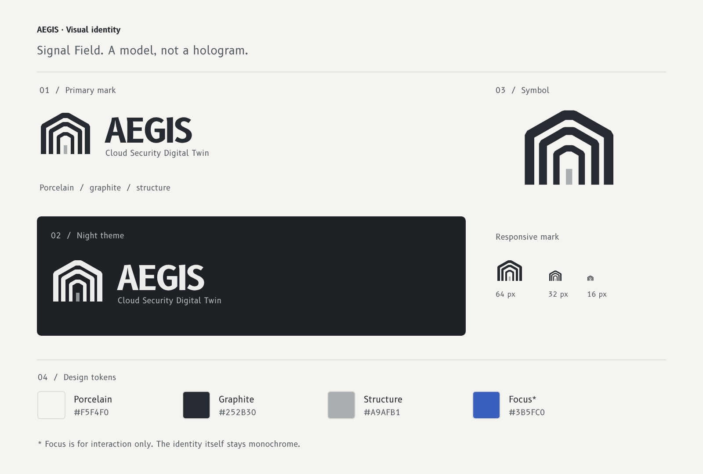

# AEGIS identity



## The mark

A passage through nested gates, the stages a request crosses seen as one
doorway, with a single line resting in the passage: the route at rest,
neither selected nor abnormal. It echoes the milled service pieces of the
model and keeps to the rules of `docs/DESIGN.md`: no hue in either theme,
no shield, lock, glow, gradient or green. The gates are graphite (ink) and
the line is the structure grey (`--color-logo-line`), so the silhouette
reads without any colour at all.

## Files

| File                                                        | What it is                                              |
| ----------------------------------------------------------- | ------------------------------------------------------- |
| `aegis-logo.svg`, `aegis-logo-dark.svg`                     | Mark, name and descriptor in a row, for each theme      |
| `aegis-logo-2x.png`, `aegis-logo-dark-2x.png`               | The same at twice the size, on a transparent ground     |
| `aegis-logo-compact.svg`, `aegis-logo-compact-dark.svg`     | Mark and name, without the descriptor                   |
| `aegis-lockup-stacked.svg`, `aegis-lockup-stacked-dark.svg` | Mark over name over descriptor, centred                 |
| `aegis-symbol.svg`, `aegis-symbol-dark.svg`                 | The mark alone, on nothing                              |
| `aegis-symbol-512.png`, `aegis-symbol-dark-512.png`         | The same at 512 px, on a transparent ground             |
| `aegis-favicon.svg`                                         | The mark on a porcelain plate; follows the system theme |
| `aegis-favicon-32.png`, `aegis-favicon-64.png`              | The favicon in the light theme, as pictures             |
| `aegis-brand-preview.png`                                   | The sheet above                                         |

The web client uses the favicon as `apps/web/public/favicon.svg`, with
`apple-touch-icon.png`, `icon-192.png` and `icon-512.png` beside it, and
draws the mark inline in its top bar (`apps/web/src/features/topnav/Logo.tsx`).
The repository's README shows `aegis-logo.svg`, or `aegis-logo-dark.svg` to
a reader in a dark theme.

## How they are made

Every file here, and the favicon and icons of the web client, is written by
one script:

```bash
python3 apps/web/scripts/build-identity.py
```

It needs fontTools (`pip install fonttools`), Google Chrome, which draws the
PNGs, and `pnpm install`, which brings the B612 font. The strokes are the
same ones the top bar draws, and every colour is read from the tokens in
`apps/web/src/index.css`. The words are B612, the interface's own type,
turned into outlines, so a file looks the same where B612 is not installed.
`apps/web/src/features/topnav/Logo.test.ts` holds the files to the bar's
strokes and to the tokens. To change the mark, change it in the script and in
`Logo.tsx` and run the script again; do not edit a file here by hand.
