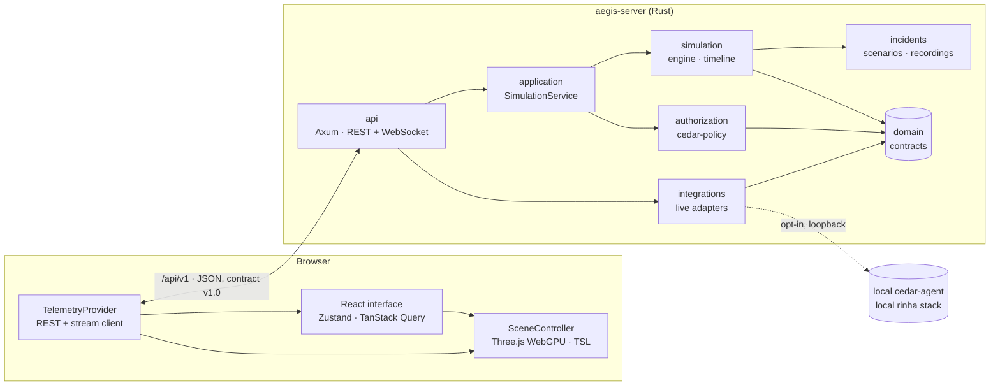
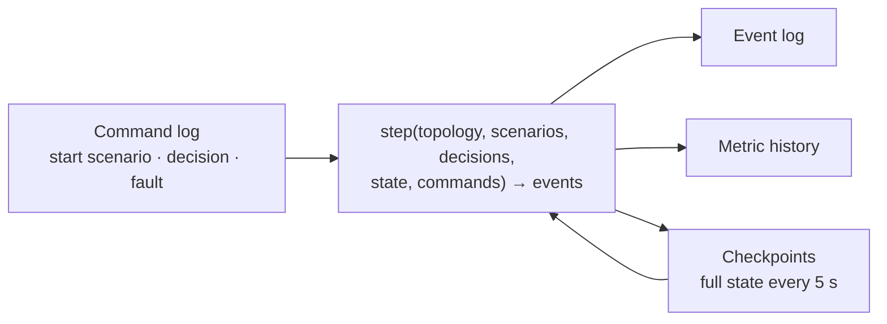

**English** · [Português](Arquitetura)

AEGIS is two programs and the contract between them, plus a build of the
same engine for the browser. This page shows how the parts fit together and
which rules keep what they show honest.
[`docs/ARCHITECTURE.md`](https://github.com/cleissonbarbosa/csdt/blob/main/docs/ARCHITECTURE.md)
is the complete reference.

## Overview

| Part                 | What it is                                                                                                                 |
| -------------------- | -------------------------------------------------------------------------------------------------------------------------- |
| `apps/server`        | A Rust service (crate `aegis-server`) that owns a deterministic simulation, evaluates Cedar policies and streams telemetry |
| `apps/web`           | A React client that draws that telemetry as a 3D scene (Three.js, WebGPU or WebGL 2) with an interface around it           |
| `packages/contracts` | The versioned JSON contract between the two, as zod schemas checked against real server output                             |
| `apps/wasm`          | The server library compiled to WebAssembly, so the client can run as a static site with no server                          |



## The server

### Layers

Dependencies point inward: `api → application → simulation / authorization →
domain`.

| Module          | Responsibility                                                                                                                                                                                                                                                              |
| --------------- | --------------------------------------------------------------------------------------------------------------------------------------------------------------------------------------------------------------------------------------------------------------------------- |
| `domain`        | The versioned contract types (serde, camelCase JSON), `SCHEMA_VERSION` and the `DataSource` provenance enum. No I/O                                                                                                                                                         |
| `simulation`    | `model` compiles a topology (a DAG) and propagates load and experience each tick; `engine::step` is the pure step function; `timeline` adds the command log, checkpoints, seek, replay and branching; `decisions` holds the Cedar outcomes; `report` reads an incident back |
| `incidents`     | Scenarios as data: the file format (`spec.rs`), the five bundled scenarios, and recordings (a seed plus a command list)                                                                                                                                                     |
| `authorization` | The embedded `cedar-policy` decision point                                                                                                                                                                                                                                  |
| `integrations`  | Opt-in adapters for local instances; every outbound target goes through `guard.rs`                                                                                                                                                                                          |
| `workspace`     | Sorts an operator's files into the parts of a workspace and checks each; reads a Compose file or a cloud inventory as a topology                                                                                                                                            |
| `application`   | `Sources` (what everything is built from), `Assets` (everything immutable, built once) and `SimulationService`, which owns the one mutable timeline                                                                                                                         |
| `api`           | Axum routes under `/api/v1` and the `/stream` WebSocket: validation, limits and error mapping                                                                                                                                                                               |

`simulation` and `incidents` perform no I/O at all. The only file access in
the server is `workspace::load`, which reads the directory named by
`AEGIS_WORKSPACE` once, before the server listens. An import through the
interface goes through `workspace::from_files`, which takes files already in
memory and touches nothing. See [Your own platform](Your-own-platform).

### One timeline behind one lock

`SimulationService` owns the single mutable timeline behind one mutex. It is
the only place that advances it, from a scheduler that wakes every 50 ms, and
it fans messages out through a bounded broadcast channel, each message
serialised once for every subscriber. An import swaps the platform and the
timeline together, under the same lock; a reset swaps the start-up set back.

`build_state(config)` in `lib.rs` assembles the application without starting
the scheduler. The integration tests build state that way, call the router
in-process and advance time themselves.

## Determinism and time



`engine::step` is a pure function. It never reads a clock, never uses a
global counter, never iterates an unordered collection, and draws randomness
only from the generator stored in the simulation state. Anything that changes
over time lives in that state, so a checkpoint captures it. History is
therefore derivable: the timeline keeps the command log (the only input that
cannot be derived), periodic checkpoints, and the events and samples already
produced.

| Quantity         | Value                                                  | Constant                                         |
| ---------------- | ------------------------------------------------------ | ------------------------------------------------ |
| One tick         | 200 ms of virtual time                                 | `TICK_MS` (`simulation/model.rs`)                |
| A checkpoint     | every 25 ticks (5 virtual seconds)                     | `CHECKPOINT_INTERVAL` (`simulation/timeline.rs`) |
| A metric sample  | every 5 ticks (1 virtual second)                       | `METRIC_INTERVAL`                                |
| Seekable history | 9 000 ticks (30 virtual minutes)                       | `MAX_HISTORY_TICKS`                              |
| Events kept      | at most 8 000                                          | `MAX_EVENTS`                                     |
| Scheduler        | every 50 ms of wall-clock time, at most 8 ticks a wake | `SCHEDULER_PERIOD` (`application/service.rs`)    |
| Playback speeds  | 0.5, 1, 2 and 4                                        | `PLAYBACK_SPEEDS` (`domain/playback.rs`)         |

- **Seek** restores the nearest earlier checkpoint and steps forward to the
  target.
- **Replay** keeps stepping from there. It reproduces the recorded history
  exactly and announces nothing again.
- **Branch**: a command issued in the past discards the future beyond the
  cursor, and the simulation goes on from that point.
- **A recording** is a seed plus a command list; loading one simulates it
  again. A session (`GET /session`) is the timeline in use written out in the
  same form.

Tests compare state digests bit for bit after arbitrary seeks. Floats are
parsed exactly (`serde_json` with `float_roundtrip`), so a topology written
out and read back is the same bits. [Incidents and time
travel](Incidents-and-time-travel) shows all of this from the interface.

**A report invents nothing.** `simulation/report.rs` reads one incident back
from its events, its metric samples, the topology and the resolved scenario.
It steps nothing and estimates nothing, and each cause it gives says what
kind it is: `prescribed`, `dependency`, `load`, `fault` or `unattributed`.

## Cedar outcomes are looked up

At start-up every request shape the simulation will ever show is evaluated
once by `cedar-policy`, against the policies and entities in use
(`DecisionTable::build`). The engine only looks results up, which keeps it
pure while every outcome stays genuine:

- the baseline denial rate is the denied share of the evaluated mix;
- a scenario flow is blocked at the authorizer if and only if Cedar denied
  its request, and its events carry Cedar's determining policy ids.

A new request shape goes into `fixtures/cedar/catalog.json`. No file can
state an outcome: a scenario cannot hold the event kinds, and a recording or
a session cannot hold the command, that would put a decision on the
timeline. See [Cedar policies](Cedar-policies).

## Questions that record nothing

Some routes ask the model a question and place nothing on the timeline in
use: no command, no event, no decision. An experiment (an intervention
compared), a trial, the limits (`headroom`, `weak-points`), a comparison of
platforms and a preview of files each run on timelines of their own, from the
server's seed. `explain` and
`matrix` go to Cedar directly. Each is bounded (`MATRIX_LIMIT`,
`MAX_DISABLED_POLICIES`, `TRIAL_MS`, an import's limits, `LEAD_IN_MS`,
`HEADROOM_LADDER`, `HEADROOM_REFINEMENTS`, `WEAK_POINTS_MAX`), and all but
`explain` run off the async workers, so they do not hold up other requests.

## The engine in the browser

`apps/wasm` (crate `aegis-wasm`) is a thin crate around the server library,
compiled for `wasm32-unknown-unknown`. It serves `api::offline_router`: the
same route table, the same `SimulationService` and the same Cedar engine. It
decides nothing about the simulation or about a response; it carries text
across the boundary. Only what needs an operating system is left out: the
socket, the scheduler task, rate limiting, the HTTP client and the two live
adapters.

In that build `std::time::Instant::now()` compiles and then panics in the
tab, so shared code takes time from `crate::clock::Instant` and keeps
anything that needs the operating system behind
`#[cfg(not(target_arch = "wasm32"))]`.

### The boundary

- The module imports nothing from its host; a test reads the built file's
  import section. There is no `wasm-bindgen` and no `unsafe` block: the page
  writes into a buffer the module owns and reads another.
- Everything that crosses is lines of UTF-8: `METHOD path` and a JSON body
  in; the status, the body and the stream messages out.
- `ABI_VERSION` is checked by the page (`apps/web/src/engine/binding.ts`);
  a change to the boundary changes it on both sides.
- Wall-clock time is an argument of every call. The page's worker calls
  `aegis_advance` every 50 ms, and one call advances at most one second, so
  a tab that slept does not sprint when it wakes.

| Function                            | What it does                                                           |
| ----------------------------------- | ---------------------------------------------------------------------- |
| `aegis_abi`                         | The version of the boundary                                            |
| `aegis_period_ms`                   | How often to call `aegis_advance`: the server scheduler's period       |
| `aegis_input(len)`                  | Reserves the input buffer; 0 when that is more than any call may carry |
| `aegis_output`                      | Where the last call's output is                                        |
| `aegis_boot(seed, now_ms)`          | Starts the engine; the output is `ok` or the reason it could not start |
| `aegis_request(len, now_ms)`        | Answers one request: status, body and stream messages, one per line    |
| `aegis_advance(elapsed_ms, now_ms)` | Advances the simulation; the output is the stream messages it produced |
| `aegis_open(now_ms)`                | Opens the stream: the greeting and a snapshot                          |
| `aegis_message(len, now_ms)`        | Answers a subscriber's `ping` or `resync`                              |
| `aegis_panic`, `aegis_panic_len`    | The message of a panic that stopped the module, if one did             |

### Server and browser compared

|                 | Server                                 | In the browser                                        |
| --------------- | -------------------------------------- | ----------------------------------------------------- |
| A request       | HTTP to `/api/v1`                      | A function call into the module, same path and body   |
| The stream      | WebSocket                              | What each call hands back, delivered as socket events |
| Time            | A 50 ms task and the operating system  | The worker's timer; the clock is an argument          |
| Simulation      | One, shared by every viewer            | One per tab, gone on reload                           |
| Cedar           | Embedded, or a connected `cedar-agent` | Embedded                                              |
| Evaluation time | Measured                               | Not measured, and shown as such                       |
| Workspace       | Start-up directory, or import          | Import, held in the tab                               |

## The contract

The Rust `domain` module is the source of truth.
`packages/contracts/src/index.ts` mirrors it as zod schemas (contract version
`1.0`, stream protocol version `1`) and exports the `TelemetryProvider`
interface. The package is consumed as TypeScript source and has no build
output.

`packages/contracts/samples/` holds real server output, written by the
`export-contract-samples` binary as it drives the real router through a fixed
scenario. The contract tests parse every sample and require the parsed value
to equal the input, so drift fails in both directions, and CI fails if the
committed samples differ from what the server emits. `pnpm test:engine` holds
the built WebAssembly module to the same samples. After changing a domain
type, a route's response or a fixture:

```bash
pnpm contracts:samples    # then update src/index.ts to match and commit both
```

## The web client

### Data flow

`DemoSimulationProvider` (the REST client in `providers/api.ts` and the
reconnecting `StreamClient`) feeds `app/useAegisConnection.ts`, which feeds
the Zustand stores (`stores/telemetry.ts`, and `stores/ui.ts` with the
persisted settings), which feed the features and the scene. TanStack Query
holds request and response data (scenarios, providers, the policy catalogue)
and is invalidated from stream events. Every REST response and stream message
is parsed with the shared schemas before use.

### Two transports

Where requests go is decided when the client is built. The `@transport`
import resolves to `providers/serverTransport.ts` (`fetch` and a WebSocket)
or, with `--mode static`, to `engine/transport.ts`, which answers with a real
`Response` and a socket-shaped object fed by the engine's worker
(`engine/worker.ts` holds the module, `engine/binding.ts` knows its boundary,
`engine/client.ts` matches answers to requests). Nothing above
`providers/transport.ts` knows which one it has. The static build writes its
Content-Security-Policy into the page, and no code may evaluate a string.

### Rendering

React Three Fiber owns the canvas, its size, the pixel ratio and the frame
loop. One imperative `SceneController` (`graphics/SceneController.ts`) owns
everything drawn inside it and is fed through store subscriptions set up in
`features/scene/SceneCanvas.tsx`, so telemetry never re-renders a React
component in the frame path.

- **TSL only.** Materials are written in TSL (`three/webgpu`, `three/tsl`),
  which compiles to WGSL on WebGPU and to GLSL ES 3.0 on WebGL 2. Nothing
  uses compute shaders or storage buffers, so WebGL 2 is the same code on
  another backend. With neither API available the application shows its
  table view.
- **One pass.** Materials shade themselves under one fixed light; there is
  no post-processing. The camera has a 14° lens.
- **Pieces are a built asset.** `apps/web/scripts/build-pieces.py` models
  every service type in Blender and writes `graphics/pieces.glb`, which a
  small parser in `graphics/pieces.ts` reads. Each piece's working part is a
  mechanism (spin, index, swing, slide or convey) moved in the vertex shader.
- **Beads are stateless.** The CPU updates one small per-connection data
  texture; position, shape and colour are derived in the vertex shader.

Draw calls follow object classes, not object counts: 28 for 51 services, 34
for 178. An end-to-end test fails if switching to the 178-service topology
adds more than six.

| What         | How it is drawn                                                    |
| ------------ | ------------------------------------------------------------------ |
| Pieces       | One instanced mesh per service type                                |
| Ground marks | One instanced mesh: contact shadow, status lamp, selection ring    |
| Connections  | One instanced mesh of camera-facing hairlines along Bézier curves  |
| Traffic      | One instanced mesh of stateless sprites (beads)                    |
| Names        | Not in the scene: a 2D canvas over it, at the display's resolution |
| Plates       | One mesh per region, plus the shadow it casts                      |

**Names** are drawn by `graphics/labelLayer.ts` on a canvas of their own,
laid over the scene at the display's resolution whatever the scene's is.
`graphics/labelPlacement.ts` (pure and tested) leaves out a name that would
lie across a more important one, or that would not lie wholly inside the
free part of the stage; only the selected and the pointed-at name are drawn
regardless. An end-to-end test reads `window.__aegis.labels()` and fails on
an overlap.

### Two levels of one model

The application opens on the overview (`layoutMode: 'layers'`): one piece per
kind of service, in the four layers a request crosses. `lib/overview.ts`
derives it as a real `Topology` with columnar snapshots, as a pure function
of the server's topology and snapshot; every figure is summed or
traffic-weighted from the services it stands for. The detailed arrangements
(`regions`, `dependencies`) draw the server's topology as it is.
`SceneController` draws whichever topology it is handed, and the bridge in
`SceneCanvas.tsx` translates ids between the two levels. `graphics/layout.ts`
is a pure function of the topology, with no randomness and no iteration to
convergence.

An [incident capture](Incident-captures) and the platform editor are modes
of the same shell and go through the same scene bridge; a capture never
reaches the server or the simulation's timeline.

## Repository layout

```text
apps/
  server/src/
    domain/          versioned data contracts and ports; no I/O
    simulation/      model, channels, engine (pure step), timeline, rng
    incidents/       declarative scenarios and prerecorded incidents
    authorization/   embedded Cedar policy decision point
    integrations/    live adapters, target guard
    application/     use cases; owns the single mutable timeline
    workspace.rs     reads an operator's own files from a directory at start-up
    workspace/       a Compose file and a cloud inventory, each read as a topology
    api/             Axum routes, WebSocket, rate limiting, errors
  wasm/src/          the same routes and service as a WebAssembly module
  web/src/
    graphics/        layout, modelled pieces, TSL materials, SceneController
    features/        scene, explorer, inspector, timeline, scenarios, capture, …
    stores/          telemetry, interface state, persisted settings, capture
    providers/       REST client, stream client, TelemetryProvider
    engine/          the module's binding, its worker and the transport to it
    components/ui/   buttons, badges, dialog, fields, sparkline
packages/contracts/  zod schemas + samples exported by the server
fixtures/            the bundled topology, scenarios, recordings and Cedar
                     files, laid out as a workspace
schemas/v1/          JSON Schemas of the file formats, generated from the Rust types
examples/            a small workspace to copy from
scripts/             screenshots, benchmarks, the version, the incident capture scripts
```

The routes themselves are on [HTTP API and stream](HTTP-API-and-stream), and
the reasons behind the scene's look on [Design principles](Design-principles).

## Reference

- [`docs/ARCHITECTURE.md`](https://github.com/cleissonbarbosa/csdt/blob/main/docs/ARCHITECTURE.md): model, API, stream protocol, rendering
- [`AGENTS.md`](https://github.com/cleissonbarbosa/csdt/blob/main/AGENTS.md): "Architecture", the things that are easy to break
- [`apps/server/src/lib.rs`](https://github.com/cleissonbarbosa/csdt/blob/main/apps/server/src/lib.rs),
  [`simulation/engine.rs`](https://github.com/cleissonbarbosa/csdt/blob/main/apps/server/src/simulation/engine.rs),
  [`simulation/timeline.rs`](https://github.com/cleissonbarbosa/csdt/blob/main/apps/server/src/simulation/timeline.rs),
  [`simulation/decisions.rs`](https://github.com/cleissonbarbosa/csdt/blob/main/apps/server/src/simulation/decisions.rs),
  [`application/service.rs`](https://github.com/cleissonbarbosa/csdt/blob/main/apps/server/src/application/service.rs)
- [`apps/wasm/src/lib.rs`](https://github.com/cleissonbarbosa/csdt/blob/main/apps/wasm/src/lib.rs): the engine for the browser and its boundary
- [`packages/contracts/src/index.ts`](https://github.com/cleissonbarbosa/csdt/blob/main/packages/contracts/src/index.ts)
  and [`packages/contracts/samples/`](https://github.com/cleissonbarbosa/csdt/tree/main/packages/contracts/samples)
- [`apps/web/src/providers/transport.ts`](https://github.com/cleissonbarbosa/csdt/blob/main/apps/web/src/providers/transport.ts),
  [`graphics/SceneController.ts`](https://github.com/cleissonbarbosa/csdt/blob/main/apps/web/src/graphics/SceneController.ts),
  [`features/scene/SceneCanvas.tsx`](https://github.com/cleissonbarbosa/csdt/blob/main/apps/web/src/features/scene/SceneCanvas.tsx),
  [`lib/overview.ts`](https://github.com/cleissonbarbosa/csdt/blob/main/apps/web/src/lib/overview.ts)
