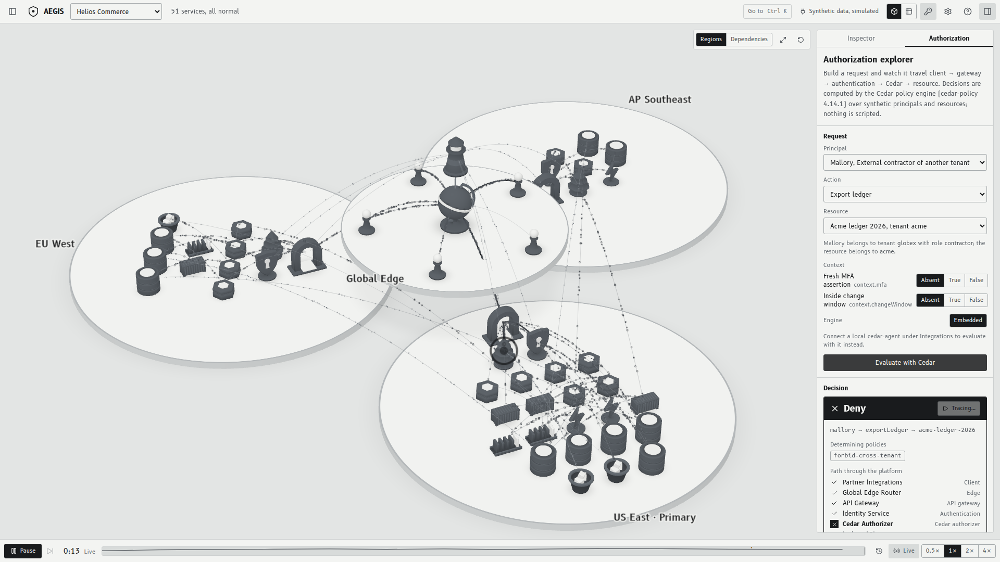

**English** · [Português](Políticas-Cedar)

Every authorization decision in AEGIS is made by
[Cedar](https://www.cedarpolicy.com), the policy engine, embedded in the
server (and in the engine the static site runs in your tab) as the
`cedar-policy` crate. This page shows how to ask it who may do what, read
why it answered as it did, and change the policies it decides by.

## What is real, and what is not

- **The decisions are real.** Each one is what `cedar-policy` returned for
  the policies and entities in use; nothing is scripted. The tracer names
  the engine's version.
- **The data is synthetic.** The tenants, principals and resources are
  fictional, and a decision is labelled `synthetic`, even over policies of
  your own: it is Cedar's answer for the entities in the files, not an
  observation of a running system.
- **The simulation only looks answers up.** At start-up every request shape
  the simulation will show is evaluated once. The share of ordinary checks
  denied is the denied share of that mix, and a scenario's flow is stopped
  at the authorizer if and only if Cedar denied its request. A file cannot
  state an outcome.

## Building a request

Press **Test an authorization** in the bar (or **⋯ → Trace a request
through Cedar**). The panel **Trace a request** opens beside the model.

| Field         | What you choose                                                                                                                       |
| ------------- | ------------------------------------------------------------------------------------------------------------------------------------- |
| **Principal** | Who asks                                                                                                                              |
| **Action**    | What for                                                                                                                              |
| **Resource**  | On which thing; only the resources of the action's type are offered                                                                   |
| **Context**   | **Fresh MFA assertion** (`context.mfa`) and **Inside change window** (`context.changeWindow`), each **Absent**, **True** or **False** |
| **Engine**    | **Embedded**, or a local `cedar-agent` once it is connected (server only; see [Integrations](Integrations))                           |

Then press **Evaluate with Cedar**. The bundled catalogue offers two tenants
(Acme Retail and Globex Logistics) and six principals:

| Principal   | Tenant | Who they are                          |
| ----------- | ------ | ------------------------------------- |
| **Alice**   | Acme   | Finance analyst                       |
| **Bob**     | Acme   | Support agent                         |
| **Carol**   | Acme   | Tenant administrator                  |
| **Erin**    | Acme   | Finance analyst, suspended            |
| **Dave**    | Globex | Administrator of another tenant       |
| **Mallory** | Globex | External contractor of another tenant |

### The path it travels



A blue request travels the model: client, edge, API gateway,
authentication, Cedar authorizer, resource. An allowed request goes on to
the data layer. A denied one stops at the Cedar authorizers: a red badge
with a cross lands there, the path stays drawn and everything off it
recedes. The red marks where the request you chose to follow ended; the
policy did its job, and nothing is broken. **Path through the platform**, on
the card, says which hops were reached and where it was blocked. **Show the
path** (or **Trace again**) sends it once more, and closing the panel puts
the path away.

## The decision

The card says **Allow** or **Deny**, then:

- **Determining policies**: the ids Cedar returned. For a denial by
  default it says **None. No policy permits this request, so Cedar denies it
  by default.**
- **Policy by policy**: see [Why not](#why-not-policy-by-policy).
- **Evaluation diagnostics**: Cedar's own messages, such as a policy that
  errored on a missing attribute.
- **Evaluated with**: the engine, how many policies were active and which
  were off, and the context.
- How long it took: measured in microseconds on the server, not timed in the
  browser.

Each evaluation is recorded on the timeline as a command and listed under
**Evaluated in this timeline**, where any one can be traced again.

Try these, from the tour:

| Request                                                      | Answer                                                  |
| ------------------------------------------------------------ | ------------------------------------------------------- |
| Mallory, **Export ledger**, **Acme ledger 2026**             | **Deny**, determined by `forbid-cross-tenant`           |
| Alice, **View ledger**, **Acme ledger 2026**                 | **Allow**, determined by `finance-view-ledger`          |
| Alice, **Export ledger**, **Fresh MFA assertion** **Absent** | **Deny**, with a diagnostic about the missing attribute |
| The same with **Fresh MFA assertion** **True**               | **Allow**                                               |

## Switching policies off

**Policies**, under the form, lists every policy in force with its effect
(**Permit** or **Forbid**), its description and its **Cedar source**. Switch
one off and evaluate again to see the outcome change: switch off
`forbid-destructive-outside-change-window` and try Carol deleting a
customer. Switching off works with the embedded engine only; a
`cedar-agent` uses its own policy store.

## A result that no longer matches the form

A result belongs to what it was asked. Change the form after an evaluation
and, before you evaluate again, the card says **Configuration changed.
Evaluate again.** The result loses its colour and its firm edge, reads
**Was Allow** (or **Was Deny**), and lists what changed: the principal, the
action, the resource, a context key, a policy switched on or off, the
engine, or the policies in use being replaced. It is never shown as the
answer to the form beside it.

## Keeping a result to compare

**Keep to compare** keeps the result on screen as A. Change the context or
the policies and evaluate again: the **Comparison** sets A and B side by side,
with the **Decision** on each, the policies that decided it (**Decided by**),
the **Policies off**, and **What differs from A to B**. A sentence says
whether the decision changed. If A and B are different requests, it says so:
the two decisions answer different questions. **Clear** lets go of A.

## Why not: policy by policy

Under every decision, **Policy by policy** gives each policy in force one
line, grouped:

| Group                                             | Means                                                        |
| ------------------------------------------------- | ------------------------------------------------------------ |
| **Hold for this request**                         | The policy holds                                             |
| **About it, with a condition that does not hold** | Its scope takes the request in, but its condition is not met |
| A folded line, "_n_ not about this request"       | Its scope does not take the request in at all                |

Cedar names no policy for a denial by default, so for one the line above
says which permit came closest. Each line is Cedar's own answer: the
embedded engine puts each policy to the request by itself, twice, as it is
and with its conditions left out, both made from Cedar's JSON form of the
policy. A forbid is turned into a permit for the asking. Nothing in AEGIS
parses a policy to say why it did not apply. A permit is an outlined tag and
a forbid a filled one; neither is an alarm. None of this is recorded on the
timeline.

## Who may do what

**⋯ → Who may do what** (also on the tracer and on a service's
**Exposure**) asks Cedar every principal and action of the catalogue, on
every resource the action applies to. Principals run down, actions across,
and each cell says on how many resources Cedar allows it. A denial is not
red.

- Set each context key to **Absent**, **True** or **False** above the
  table.
- **Policies in force: … of …** opens a switch per policy. With any
  switched off, every cell whose answer differs from all policies in force,
  under the same context, is marked, and a sentence counts them.
- Pick a cell for the answer on each resource, and **Trace it** to see that
  request cross the model.
- **Edit the policies** opens the editor.

The matrix is bounded (20 000 requests) and records nothing on the
timeline.

## Editing the policies

**Edit the policies** (on the tracer and the matrix) opens **Edit the Cedar
policies**: the policies in force as one text in Cedar's own syntax, each
under its `@id` and `@description`.

```text
@id("forbid-cross-tenant")
@description("Hard tenant isolation: no principal may touch another tenant's resources.")
forbid(principal, action, resource) unless { principal.tenant == resource.tenant };
```

1. Edit the text. A moment after you stop typing, the engine checks it:
   **Not valid.**, with where and Cedar's message, or a count of the
   policies Cedar accepts.
2. Once it is valid, the dialog lists what Cedar would decide differently:
   policies added, removed or changed in meaning, catalogued requests and
   scenario traffic whose outcome changes, and scenarios that could or could
   no longer run.
3. **Apply these policies** replaces the policies only: the platform, its
   scenarios and its entities stay as they are. The timeline starts again,
   as for any change of files, and the matrix opens under the new policies.
   **Put back the ones in use** discards your edit.

Applied policies are an import like any other: on a server, for everyone
connected, and held in memory only. **⋯ → Import or export files → Return
to what the server started with** (on the static site, **Return to what this
page opened with**) undoes it. A server started with `AEGIS_IMPORT=off`
refuses it. To compare two sets of policies from a terminal, see
[Your own platform](Your-own-platform#compare-two-sets-of-policies).

### Writing one as a sentence

**Write one as a sentence**, above the text, adds a policy without writing
Cedar:

1. Choose **Permit** or **Forbid**, **Who** (one principal, a group as the
   entity store has it, or anyone), **To do what** (one action, or anything)
   and **On what** (one resource, every resource of a type, or anything).
2. Under **Conditions**, tick _the resource is of the principal's own
   tenant_ or a key of the catalogue's context, and say whether the policy
   applies **Only when these hold** or **Except when these hold**.
3. Give it an id and a sentence on what it is for, and press **Add it to the
   policies**. Its Cedar text is added to the editor, and Cedar checks it
   with the rest before anything is applied.

The sentence only adds text: it never reads a policy already written. Its
choices are only what the files state: who and what from the catalogue,
groups from the entity store, and the tenant condition only where every
principal and resource of the catalogue has a `tenant`.

### What ordinary traffic asks

Below the text, **What ordinary traffic asks** draws the catalogue's
`trafficMix` as a bar, one band per request shape, each as wide as its
share. Drag a boundary, or move it with the arrow keys, to shift share from
one shape to the next; the file's total stays the same. The check then says
"At rest Cedar would deny … of ordinary requests; it denies … now", with the
new policies and shares against those in use. **Apply these policies**
applies the new shares with the policies.

## Exposure

**Exposure**, on a service's card, follows its connections all the way:

- what the service could reach were it taken over, how many of those hold
  data, and **Keep them in front on the model** to bring them forward in
  your blue;
- how many services lead to it, and the shortest way in from outside the
  platform;
- **What Cedar guards here**: for the requests that end at this service,
  how many of those the catalogue describes Cedar allows, and to how many
  principals, under every policy in force and an empty context.

It is read from the topology, and nothing is simulated. It says what the
topology allows, never what an attacker would do.

## Cedar in an incident

A scenario's flow can be tied to a request shape of the catalogue. Cedar
decides that shape once, at start-up, and the flow is stopped at the
authorizer only if Cedar denied it; the events of the run carry Cedar's
determining policy ids. In **Cedar Authorization Denial**, Mallory's
requests stop at the authorizer. Part of one of its flows, which names the
catalogued request by its id:

```json
{
  "id": "mallory-export-ledger",
  "label": "Mallory · exportLedger",
  "suspicious": true,
  "authz": {
    "request": "mallory-export-ledger",
    "authorizer": "role:primaryAuthorizer"
  }
}
```

An incident's summary lists **What Cedar decided** for the requests it sent.
See [Incidents and time travel](Incidents-and-time-travel).

## The catalogue and the files

Cedar evaluates three files of the bundled set
([`fixtures/cedar/`](https://github.com/cleissonbarbosa/csdt/tree/main/fixtures/cedar)),
and a workspace can replace each:

| File                       | What it holds                                                                                                                                                                                          |
| -------------------------- | ------------------------------------------------------------------------------------------------------------------------------------------------------------------------------------------------------ |
| `cedar/policies.json`      | The policies, as `{ "id", "description", "content" }`. A workspace may use `cedar/*.cedar` files instead                                                                                               |
| `cedar/entities.json`      | The entity store, in the JSON form Cedar reads                                                                                                                                                         |
| `cedar/catalog.json`       | AEGIS' own file: what the tracer offers and what authorization traffic is made of                                                                                                                      |
| `cedar/schema.cedarschema` | Optional (the bundled set has none). When present, the policies are validated against it in strict mode and the entities checked against it; what the validator reports stops the server from starting |

The catalogue's fields:

| Field                                           | Meaning                                                                                                        |
| ----------------------------------------------- | -------------------------------------------------------------------------------------------------------------- |
| `tenants`, `principals`, `actions`, `resources` | The tracer's choices, with their labels. A resource is offered for an action when their `resourceType` matches |
| `contextKeys`                                   | Boolean context attributes the tracer lets you set                                                             |
| `trafficMix`                                    | Request shapes and their weights: the platform's ordinary authorization traffic                                |
| `scenarioRequests`                              | Request shapes a scenario's flow can be tied to, by `id`                                                       |

The bundled catalogue holds six principals, six actions, seven resources,
two context keys, ten ordinary request shapes and five for scenarios. One
entry of `trafficMix`:

```json
{
  "id": "alice-export-ledger-mfa",
  "weight": 0.04,
  "principal": "User::\"alice\"",
  "action": "Action::\"exportLedger\"",
  "resource": "Ledger::\"acme-ledger-2026\"",
  "context": { "mfa": true }
}
```

A new request shape the simulation should show goes into the catalogue, so
that Cedar decides it at start-up. Field by field, see
[Workspace files](Workspace-files#cedar).

## The bundled policies

| Id                                         | Effect | What it says                                                                 |
| ------------------------------------------ | ------ | ---------------------------------------------------------------------------- |
| `tenant-view-orders`                       | Permit | Any member of a tenant may view that tenant's orders                         |
| `support-refund-limit`                     | Permit | Support agents may refund orders of their own tenant up to 500               |
| `support-view-customers`                   | Permit | Support agents may view customer profiles of their own tenant                |
| `finance-view-ledger`                      | Permit | Finance staff may read their tenant's ledger                                 |
| `finance-export-ledger-mfa`                | Permit | Exporting the ledger also requires a fresh MFA assertion in the context      |
| `admin-own-tenant`                         | Permit | Tenant administrators may perform any action on their own tenant's resources |
| `forbid-cross-tenant`                      | Forbid | No principal may touch another tenant's resources                            |
| `forbid-suspended`                         | Forbid | Suspended principals are denied everything, whatever their role              |
| `forbid-destructive-outside-change-window` | Forbid | Customer deletion is only possible inside an approved change window          |

A forbid that holds is never overridden by a permit; a request no permit
covers is denied by default.

## Routes behind this page

| Route                                                   | What it does                                          |
| ------------------------------------------------------- | ----------------------------------------------------- |
| `POST /api/v1/demo/authorization/evaluate`              | Evaluates a request; recorded on the timeline         |
| `POST /api/v1/demo/authorization/explain`               | One request, policy by policy; not recorded           |
| `POST /api/v1/demo/authorization/matrix`                | Every request of the catalogue; not recorded          |
| `GET /api/v1/demo/authorization/catalog` · `/decisions` | The policies and catalogue, and the decisions made    |
| `POST /api/v1/demo/workspace/diff`                      | What Cedar would decide differently under other files |

[HTTP API and stream](HTTP-API-and-stream) has every route.

## Reference

- [docs/DEMO.md](https://github.com/cleissonbarbosa/csdt/blob/main/docs/DEMO.md): step 3 of the tour
- [docs/ARCHITECTURE.md](https://github.com/cleissonbarbosa/csdt/blob/main/docs/ARCHITECTURE.md): Cedar decisions are real
- [docs/WORKSPACE.md](https://github.com/cleissonbarbosa/csdt/blob/main/docs/WORKSPACE.md): the Cedar files and comparing two workspaces
- [docs/DESIGN.md](https://github.com/cleissonbarbosa/csdt/blob/main/docs/DESIGN.md): a result belongs to what it was asked; a decision is taken apart, never restated
- [fixtures/cedar/](https://github.com/cleissonbarbosa/csdt/tree/main/fixtures/cedar): the bundled policies, entities and catalogue
- [apps/server/src/authorization/](https://github.com/cleissonbarbosa/csdt/tree/main/apps/server/src/authorization): the embedded decision point
- [apps/server/src/application/access.rs](https://github.com/cleissonbarbosa/csdt/blob/main/apps/server/src/application/access.rs): policy by policy, and the matrix
- [apps/web/src/features/authorization/](https://github.com/cleissonbarbosa/csdt/tree/main/apps/web/src/features/authorization): the tracer, the matrix and the policy editor
- [apps/web/src/lib/evaluation.ts](https://github.com/cleissonbarbosa/csdt/blob/main/apps/web/src/lib/evaluation.ts): when a result is stale
- [apps/web/src/features/inspector/Exposure.tsx](https://github.com/cleissonbarbosa/csdt/blob/main/apps/web/src/features/inspector/Exposure.tsx): exposure
