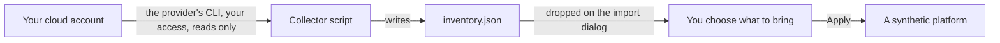

**English** · [Português](Inventários-de-nuvem)

A cloud inventory is what a provider lists of an account, written to one
file by a script you run, and read by AEGIS as a platform: the resources it
has a piece for, and the connections the provider itself states between
them. It is the quick way to stand your own AWS, Google Cloud or Oracle
Cloud account on the model.

> **AEGIS reaches no cloud.** The server, the engine and the page hold no
> cloud SDK and no credential; the file is text, read as a Compose file is.
> The script that writes it is yours to run, on your machine, with your own
> access, and it only reads.

What comes out is a topology like any other, and it is `synthetic`: the
platform has the account's shape, and everything the simulation shows on it
is computed. Read [What an inventory cannot say](#what-an-inventory-cannot-say)
before reading what breaks.

## From an account to a platform



1. **Write the file.** In the application: **⋯**, **Import or export
   files**, **Get an inventory of a cloud account, to import**. Choose the
   **Provider**, fill in what to read, and **Copy the command**. Or write it
   yourself ([The collectors](#the-collectors)).
2. **Drop it on the dialog.** The file is checked as every file is, and a
   panel says what it holds: how many resources, in which regions and
   networks, of which kinds, with which tags.
3. **Choose what to bring, and apply.** Each choice is written into the
   file's own `selection` and the file is read again, so the counts are the
   server's. **Apply** makes it the platform; **Save as one file** then
   gives you the topology it became, to edit by hand.

Before applying, **How would an incident go on each?** in the same dialog
runs a bundled scenario on the platform in use and on the one the file
describes ([Your own platform](Your-own-platform#an-incident-on-both-platforms)).

The file also works without the dialog: put it in a workspace's
`topologies/` and it is read when the server starts, with a selection
written by hand. On the static site the file is read by the same code, in
the tab, and goes nowhere.

```bash
cargo run -p aegis-server -- check-workspace examples/cloud-inventory
AEGIS_WORKSPACE=examples/cloud-inventory cargo run -p aegis-server
```

## What is read from the file

| From the file                      | In the topology                                                                                                                                                      |
| ---------------------------------- | -------------------------------------------------------------------------------------------------------------------------------------------------------------------- |
| each resource the selection brings | a node with the resource's `id`, `name` and `type`; its description says what the provider calls it and, for a group, how many it stands for                         |
| its `region`                       | the node's region; `global` is the provider's edge, for what is in no region                                                                                         |
| a relation                         | a connection, drawn as its basis says ([below](#connection-bases))                                                                                                   |
| `public` resources                 | where `clients` enter: each public resource no other public resource routes to; with none stated public, each resource that leads somewhere and is led to by nothing |
| the file's `name`                  | the platform's id and name                                                                                                                                           |

Two nodes are added that the file does not list: `clients`, which stands
for whoever uses the platform and sends the default 100 requests a second,
shared evenly between the entries; and `unknown-sources`, idle at rest,
which a scenario sends hostile traffic through.

Roles are named where the file has something to be one, so the bundled
scenarios run where they can and say which role is missing where they
cannot. An account with a distribution, a load balancer behind it and a
threat detector has what the bundled DDoS surge asks for. The collectors
read no Cedar authorizer, so the two scenarios that ask for one do not run.

## Connection bases

Every relation in the file says what states it. That is its `basis`, and a
connection is drawn only from a relation the file holds.

| Basis      | What states it                                                                                                         | Drawn as                                                                                                                                      |
| ---------- | ---------------------------------------------------------------------------------------------------------------------- | --------------------------------------------------------------------------------------------------------------------------------------------- |
| `routing`  | The provider sends requests from one to the other: a balancer's target, a distribution's origin, an API's integration. | `route`; what a router sends on is shared evenly between its routes                                                                           |
| `event`    | The provider delivers from one to the other when something happens: a queue a function reads, a topic's subscription.  | `publish` into a queue, `consume` out of one or from any other source of events                                                               |
| `declared` | The resource's own configuration names the other, or you declared it when the file was written (`--relation`).         | read by what it leads to: `data` to a database or a store, `publish` to a queue, `auth` to an authentication service, `call` to anything else |
| `network`  | A network rule admits one to the other.                                                                                | as `declared`                                                                                                                                 |

**A network rule is a permission, not a call.** It is drawn because
nothing else says who reaches a database, but nobody saw the call. The
platform's description says how many connections rest on one, and turning
off **Draw connections from network rules** draws none of them.

Two statements of the same connection are one connection, read as the
stronger says, in the order of the table. A topology is followed one way:
where the stated connections run in a circle, the one that would close it
is left out, weakest basis first and then in the file's order, and the
platform's description names each one.

## Choosing what to bring

A file may carry a `selection`; without one, everything is brought. In the
dialog, each control writes one field of it. Each field left out asks for
everything, and every field given must hold.

| Field           | In the dialog                                     | Brings                                                                                                          |
| --------------- | ------------------------------------------------- | --------------------------------------------------------------------------------------------------------------- |
| `regions`       | **Regions**                                       | only resources in these regions                                                                                 |
| `networks`      | **Networks**                                      | only resources in these networks; `null` stands for the resources in none                                       |
| `kinds`         | **Kinds of service**                              | only resources of these kinds                                                                                   |
| `tags`          | **Tag**                                           | only resources that carry every tag listed: `{ "key": "env", "values": ["prod", "staging"] }`, or the key alone |
| `name`          | **Name has**                                      | only resources whose name has this in it, whatever the case                                                     |
| `alongPaths`    | **Also what leads to them and what they lead to** | also what leads to the chosen resources and what they lead to, following the connections both ways              |
| `connectedOnly` | **Only what a connection touches**                | not what no connection touches; a security monitor stays, since it watches and nothing calls it                 |
| `bases`         | **Draw connections from network rules**           | only connections stated in these ways; the others are not drawn, and the description counts them                |
| `exclude`       | **Resources, one by one**                         | not these resources, by id, whatever else is asked                                                              |
| `without`       | written by hand                                   | not these connections: `{ "from": "cdn", "to": "assets" }`                                                      |

`alongPaths` is what makes a tag useful: ask for `app=shop` and the
balancer in front of it and the database behind it, which nobody tagged,
come with it. **Bring everything** clears the selection. A selection that
leaves nothing, or names a resource the file does not list, is refused with
the reason. More than 1 998 resources or 20 000 connections is more than a
topology holds: the file is still surveyed, and the answer says to narrow
it.

## What an inventory cannot say

- **How much traffic there is, how it is shared, how slow anything is.**
  The 100 requests a second, the even shares and every latency are the
  converter's defaults. To give the platform the rates of a real incident,
  draft one from an [incident capture](Incident-captures), or save the
  topology and write the `baseRps` and connection weights you know.
- **A capacity.** None is given: each service has the model's default
  headroom over its load at rest. State `capacityRps` where you know a
  limit before reading "would have prevented it".
- **Who calls whom, where the provider does not stand between them.** One
  service calling another over HTTP is in no inventory. Declare the ones you
  know with `--relation`, or read them from traces with a capture exporter.
- **That a permission is used.** See [Connection bases](#connection-bases).
- **What a service does about load.** A rate limit, a filter of suspicious
  traffic and autoscaling are stated by a topology file; an inventory states
  none of them. Add them to the saved topology
  ([Your own platform](Your-own-platform#what-a-service-does-about-load)).

## The collectors

`scripts/export-cloud-inventory.py` is a tool for you, run on your machine.
It uses only Python 3's standard library and the provider's own CLI, which
must be installed and signed in, and calls the CLI with a list of
arguments, never through a shell. It writes a new file and refuses to
overwrite one, and exits 0 when it wrote the file, 1 with
`Inventory failed: …` when it could not, and 2 for a usage error.
`<provider> --help` lists a provider's options and the kinds. Every provider
takes these:

```text
  --name shop-prod            # the platform's name in AEGIS; it need not be the account's
  --tag env=prod              # write only resources carrying this tag; repeatable; --tag env for the key alone
  --tag-key env               # write only this tag key of each resource; repeatable; without it every tag is written
  --type orders-db=database   # declare the kind of the one resource with exactly this name; repeatable
  --relation checkout=orders  # declare a connection between two resources by their names; repeatable
  --no-network-rules          # do not read network rules: no connection is drawn from a permission
  --output inventory.json     # a new file
```

### AWS

Needs the AWS CLI v2, recent enough to list buckets by region. It is called with the profile you name (`--profile`)
or the CLI's default credential chain. `--region` is required and may be
repeated. It reads load balancers and their target groups, Auto Scaling
groups and instances, ECS services and EKS clusters, Lambda functions and
their event sources, API Gateway APIs and Cognito user pools, SQS, SNS and
Kinesis, RDS, DynamoDB and ElastiCache, S3 buckets, CloudFront
distributions, GuardDuty detectors, VPCs and security groups, and tags.

```bash
python3 scripts/export-cloud-inventory.py aws \
  --profile readonly \
  --region sa-east-1 \
  --name shop-prod \
  --output inventory.json
```

The least access is these actions. They are lists and descriptions that take
no resource, so `Resource` is `"*"`:

```json
{
  "Version": "2012-10-17",
  "Statement": [
    {
      "Sid": "AegisInventoryRead",
      "Effect": "Allow",
      "Action": [
        "tag:GetResources",
        "ec2:DescribeVpcs",
        "ec2:DescribeSecurityGroups",
        "ec2:DescribeInstances",
        "autoscaling:DescribeAutoScalingGroups",
        "elasticloadbalancing:DescribeLoadBalancers",
        "elasticloadbalancing:DescribeTargetGroups",
        "elasticloadbalancing:DescribeTargetHealth",
        "ecs:ListClusters",
        "ecs:ListServices",
        "ecs:DescribeServices",
        "eks:ListClusters",
        "eks:DescribeCluster",
        "lambda:ListFunctions",
        "lambda:ListEventSourceMappings",
        "apigateway:GET",
        "cognito-idp:ListUserPools",
        "sqs:ListQueues",
        "sqs:GetQueueAttributes",
        "sns:ListTopics",
        "sns:ListSubscriptions",
        "rds:DescribeDBClusters",
        "rds:DescribeDBInstances",
        "dynamodb:ListTables",
        "elasticache:DescribeReplicationGroups",
        "elasticache:DescribeCacheClusters",
        "kinesis:ListStreams",
        "s3:ListAllMyBuckets",
        "guardduty:ListDetectors",
        "cloudfront:ListDistributions"
      ],
      "Resource": "*"
    }
  ]
}
```

### Google Cloud

Needs the gcloud CLI, signed in. It is called as whoever gcloud is signed in
as, or with the configuration you name (`--configuration`), and with
`--quiet`, so that it asks nothing and enables nothing. `--project` is
required and is not written to the file. `--region` is optional and
repeatable; without it every region is kept and Memorystore is not read. It
reads load balancers (forwarding rules, proxies, URL maps, backends),
managed instance groups and instances, Cloud Run and Cloud Functions,
Pub/Sub, Cloud SQL, Spanner, Firestore, Memorystore, Cloud Storage, GKE
clusters, firewall rules and labels. It reads no security monitor and lists
a global load balancer as a load balancer, so the bundled scenarios that
need an edge router or a monitor say which role is missing.

```bash
python3 scripts/export-cloud-inventory.py gcp \
  --project shop-prod-1234 \
  --region southamerica-east1 \
  --name shop-gcp \
  --output inventory.json
```

The least access is a predefined role for each service that has one which
reads no data, and one permission in a custom role for Firestore. With your
own user credentials, gcloud may also need `serviceusage.services.use` on
the project it bills the calls to.

```text
roles/compute.viewer
roles/container.clusterViewer
roles/cloudfunctions.viewer
roles/run.viewer
roles/pubsub.viewer
roles/cloudsql.viewer
roles/redis.viewer
roles/spanner.viewer
roles/storage.bucketViewer
datastore.databases.list
```

### Oracle Cloud

Needs the OCI CLI, configured. It is called with the profile you name
(`--profile`) or the CLI's default one. `--compartment` (the compartment's
OCID) and `--region` are required; the compartments under it are not read,
and neither OCID is written to the file. Where the networks are kept in a
compartment of their own, name it with `--network-compartment`. It reads
load balancers, instance pools and instances, OKE clusters, container
instances, functions, API gateways, streams and queues, Autonomous
Databases, DB systems, MySQL systems and NoSQL tables, Object Storage
buckets, VCNs, subnets and network security groups, and tags. No `event` or
`declared` relation comes from an Oracle Cloud read: declare the ones you
know with `--relation`.

```bash
python3 scripts/export-cloud-inventory.py oci \
  --profile DEFAULT \
  --compartment ocid1.compartment.oc1..aaaa \
  --region sa-saopaulo-1 \
  --name shop-oci \
  --output inventory.json
```

The least access is these statements, with `<group>` the group the
profile's user is in and `<compartment>` the compartment read:

```text
Allow group <group> to inspect vcns in compartment <compartment>
Allow group <group> to inspect subnets in compartment <compartment>
Allow group <group> to read network-security-groups in compartment <compartment>
Allow group <group> to use network-security-groups in compartment <compartment> where request.permission='NETWORK_SECURITY_GROUP_LIST_SECURITY_RULES'
Allow group <group> to read instances in compartment <compartment>
Allow group <group> to inspect vnic-attachments in compartment <compartment>
Allow group <group> to inspect vnics in compartment <compartment>
Allow group <group> to read instance-pools in compartment <compartment>
Allow group <group> to inspect clusters in compartment <compartment>
Allow group <group> to read cluster-node-pools in compartment <compartment>
Allow group <group> to inspect compute-container-instances in compartment <compartment>
Allow group <group> to inspect load-balancers in compartment <compartment>
Allow group <group> to inspect network-load-balancers in compartment <compartment>
Allow group <group> to inspect fn-app in compartment <compartment>
Allow group <group> to inspect fn-function in compartment <compartment>
Allow group <group> to read api-gateways in compartment <compartment>
Allow group <group> to read api-deployments in compartment <compartment>
Allow group <group> to inspect streams in compartment <compartment>
Allow group <group> to inspect queues in compartment <compartment>
Allow group <group> to inspect autonomous-databases in compartment <compartment>
Allow group <group> to inspect db-systems in compartment <compartment>
Allow group <group> to inspect mysql-instances in compartment <compartment>
Allow group <group> to inspect nosql-tables in compartment <compartment>
Allow group <group> to inspect buckets in compartment <compartment>
```

The four network statements apply to any `--network-compartment` too.

## What the collectors promise

- **Every call is a read.** Each collector lists the operations it may call
  (`READS`), a test holds what it calls to that list, and every one of them
  is a list, a describe or a get.
- **A refused read is noted, and the rest is read.** A profile that may not
  list queues gives an inventory without queues and a note that says so,
  with the provider's short name for the refusal (`AccessDenied`) and
  nothing else of what it said. If every read is refused, nothing is
  written.
- **Nothing names the account.** The file holds resource names, tags,
  region and network names and how they connect, but no account id, ARN,
  project id, OCID, address or credential; a test of each collector checks
  that. A name or a tag you wrote may still say more than you want shared:
  read the file, or write fewer tags with `--tag-key`.
- **They were written from the providers' references, not against an
  account.** Their tests answer in the shapes the references document. A
  first run against a real account may meet a shape they do not cover: a
  missing field is treated as absent, and a failure names the read that
  failed.

AEGIS never runs a collector, and a collector is not an
[integration](Integrations): the server and the page never call it or
anything it reads from. Once applied, a platform is served to whoever can
reach the API, like any workspace ([Security model](Security-model)).

## The format in brief

One JSON file, version 1, described by
[`schemas/v1/inventory.schema.json`](https://github.com/cleissonbarbosa/csdt/blob/main/schemas/v1/inventory.schema.json).
The reader refuses a file that breaks a rule, rather than repairing it, and
names the rule.

| Field         | Meaning                                                                                                         |
| ------------- | --------------------------------------------------------------------------------------------------------------- |
| `kind`        | `"aegis-cloud-inventory"`: how a `.json` file is told from a topology                                           |
| `version`     | `1`                                                                                                             |
| `provider`    | `aws`, `gcp` or `oci`                                                                                           |
| `name`        | 1–64 characters: the platform's name and, with anything but letters, digits, `.`, `_` and `-` replaced, its id  |
| `collectedAt` | optional, at most 64 characters: when it was read, shown as written                                             |
| `resources`   | 1–10 000 of `{ id, name, type, native, region, network?, tags?, public?, members? }`                            |
| `relations`   | up to 50 000 of `{ from, to, basis, evidence? }`                                                                |
| `selection`   | optional: [which part is brought](#choosing-what-to-bring)                                                      |
| `notes`       | up to 40 strings of at most 1 280 characters: what the collector could not read, shown as written in the dialog |

A resource's `id` is made from its name, never the provider's own
identifier; its `type` is a kind of service other than `external-client`,
and `native` is what the provider calls it (`AWS::RDS::DBCluster`). After
an import only the topology is kept: no tag, network, selection or note, and
the file itself is not stored. Three example files, one per provider, are in
[`examples/cloud-inventory`](https://github.com/cleissonbarbosa/csdt/tree/main/examples/cloud-inventory);
the collectors' own tests write them, never a hand.

## Reference

- [docs/INVENTORY.md](https://github.com/cleissonbarbosa/csdt/blob/main/docs/INVENTORY.md): the complete reference, with what each collector reads and does not
- [docs/WORKSPACE.md](https://github.com/cleissonbarbosa/csdt/blob/main/docs/WORKSPACE.md): workspaces, roles and the import dialog
- [examples/cloud-inventory](https://github.com/cleissonbarbosa/csdt/tree/main/examples/cloud-inventory): one inventory per provider
- [scripts/export-cloud-inventory.py](https://github.com/cleissonbarbosa/csdt/blob/main/scripts/export-cloud-inventory.py) and [scripts/cloud_inventory/](https://github.com/cleissonbarbosa/csdt/tree/main/scripts/cloud_inventory): the collectors
- [apps/server/src/workspace/inventory.rs](https://github.com/cleissonbarbosa/csdt/blob/main/apps/server/src/workspace/inventory.rs): the reader
- [apps/web/src/features/workspace/InventoryFilters.tsx](https://github.com/cleissonbarbosa/csdt/blob/main/apps/web/src/features/workspace/InventoryFilters.tsx) and [CloudCommand.tsx](https://github.com/cleissonbarbosa/csdt/blob/main/apps/web/src/features/workspace/CloudCommand.tsx): the dialog's choices and the command it writes
