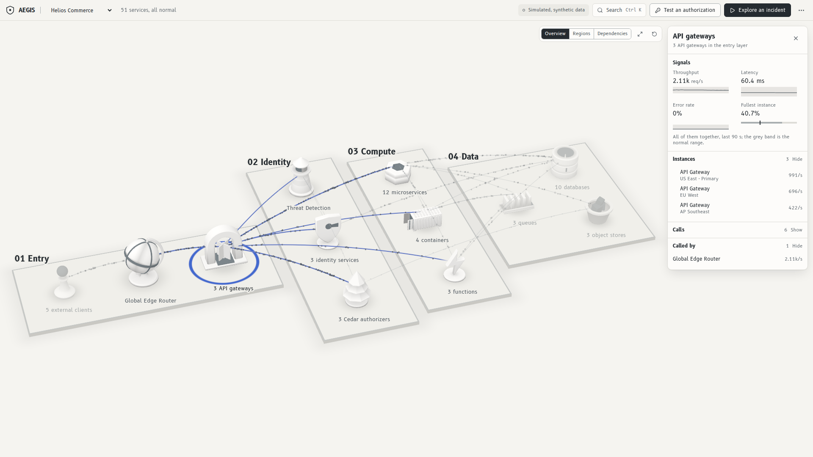

**English** · [Português](Início)

AEGIS is an interactive digital twin of a cloud platform that does not exist.
A deterministic Rust engine simulates _Helios Commerce_, 51 services across
three regions and a global edge, tick by tick: load, saturation, queues and
cascading failure. Authorization outcomes come from the real
[Cedar](https://www.cedarpolicy.com) policy engine. The result is drawn as a
scale model you can walk around in the browser: services are pieces on
plates, requests are beads on wires, and the only colour on the screen is a
problem.



> **The simulation is synthetic.** AEGIS scans no network and attacks
> nothing. The only real incidents it shows are incident captures: files
> read in your browser, labelled as not simulated and never mixed into the
> simulation.

## Try it

- **In the browser, with nothing to install:** the
  [static site](https://cleissonbarbosa.github.io/csdt/) runs the engine in
  the tab, compiled to WebAssembly. It is published by hand, so it can be
  behind `main`.
- **On your machine:** with Docker, then open `http://localhost:8080`.

```bash
git clone https://github.com/cleissonbarbosa/csdt.git aegis
cd aegis
docker compose up --build
```

[Getting started](Getting-started) has every other way to run it, and a
first tour.

## What you can do

| To                                                                               | Read                                                   |
| -------------------------------------------------------------------------------- | ------------------------------------------------------ |
| See how the platform is, follow a request, inspect a service                     | [Using the interface](Using-the-interface)             |
| Launch an incident, rewind it, read why it happened, run it again with a change  | [Incidents and time travel](Incidents-and-time-travel) |
| Ask Cedar who may do what, and why a request was denied                          | [Cedar policies](Cedar-policies)                       |
| Run the simulation on a platform of your own, from files or drawn in the browser | [Your own platform](Your-own-platform)                 |
| Look up a field of a topology, scenario, recording or policy file                | [Workspace files](Workspace-files)                     |
| Bring in the services an AWS, Google Cloud or Oracle Cloud account lists         | [Cloud inventories](Cloud-inventories)                 |
| Look at a real incident in the same model                                        | [Incident captures](Incident-captures)                 |
| Connect a local cedar-agent or rinha-backend instance                            | [Integrations](Integrations)                           |

## How it is built

| Page                                               | What it covers                                                     |
| -------------------------------------------------- | ------------------------------------------------------------------ |
| [Architecture](Architecture)                       | The server, the engine in the browser, the contract and the client |
| [HTTP API and stream](HTTP-API-and-stream)         | The routes under `/api/v1` and the `/stream` WebSocket             |
| [Security model](Security-model)                   | What AEGIS cannot do, and how each part is bounded                 |
| [Design principles](Design-principles)             | Why the interface looks and moves the way it does                  |
| [Performance](Performance)                         | What was measured, on what, and how to measure it again            |
| [Development](Development)                         | Toolchain, commands, tests, releases and the project's rules       |
| [FAQ and troubleshooting](FAQ-and-troubleshooting) | Common questions and the usual fixes                               |
| [Glossary](Glossary)                               | The words the interface and these pages use                        |

## What you can rely on

- **Nothing is fabricated.** Every figure on screen is derived from the
  model in the same tick. Every Cedar outcome is what `cedar-policy`
  returned. Every benchmark figure and screenshot comes from a script in the
  repository, run against the application.
- **Provenance is labelled.** Data is _synthetic_ (the simulation), a
  _capture_ (a real incident read from a file) or _live_ (measured from a
  connected system), from where it is produced to the pixel.
- **Every moment can be revisited.** The engine is deterministic and its
  history is event-sourced: seeking restores a past moment exactly, and
  replaying re-simulates it bit for bit.

## About this wiki

This wiki follows the `main` branch and is written in English and Brazilian
Portuguese; the first line of every page leads to the same page in the
other language. Its source is
[`docs/wiki/`](https://github.com/cleissonbarbosa/csdt/tree/main/docs/wiki)
in the repository, so a correction is a pull request there: an edit made
here is replaced by the next publication. Each page ends with the documents
of the repository it summarises, which remain the complete reference.

AEGIS is free software under the
[GNU Affero General Public License, version 3 or later](https://github.com/cleissonbarbosa/csdt/blob/main/LICENSE).
