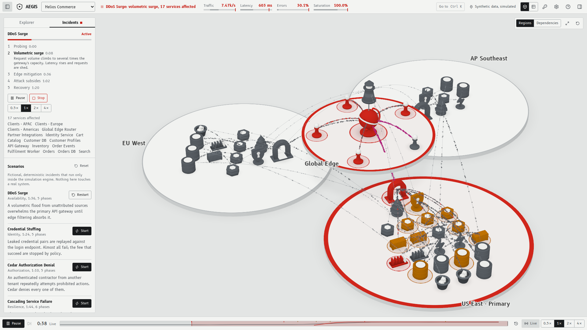
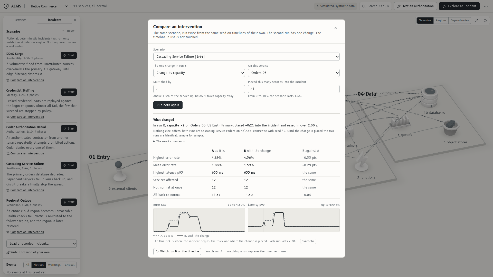

**English** · [Português](Incidentes-e-linha-do-tempo)

An incident in AEGIS is a scenario the engine runs: a file of phases, each
with the effects that hold during it and the events it announces. Because
the engine is deterministic, every moment of an incident can be revisited,
read back and run again with one change. This page shows how, from the
interface.

> On a server there is one simulation: what you start, pause or reset,
> everyone connected sees. On the static site the simulation is your tab's
> own.

## The five scenarios

They come with AEGIS (`fixtures/scenarios/*.json`) and name parts of the
platform by role (`primaryGateway`, `outageRegion`), not by id, so they run
on both bundled topologies.

| Id                    | Name                           | Length | What happens                                                                                                                    |
| --------------------- | ------------------------------ | ------ | ------------------------------------------------------------------------------------------------------------------------------- |
| `ddos-surge`          | **DDoS Surge**                 | 1:36   | A volumetric flood from unattributed sources overwhelms the primary API gateway until edge filtering absorbs it                 |
| `credential-stuffing` | **Credential Stuffing**        | 1:24   | Leaked credential pairs are replayed against the login endpoint. Almost all fail; the few that succeed are stopped by policy    |
| `cedar-denial`        | **Cedar Authorization Denial** | 1:10   | An authenticated contractor from another tenant repeatedly attempts prohibited actions, and Cedar denies every one              |
| `cascading-failure`   | **Cascading Service Failure**  | 1:44   | The primary orders database degrades. Dependent services fail, queues back up, and circuit breakers finally stop the spread     |
| `regional-outage`     | **Regional Outage**            | 1:40   | A whole region becomes unreachable. Health checks fail, traffic is re-routed to the failover region, and the region is restored |

A scenario that cannot run on the platform in use says so, with the reason:
**Cannot run: …**.

To write your own, press **Write a scenario of your own** under the list. It
opens the platform editor on the platform in use, at its **Incident** tab
beside **Platform**. The phases lie on a strip where the timeline is: drag a
phase to move its start, its grip sets the ramp, and a double click cuts it
in two. Effects are dragged from a palette onto a service, a region's lane
or a connection, and are placed by role first, so the scenario runs on any
platform that has the role. A flow is drawn by clicking the services it
passes, one after another. The engine checks the file as you write and says
where it can run; **Save the scenario** hands it over as a file, and **Run
it** imports it with the files in use and starts it. See
[Your own platform](Your-own-platform) for the editor, and
[Workspace files](Workspace-files#scenario) for the format.

## Launching an incident

Press **Explore an incident** in the bar and **Start** a scenario. The
timeline rises at the foot of the stage, the traffic the scenario injects is
one route across the model, and the rest recedes. The sentence in the bar
names the incident and blinks until you press it; beside it, the signals
that have left their normal range appear.

| Control                           | What it does                                                      |
| --------------------------------- | ----------------------------------------------------------------- |
| **Start** / **Restart**           | Starts the scenario, or starts it again while it runs             |
| **Pause** / **Resume**            | Stops or resumes virtual time                                     |
| **Stop**                          | Stops the scenario and lets the platform recover. History is kept |
| **Scenario speed**                | 0.5×, 1×, 2× or 4×                                                |
| **Compare an intervention**       | Runs the scenario twice, once with one change (see below)         |
| **Reset**, then **Erase history** | Returns to a clean baseline at 0:00                               |

While the incident runs, the bar's button reads **Follow the incident** and
brings its phases back in front.

## The event log

**Events**, under the scenarios, lists every event, newest first. **Minimum
severity** narrows it (**All**, **Notices**, **Warnings**, **Critical**).
When a fault spreads, runs of "this service changed state" fold into one
line ("12 services changed state") so the cause stays visible; press it to
unfold.

Press an event for its detail: **Severity**, **Kind**, **Simulation
clock**, **Into the incident**, **Sequence** and **Data** (its provenance).
For a change of state it also says why. **Jump to this moment** moves the
cursor to just before it.

## Two clocks

A phase is timed from the start of its incident: `+0:14`. The simulation
clock counts from 0:00, when the timeline began. An event shows both, which
differ by when the incident began. Phases that have been reached can be
selected; one not reached yet cannot.

## The timeline

The timeline is on screen while there is something on it: an incident, a
pause, a moment in history. **⋯ → Timeline and playback** brings it up at
any time.

### Where the cursor is

Simulated time is never called live. The label beside the clock says where
you are:

| Label                 | Meaning                                                         |
| --------------------- | --------------------------------------------------------------- |
| **Simulation now**    | New history is being made                                       |
| **Paused**            | Paused at the simulation's now: nothing advances until you play |
| **History**           | Inside recorded history: the past is being re-simulated exactly |
| **Paused in history** | Paused at a moment that was re-simulated exactly                |

While the cursor is in history, the bar's sentence says which moment it
speaks of: "At 1:16, in history: 51 services, all normal".

### Controls

| Control                                 | What it does                                                                              |
| --------------------------------------- | ----------------------------------------------------------------------------------------- |
| **Play** / **Pause** (<kbd>Space</kbd>) | Runs or stops virtual time                                                                |
| **Step one tick forward**               | Advances one tick (200 ms of virtual time) while paused                                   |
| The strip                               | Opens into a chart of traffic and errors with incidents marked; drag the playhead to seek |
| <kbd>←</kbd> / <kbd>→</kbd>             | Step 5 s; with <kbd>Shift</kbd>, 30 s                                                     |
| **Replay the incident**                 | Goes back to where the latest incident began and plays it again                           |
| **Now**                                 | Jumps to the simulation's now, the end of recorded history                                |
| **Playback speed**                      | 0.5×, 1×, 2× or 4×                                                                        |

Seeking restores the topology, metrics, health and incident state of that
moment exactly; the model, the signals and every card follow. Playing from
there re-simulates recorded history bit for bit and announces nothing again.

### Branching

Start a scenario, or place a fault, while the cursor is in the past and the
timeline branches: the old future is discarded and a new one is made from
there.

### Why it is exact

The engine's step is a pure function: it reads no clock and draws
randomness only from a generator kept in its state. The timeline keeps the
commands you gave (start a scenario, place a fault, evaluate a request), a
checkpoint of the whole state every 25 ticks (5 s), and the events and
samples already produced. A seek restores the nearest earlier checkpoint
and steps forward to the target. History is bounded: 30 minutes of virtual
time and 8 000 events.

## Recorded incidents

**Load a recorded incident…**, under the scenarios, loads a fictional
incident whose whole history is there at once: scrub anywhere. A recording
is only a seed and a list of commands; the engine simulates it again,
identically, every time.

| Recording                        | Length | What it holds                                                                   |
| -------------------------------- | ------ | ------------------------------------------------------------------------------- |
| **Black Friday Flood**           | 4:20   | A volumetric flood during peak trading, then a database failure that cascades   |
| **Insider Probe, Then Darkness** | 5:30   | A Cedar denial across tenants, then credential stuffing, then a regional outage |

## Why it happened

An incident can be read back from its own record. Select a phase that has
been reached, or an event, and it says what the scenario wrote for it
(**Prescribed by the scenario**), **What followed** in the model, and what
was **Observed**. The engine reads this from the run's events, samples,
topology and scenario; it simulates nothing and estimates nothing.

### Kinds of statement

Each line says what kind of statement it is. The tags are ink, not alarms.

| Tag               | Where it comes from                                                                                                                       |
| ----------------- | ----------------------------------------------------------------------------------------------------------------------------------------- |
| **Prescribed**    | Written in the scenario file: the scenario does this by itself                                                                            |
| **Modelled**      | A relation of the topology the model follows: a dependency carries failures back to its callers, added traffic flows on to what is called |
| **By hand**       | A fault placed by hand was in force on the service                                                                                        |
| **Observed**      | An event or a figure the engine recorded during the run                                                                                   |
| **Not explained** | None of the relations the report knows accounts for it, and it does not guess                                                             |

### Kinds of cause

A service that got worse is attributed to the first of these that holds, in
this order:

1. **The scenario acts on it** (`prescribed`).
2. **A fault placed by hand is in force on it** (`fault`).
3. **It receives the traffic the scenario adds at another service** (`load`).
4. **It calls a service that was already not normal**, or a queue's consumer
   that drains it was (`dependency`).
5. Otherwise **nothing the report can point to** (`unattributed`).

A cause is never chosen because it is plausible.

### The summary

**Summary so far: origin, propagation, peak** opens while the incident runs.
Afterwards the incident's entry under **On this timeline** gives the whole
of it. **Copy** takes it away as plain text.

| Section                | What it holds                                                                                             |
| ---------------------- | --------------------------------------------------------------------------------------------------------- |
| **Moments**            | The moments to go back to; press one to seek there                                                        |
| **Origin**             | The root cause the scenario names, else the first service it acts on, else the first seen to leave normal |
| **Propagation**        | The first time each service left its normal state, and why                                                |
| **Peak impact**        | **Highest error rate**, **Highest latency p95**, **Not normal at once**, **Mean error rate**              |
| **Objectives**         | How long each objective was not met                                                                       |
| **What Cedar decided** | The decisions for the requests the scenario sends, as this run recorded them                              |
| **Phases**             | Each phase, when it began, with what it prescribed and what followed                                      |
| **Recovery**           | The services coming back to normal, in order                                                              |

## Objectives

A report says how long the platform was outside its two objectives: no more
than 5% of client requests failing, and a p95 latency no more than two and a
half times its value at rest. They are the thresholds the engine's own
detection rules alert on, and the time is the incident's samples counted,
one a second. They are not a service-level agreement of anybody's.

**⋯ → Find where the platform gives** asks the platform at rest the same
question without a scenario. **Find the limit** raises every client's demand
until an objective is missed: the bundled platform holds at ×2 and gives at
×2.04. **Try every service** takes each service out in turn and ranks them by
how many others they take with them. Every figure is a run; nothing between
two runs is estimated. See
[Your own platform](Your-own-platform#where-the-platform-gives).

## Compare an intervention

**Compare an intervention** (under a scenario, or in **⋯**) runs the same
scenario twice from the same seed, on timelines of their own: run A as it
is, run B with one change. The timeline in use is not touched.

| Field                                                | Choices                                                                                                            |
| ---------------------------------------------------- | ------------------------------------------------------------------------------------------------------------------ |
| **Scenario**                                         | Any scenario that can run on the platform                                                                          |
| **The one change in run B**                          | **Change its capacity**, **Change its latency**, **Make a share of its requests fail**, **Take it out of service** |
| **On this service**                                  | Starts on the service the scenario is about                                                                        |
| **Multiplied by** / **Share that fails, in percent** | The figure of the change                                                                                           |
| **Placed this many seconds into the incident**       | From 0 to the scenario's length                                                                                    |

**Run both** answers with **What changed**, down to **The exact commands**
the runs differ by, then errors, latency, services affected and recovery
side by side, the services affected in one run only, and both runs drawn.
**Watch run B on the timeline** (or **Watch run A**) replaces the timeline in
use with that run, to scrub.

### One change at several figures

One figure is one answer. Below the form, **Or the same change at several
figures (multipliers)**, or **(percentages)** for a share that fails, takes
up to eight values of the one number, separated by commas. Multipliers start
as 0.5, 1, 1.5, 2, 3 and percentages as 5, 10, 20, 40. **Take it out of
service** has no figure, so it has no such row. **Run them all** runs each
value against the incident as it is, from the same seed, and lays them out
by **Figure**, **Highest error rate**, **Highest latency p95**, **Services
affected** and **All back to normal**, with a sentence saying at which
figure the highest error rate was lowest. In the chart a dot is a run and
the line only joins them; the dashed line is the incident as it is.

A change the form cannot make (another service, another connection, a
capacity written down) is a change to the platform's files: see
[Your own platform](Your-own-platform#an-incident-on-both-platforms).

## Try a fault before placing it

**Faults**, on a service's or a connection's card, holds it away from normal
outside any scenario.

| On           | Faults offered                                               |
| ------------ | ------------------------------------------------------------ |
| A service    | Latency ×4, 20% of requests fail, Capacity ×0.5, Unreachable |
| A connection | Network latency ×4, 20% of calls fail                        |

A fault stays until you lift it or reset the simulation. While the platform
is otherwise normal, the sentence in the bar counts the faults placed by
hand, and **Placed by hand**, in the incidents panel, lists them with **Lift
all**.

To see what a fault would do first, choose it under **Try one first,
without placing it**. The engine runs the platform at rest twice on
timelines of its own, once with the fault (placed 4 s in and held for 60 s),
and lists the services that would leave normal and when, with the highest
error rate and p95 latency against their values before. Those services are
brought forward on the model in your blue, because nothing has happened to
them. Nothing is placed on the timeline until you press **Place it**; **Put
this away** forgets the trial.

## Sessions

**⋯ → Save or share this session** lists what reproduces what is on screen:
the platform, the seed, each command with its time, the moment and the
view.

- **Save as a file** writes it, with the platform's files too when they are
  not the bundled ones.
- **Copy a link** puts it in the part of the address after `#`, which is not
  sent to any server. It is offered only for the bundled platform and for a
  link short enough to share.
- A session never states an outcome: the authorization decisions you
  evaluated by hand are left out, and the dialog says how many.

Opening a link or a file (**Choose a session file**) shows what the session
holds first, and changes nothing until you press **Open this session**.
Then the engine simulates it again: no figure travels with a session.
Opening one replaces the timeline in use.

## Routes behind this page

| Route                                                    | What it does                                                                               |
| -------------------------------------------------------- | ------------------------------------------------------------------------------------------ |
| `POST /api/v1/demo/scenarios/start` · `/reset`           | Starts a scenario, or resets the simulation                                                |
| `POST /api/v1/demo/playback/control`                     | `play`, `pause`, `step`, `seek`, `setSpeed`, `replay`, and `live` for the simulation's now |
| `POST /api/v1/demo/faults/inject` · `/clear`             | Places or lifts a fault                                                                    |
| `GET /api/v1/incidents/{id}/report`                      | One incident read back from its record                                                     |
| `POST /api/v1/demo/experiments/compare` · `/trial`       | An intervention compared, a fault tried                                                    |
| `GET /api/v1/session` · `POST /api/v1/demo/session/load` | The timeline as what reproduces it                                                         |

[HTTP API and stream](HTTP-API-and-stream) has every route.

## Reference

- [docs/DEMO.md](https://github.com/cleissonbarbosa/csdt/blob/main/docs/DEMO.md): steps 4 to 7 of the tour
- [docs/ARCHITECTURE.md](https://github.com/cleissonbarbosa/csdt/blob/main/docs/ARCHITECTURE.md): scenarios, determinism and time travel, reading a run back
- [docs/DESIGN.md](https://github.com/cleissonbarbosa/csdt/blob/main/docs/DESIGN.md): the words for time, statements, trials and objectives
- [docs/WORKSPACE.md](https://github.com/cleissonbarbosa/csdt/blob/main/docs/WORKSPACE.md): the scenario and recording formats
- [fixtures/scenarios/](https://github.com/cleissonbarbosa/csdt/tree/main/fixtures/scenarios) and [fixtures/recordings/](https://github.com/cleissonbarbosa/csdt/tree/main/fixtures/recordings): the bundled scenarios and recordings
- [apps/server/src/simulation/report.rs](https://github.com/cleissonbarbosa/csdt/blob/main/apps/server/src/simulation/report.rs): the report
- [apps/server/src/application/experiment.rs](https://github.com/cleissonbarbosa/csdt/blob/main/apps/server/src/application/experiment.rs): interventions and trials
- [apps/web/src/features/scenarios/ScenarioConsole.tsx](https://github.com/cleissonbarbosa/csdt/blob/main/apps/web/src/features/scenarios/ScenarioConsole.tsx) and [apps/web/src/features/timeline/Timeline.tsx](https://github.com/cleissonbarbosa/csdt/blob/main/apps/web/src/features/timeline/Timeline.tsx): the incidents panel and the timeline
- [apps/web/src/features/experiments/ExperimentDialog.tsx](https://github.com/cleissonbarbosa/csdt/blob/main/apps/web/src/features/experiments/ExperimentDialog.tsx): the comparison dialog
