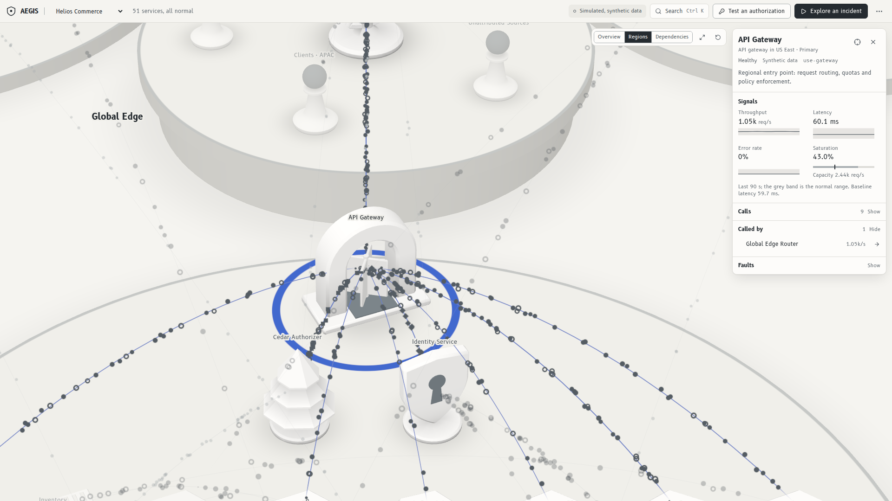
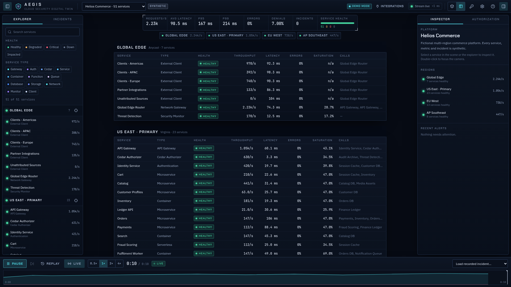

**English** · [Português](Usando-a-interface)

AEGIS is one screen: a bar along the top and a scale model of the platform
under it. This page tells you what each part of it shows and how you move
around, select, search and share. It works the same on the server and on
the static site.

## The screen at rest

At rest the screen holds the bar and the model, and nothing else. A healthy
service has no dot, badge or label, and the bar reads "51 services, all
normal". Everything else comes when it has something to say.

| In the bar                                | What it does                                                                                                                        |
| ----------------------------------------- | ----------------------------------------------------------------------------------------------------------------------------------- |
| The environment picker, at the left       | Switches the platform: **Helios Commerce** (51 services) or **Hyperscale Stress** (178 services and 648 connections in six regions) |
| The sentence                              | Says how the platform is. When something is wrong it names the incident and blinks until you press it                               |
| Instruments beside it                     | A platform signal appears here only while it is out of its normal range, most urgent first                                          |
| **Simulated, synthetic data**             | Says where the figures come from. It opens **Integrations**                                                                         |
| **Search** (<kbd>Ctrl</kbd> <kbd>K</kbd>) | Goes to any service, region, scenario or action by name                                                                             |
| **Test an authorization**                 | Opens the request tracer. See [Cedar policies](Cedar-policies)                                                                      |
| **Explore an incident**                   | Opens the incidents. While one runs it reads **Follow the incident**. See [Incidents and time travel](Incidents-and-time-travel)    |
| **⋯** (**More**)                          | Everything else, grouped by what you came to do                                                                                     |

What comes and goes:

- A card comes with a selection and leaves with it.
- The list of services, the scenarios and the request tracer come when you
  ask for them.
- The timeline is on screen only while there is something on it: an
  incident, a pause, a moment in history.

## Two levels of one model

### The overview

The application opens on the **overview**: one piece per kind of service,
twelve for the bundled platform and never more than seventeen, however many
services there are. The four plates are the layers a request crosses, in
order:

1. **Entry**: clients, the edge router, the API gateways.
2. **Identity**: authentication, the Cedar authorizers, threat detection.
3. **Compute**.
4. **Data**.

How far into the picture a piece stands is how far along the path it is. A
piece that stands for several services says how many ("3 API gateways"),
and its figures are theirs: rates added up, latency and error rate averaged
by the traffic that saw them, state as bad as its worst member. Nothing in
the overview is estimated.

### By region and by dependency tier

The two detailed arrangements draw every service on its own:

- **Regions**: a hub and its spokes. The global edge stands at the centre
  and each region is a round plate beside it.
- **Dependencies**: swimlanes. Tiers are columns from left to right, and
  each region is a lane across them.

Change the arrangement with **Topology layout** in the scene's toolbar
(**Overview**, **Regions**, **Dependencies**), with <kbd>L</kbd>, or in
**Settings**. The pieces walk to their new places. Opening a service from a
kind, a list or by name leaves the overview for the detailed arrangement you
used last. On a screen taller than it is wide, the overview is seen along
the path, so the layers stand one above another.

## Moving around the model

| Gesture                       | Effect                                                     |
| ----------------------------- | ---------------------------------------------------------- |
| Drag                          | Orbit                                                      |
| Right-drag or two-finger drag | Pan                                                        |
| Scroll or pinch               | Zoom toward the pointer                                    |
| Click                         | Inspect a service, a kind or a connection                  |
| Double-click                  | Move in on a service, or on a plate's region               |
| Point                         | Its connections turn blue: you see what it is connected to |

<kbd>R</kbd> resets the camera and <kbd>F</kbd> moves in on what is
selected. Tracing a request, or an incident among every service, takes the
camera along its path; once you take the camera yourself, it no longer moves
by itself.

## Selecting and inspecting

Select a piece and it lifts, its connections are redrawn outward in blue,
the rest of the model recedes, and a card slides in on the right.
<kbd>Esc</kbd> lets go of the selection and the card leaves with it.

### A kind of service

In the overview, a card for a kind shows its members together: throughput,
latency, error rate and the **Fullest instance**, each with its last 90
seconds against its normal range. The Cedar authorizers also show how many
checks are made and what share is denied. **Instances** lists the services
by region; **Open this service where it stands** takes you to one in the
detailed arrangement.

### A service

A service's card shows its **Signals** (throughput, latency, error rate,
saturation and its capacity), then **Calls** and **Called by**: follow a
connection to walk the dependency graph. Further down are **Exposure** (see
[Cedar policies](Cedar-policies#exposure)), **Faults** (see
[Incidents and time travel](Incidents-and-time-travel#try-a-fault-before-placing-it)),
the **Authorization decisions** made there, if any, and its **Events**.

### A connection

A connection's card says **From** and **To**, then its traffic, network
latency, error rate, rejected and suspicious shares, and **Calls per
request**. It has **Faults** of its own.

## Search and filters

- **Go to anything.** <kbd>Ctrl</kbd> <kbd>K</kbd>, or **Search** in the
  bar, opens **Go to a service or run a command**. Type the name of a
  service, a region ("Frame EU West"), a scenario ("Start DDoS Surge") or an
  action (an arrangement, a theme, the tracer). Nothing happens until you
  choose a result.
- **The list of services.** <kbd>/</kbd> opens the **Services** tab with the
  search box focused. It matches by name, type or region: type
  `database eu-west` and everything else dims in the model.
- **Filters.** **Filter** narrows the list and the model by **State**,
  **Affected by the incident** and **Kind of service**. A region's heading
  offers **Show only this region**. **Clear filters** brings everything back.

## Platform signals

Press the sentence in the bar while everything is normal, or choose **⋯ →
Platform signals**. The card holds the platform's four signals on scales
with their normal bands, what **Needs attention**, the **Regions** and the
**Platform figures**. A value takes a colour only once it leaves its band.

| Signal          | Normal band                                       |
| --------------- | ------------------------------------------------- |
| Traffic         | 60% to 140% of the oldest reading the page holds  |
| Latency p95     | Up to 1.6 times the oldest reading the page holds |
| Errors          | Up to 1%                                          |
| Peak saturation | Up to 70%, read on the fullest service            |

## Colour and shape

Colour is an answer. Blue answers you; the other hues answer the data.
Nothing normal has a hue, and nothing depends on telling two hues apart:
every state also has a shape.

| Hue     | Means                                                                      |
| ------- | -------------------------------------------------------------------------- |
| Blue    | Yours: the selection and its connections, the traced request, focus, links |
| Amber   | A deviation: degraded, throttled, rejected                                 |
| Red     | A failure, or the place where a request was stopped                        |
| Magenta | Hostile (suspicious) traffic                                               |

A service's state is told three ways: a colour, a glyph and the way its
piece's working part moves. That part runs at the pace of its traffic and
stands still when nothing passes.

| State    | Glyph    | On the model                                 |
| -------- | -------- | -------------------------------------------- |
| Healthy  | None     | Neutral piece, no mark; its part runs evenly |
| Degraded | Triangle | Amber piece and a lamp; its part hesitates   |
| Critical | Square   | Red piece and a lamp; its part is jammed     |
| Down     | Cross    | Pale piece; its part hangs crooked and still |

In the overview, a lamp under a neutral piece means some services of that
kind are affected; the piece itself takes the colour when all of them are.

Beads are requests: how many there are follows the request rate. Ordinary
traffic is told apart by shape (a disc for a request, a ring for a response,
a diamond for authentication, a square for authorization, a frame for a
queue message). Traffic that went wrong has a shape too (a bar for a
rejection, a triangle for suspicious traffic) and takes its colour only once
it amounts to something: errors above one request in a hundred, rejections
above one in ten. **⋯ → Help and legend**, or <kbd>?</kbd>, has the whole
legend.

## Tracing a request

**Test an authorization** opens the request tracer. You choose who asks for
what, Cedar decides, and a blue request travels the model to where it is
allowed or stopped. A red badge with a cross marks where it was stopped; the
red marks the end of the request you chose to follow, not a fault in the
platform. [Cedar policies](Cedar-policies) covers the tracer in full.

## The table view

<kbd>T</kbd>, or **⋯ → Table view**, shows the whole topology without 3D,
one table per region, usable with a screen reader. The filters apply to it.
A call that leaves a row's region says where it goes. When the browser can
start neither WebGPU nor WebGL 2, the application opens on the table view by
itself.

## Settings

**⋯ → Settings** holds your preferences. They are stored in this browser
only; **Restore defaults** puts them back.

| Setting                 | Choices                                                          |
| ----------------------- | ---------------------------------------------------------------- |
| **Language**            | **Browser**, English, Português (Brasil)                         |
| **Theme**               | **System**, **Light**, **Night**                                 |
| **Topology layout**     | **Overview**, **Regions**, **Dependencies**                      |
| **Rendering quality**   | **Auto**, **Low**, **Medium**, **High**, **Ultra**               |
| **Graphics backend**    | **WebGPU (auto)**, WebGL 2 (changing it restarts the scene)      |
| **Labels**              | Service and region names in the model                            |
| **Idle camera drift**   | Turns the model slowly until you move the camera; off by default |
| **Motion**              | **System**, **Reduced**, **Full**                                |
| **Performance overlay** | Frame rate, frame time, draw calls, bead count and backend       |

- **Themes.** Light is for a lit room, night for a dark one. The rules do
  not change: in either theme a colour is an answer.
- **Language.** The interface speaks English and Brazilian Portuguese. By
  default it follows the browser's first language. Changing the setting
  reloads the page: on the static site that starts the simulation in the tab
  again, on a server the simulation goes on as it is. Names, scenarios and
  events are shown as their file or the engine wrote them.
- **Reduced motion** stops camera animation, the working parts of the
  pieces, the blink of a new alarm and interface transitions.

## Keyboard

| Key                          | Action                                                     |
| ---------------------------- | ---------------------------------------------------------- |
| <kbd>Space</kbd>             | Play or pause the simulation                               |
| <kbd>R</kbd>                 | Reset the camera                                           |
| <kbd>F</kbd>                 | Move in on what is selected                                |
| <kbd>Esc</kbd>               | Let go of the selection, then put the panels away          |
| <kbd>Ctrl</kbd> <kbd>K</kbd> | Go to anything: a service, a region, a scenario, an action |
| <kbd>/</kbd>                 | Search services                                            |
| <kbd>L</kbd>                 | Next arrangement: overview, by region, by dependency       |
| <kbd>T</kbd>                 | Switch between the 3D view and the table                   |
| <kbd>P</kbd>                 | Toggle the performance overlay                             |
| <kbd>?</kbd>                 | Open the help and legend                                   |
| <kbd>←</kbd> / <kbd>→</kbd>  | On the timeline: step 5 s (hold <kbd>Shift</kbd> for 30 s) |

While an incident capture is open, the keys move its own clock; see
[Incident captures](Incident-captures).

## Links and the address

The address follows what you look at, so the address bar is always a link
to the view. Opening such a link changes nothing on the server: it only
looks at the same place.

| In the address    | What it does                                                                                         |
| ----------------- | ---------------------------------------------------------------------------------------------------- |
| `arrangement=`    | `layers` (the overview), `regions` or `dependencies`; written only when it is not the overview       |
| `view=table`      | The table view in place of the model                                                                 |
| `select=`         | The selection: `node:<id>`, `edge:<id>` or `group:<id>`                                              |
| `?challenge=<id>` | Opens the guide with that challenge offered first. It does not start it                              |
| `?embed=1`        | The model without the bar, with one line that says what this is and opens the whole application      |
| `&scenario=<id>`  | With `embed=1`, on the static site only: starts that incident. On a server an address starts nothing |
| `?capture=<id>`   | Opens a bundled incident capture: `google-cloud-2025-06-12` or `online-boutique-rcaeval`             |
| `#session=…`      | A whole session, written by **Copy a link**                                                          |

An embed reads no `capture` parameter. A whole experiment (the commands, the
seed, the moment) travels as a session: see
[Incidents and time travel](Incidents-and-time-travel#sessions).

## Guided challenges

**⋯ → Guided challenges** asks six questions about the platform, answered by
using it. Your answer is checked against the model itself: the record of the
incident, or Cedar's own decision. So is the hint a wrong answer gets.

| Id                   | Challenge                                | Starts                                                               |
| -------------------- | ---------------------------------------- | -------------------------------------------------------------------- |
| `cascade-origin`     | **Find where the cascade begins**        | Cascading Service Failure, from a clean simulation                   |
| `flood-stopped`      | **Find where the flood is stopped**      | DDoS Surge, from a clean simulation                                  |
| `region-dark`        | **Find the region that went dark**       | Regional Outage, from a clean simulation                             |
| `contractor-stopped` | **Find where the contractor is stopped** | Cedar Authorization Denial, from a clean simulation                  |
| `export-denied`      | **Explain why this export was denied**   | The request tracer with the request; the simulation is left as it is |
| `deletion-denied`    | **Find when a customer may be deleted**  | The request tracer with the request; the simulation is left as it is |

The card counts the ones you have solved, in your browser and nowhere else.
**Copy a link to this challenge** gives an address with `?challenge=<id>`.

## The first visit

The first time you open AEGIS, a card at the foot of the stage says what
this is and offers three ways in: **Understand the platform**, **Investigate
a failure** and **Test an authorization**, plus a guided challenge. Taking
one or dismissing the card is remembered in your browser, and it does not
come back. Everything it offers stays in the bar and its menu.

## Reference

- [docs/DEMO.md](https://github.com/cleissonbarbosa/csdt/blob/main/docs/DEMO.md): the five-minute tour
- [docs/DESIGN.md](https://github.com/cleissonbarbosa/csdt/blob/main/docs/DESIGN.md): the rules, the arrangement and the words
- [docs/ARCHITECTURE.md](https://github.com/cleissonbarbosa/csdt/blob/main/docs/ARCHITECTURE.md): the web client
- [README.md](https://github.com/cleissonbarbosa/csdt/blob/main/README.md): the features
- [apps/web/src/features/topnav/TopNav.tsx](https://github.com/cleissonbarbosa/csdt/blob/main/apps/web/src/features/topnav/TopNav.tsx): the bar and its menu
- [apps/web/src/features/help/HelpDialog.tsx](https://github.com/cleissonbarbosa/csdt/blob/main/apps/web/src/features/help/HelpDialog.tsx): the legend and the keys
- [apps/web/src/features/hud/Hud.tsx](https://github.com/cleissonbarbosa/csdt/blob/main/apps/web/src/features/hud/Hud.tsx): the platform signals and their bands
- [apps/web/src/features/settings/SettingsDialog.tsx](https://github.com/cleissonbarbosa/csdt/blob/main/apps/web/src/features/settings/SettingsDialog.tsx): the settings
- [apps/web/src/features/guide/challenges.ts](https://github.com/cleissonbarbosa/csdt/blob/main/apps/web/src/features/guide/challenges.ts): the guided challenges
- [apps/web/src/app/urlState.ts](https://github.com/cleissonbarbosa/csdt/blob/main/apps/web/src/app/urlState.ts), [apps/web/src/app/embed.ts](https://github.com/cleissonbarbosa/csdt/blob/main/apps/web/src/app/embed.ts) and [apps/web/src/app/captureUrl.ts](https://github.com/cleissonbarbosa/csdt/blob/main/apps/web/src/app/captureUrl.ts): the address
