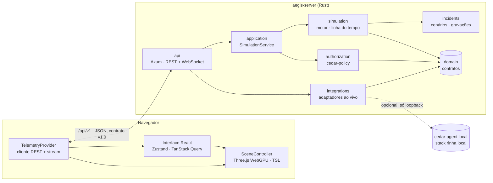
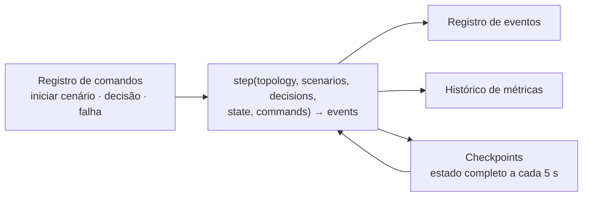

[English](Architecture) · **Português**

O AEGIS é formado por dois programas e pelo contrato entre eles, além de uma
versão do mesmo motor para o navegador. Esta página mostra como as partes se
encaixam e quais regras mantêm honesto o que elas mostram. A referência
completa é o
[`docs/ARCHITECTURE.md`](https://github.com/cleissonbarbosa/csdt/blob/main/docs/ARCHITECTURE.md)
(em inglês).

## Visão geral

| Parte                | O que é                                                                                                                            |
| -------------------- | ---------------------------------------------------------------------------------------------------------------------------------- |
| `apps/server`        | Um serviço em Rust (crate `aegis-server`) que mantém uma simulação determinística, avalia políticas Cedar e transmite a telemetria |
| `apps/web`           | Um cliente React que desenha essa telemetria como uma cena 3D (Three.js, WebGPU ou WebGL 2), com uma interface em volta            |
| `packages/contracts` | O contrato JSON versionado entre os dois, como esquemas zod conferidos contra a saída real do servidor                             |
| `apps/wasm`          | A biblioteca do servidor compilada para WebAssembly, para que o cliente rode como site estático, sem servidor                      |



## O servidor

### Camadas

As dependências apontam para dentro: `api → application → simulation /
authorization → domain`.

| Módulo          | Responsabilidade                                                                                                                                                                                                                                                                           |
| --------------- | ------------------------------------------------------------------------------------------------------------------------------------------------------------------------------------------------------------------------------------------------------------------------------------------ |
| `domain`        | Os tipos versionados do contrato (serde, JSON em camelCase), `SCHEMA_VERSION` e o enum de procedência `DataSource`. Sem E/S                                                                                                                                                                |
| `simulation`    | `model` compila uma topologia (um DAG) e propaga carga e experiência a cada tick; `engine::step` é a função de passo pura; `timeline` acrescenta o registro de comandos, checkpoints, busca, reprodução e ramificação; `decisions` guarda as decisões do Cedar; `report` relê um incidente |
| `incidents`     | Cenários como dados: o formato de arquivo (`spec.rs`), os cinco cenários embutidos e as gravações (uma semente mais uma lista de comandos)                                                                                                                                                 |
| `authorization` | O ponto de decisão `cedar-policy` embutido                                                                                                                                                                                                                                                 |
| `integrations`  | Adaptadores opcionais para instâncias locais; todo destino de saída passa por `guard.rs`                                                                                                                                                                                                   |
| `workspace`     | Separa os arquivos de um operador nas partes de um espaço de trabalho e confere cada uma; lê um arquivo Compose ou um inventário de nuvem como topologia                                                                                                                                   |
| `application`   | `Sources` (de onde tudo é construído), `Assets` (tudo o que é imutável, construído uma vez) e `SimulationService`, dono da única linha do tempo mutável                                                                                                                                    |
| `api`           | Rotas Axum sob `/api/v1` e o WebSocket `/stream`: validação, limites e mapeamento de erros                                                                                                                                                                                                 |

`simulation` e `incidents` não fazem nenhuma E/S. O único acesso a arquivos
no servidor é o `workspace::load`, que lê uma vez o diretório indicado por
`AEGIS_WORKSPACE`, antes de o servidor começar a escutar. Uma importação pela
interface passa por `workspace::from_files`, que recebe arquivos já em memória
e não toca em nada. Veja [Sua própria plataforma](Sua-própria-plataforma).

### Uma linha do tempo atrás de uma trava

O `SimulationService` mantém a única linha do tempo mutável atrás de um mutex.
Ele é o único lugar que a avança, a partir de um agendador que acorda a cada
50 ms, e distribui as mensagens por um canal de broadcast limitado, cada uma
serializada uma só vez para todos os assinantes. Uma importação troca a
plataforma e a linha do tempo juntas, sob a mesma trava; um reset devolve o
conjunto da inicialização.

`build_state(config)`, em `lib.rs`, monta a aplicação sem iniciar o agendador.
Os testes de integração constroem o estado assim, chamam o roteador no próprio
processo e avançam o tempo eles mesmos.

## Determinismo e tempo



`engine::step` é uma função pura. Ela nunca lê um relógio, nunca usa um
contador global, nunca percorre uma coleção sem ordem e só tira aleatoriedade
do gerador guardado no estado da simulação. Tudo o que muda com o tempo fica
nesse estado, e por isso um checkpoint o captura. O histórico é, portanto,
derivável: a linha do tempo guarda o registro de comandos (a única entrada que
não pode ser derivada), checkpoints periódicos e os eventos e amostras já
produzidos.

| Grandeza                | Valor                                                 | Constante                                        |
| ----------------------- | ----------------------------------------------------- | ------------------------------------------------ |
| Um tick                 | 200 ms de tempo virtual                               | `TICK_MS` (`simulation/model.rs`)                |
| Um checkpoint           | a cada 25 ticks (5 segundos virtuais)                 | `CHECKPOINT_INTERVAL` (`simulation/timeline.rs`) |
| Uma amostra de métricas | a cada 5 ticks (1 segundo virtual)                    | `METRIC_INTERVAL`                                |
| Histórico navegável     | 9 000 ticks (30 minutos virtuais)                     | `MAX_HISTORY_TICKS`                              |
| Eventos guardados       | no máximo 8 000                                       | `MAX_EVENTS`                                     |
| Agendador               | a cada 50 ms de tempo real, no máximo 8 ticks por vez | `SCHEDULER_PERIOD` (`application/service.rs`)    |
| Velocidades             | 0,5, 1, 2 e 4                                         | `PLAYBACK_SPEEDS` (`domain/playback.rs`)         |

- **Buscar** restaura o checkpoint anterior mais próximo e avança passo a
  passo até o alvo.
- **Rever** continua avançando dali. Reproduz o histórico gravado exatamente
  e não anuncia nada de novo.
- **Ramificar**: um comando dado no passado descarta o futuro além do cursor,
  e a simulação segue a partir daquele ponto.
- **Uma gravação** é uma semente mais uma lista de comandos; carregá-la a
  simula de novo. Uma sessão (`GET /session`) é a linha do tempo em uso
  escrita na mesma forma.

Os testes comparam digests do estado bit a bit depois de buscas arbitrárias.
Os números de ponto flutuante são lidos exatamente (`serde_json` com
`float_roundtrip`), então uma topologia escrita e lida de volta tem os mesmos
bits. [Incidentes e linha do tempo](Incidentes-e-linha-do-tempo) mostra tudo
isso pela interface.

**Um relatório não inventa nada.** `simulation/report.rs` relê um incidente a
partir dos seus eventos, das suas amostras de métricas, da topologia e do
cenário resolvido. Não avança a simulação nem estima nada, e cada causa que
aponta diz de que tipo é: `prescribed`, `dependency`, `load`, `fault` ou
`unattributed`.

## Decisões do Cedar são consultadas, nunca inventadas

Na inicialização, cada formato de requisição que a simulação vai mostrar é
avaliado uma vez pelo `cedar-policy`, contra as políticas e entidades em uso
(`DecisionTable::build`). O motor só consulta os resultados, o que o mantém
puro enquanto toda decisão continua genuína:

- a taxa de negação de referência é a parcela negada da mistura avaliada;
- um fluxo de cenário é barrado no autorizador se, e somente se, o Cedar negou
  a sua requisição, e os seus eventos levam os ids das políticas que o Cedar
  apontou como determinantes.

Um novo formato de requisição entra em `fixtures/cedar/catalog.json`. Nenhum
arquivo pode afirmar uma decisão: um cenário não pode conter os tipos de
evento, nem uma gravação ou sessão o comando, que poriam uma decisão na linha
do tempo. Veja [Políticas Cedar](Políticas-Cedar).

## Perguntas que não registram nada

Algumas rotas fazem uma pergunta ao modelo e não põem nada na linha do tempo
em uso: nenhum comando, nenhum evento, nenhuma decisão. A comparação de uma
intervenção, um experimento, os limites (`headroom`, `weak-points`), a
comparação de plataformas e a prévia de arquivos rodam cada um em linhas do
tempo próprias, a partir da semente do servidor. `explain` e `matrix` vão direto ao
Cedar. Todas são limitadas (`MATRIX_LIMIT`, `MAX_DISABLED_POLICIES`,
`TRIAL_MS`, os limites de uma importação, `LEAD_IN_MS`, `HEADROOM_LADDER`,
`HEADROOM_REFINEMENTS`, `WEAK_POINTS_MAX`), e todas menos `explain` rodam fora
dos workers assíncronos, para não atrasar outras requisições.

## O motor no navegador

`apps/wasm` (crate `aegis-wasm`) é uma camada fina em volta da biblioteca do
servidor, compilada para `wasm32-unknown-unknown`. Ela serve o
`api::offline_router`: a mesma tabela de rotas, o mesmo `SimulationService` e
o mesmo motor Cedar. Não decide nada sobre a simulação nem sobre uma resposta;
só leva texto através da fronteira. Fica de fora apenas o que precisa de um
sistema operacional: o socket, a tarefa do agendador, o limite de taxa, o
cliente HTTP e os dois adaptadores ao vivo.

Nessa compilação, `std::time::Instant::now()` compila e depois entra em pânico
na aba, por isso o código compartilhado pega o tempo de `crate::clock::Instant`
e deixa o que precisa do sistema operacional atrás de
`#[cfg(not(target_arch = "wasm32"))]`.

### A fronteira

- O módulo não importa nada do ambiente que o hospeda; um teste lê a seção de
  importações do arquivo compilado. Não há `wasm-bindgen` nem bloco `unsafe`:
  a página escreve num buffer do módulo e lê de outro.
- Tudo o que atravessa são linhas de UTF-8: `METHOD path` e um corpo JSON na
  entrada; o status, o corpo e as mensagens do stream na saída.
- A página confere o `ABI_VERSION` (`apps/web/src/engine/binding.ts`); uma
  mudança na fronteira o altera dos dois lados.
- O tempo real é um argumento de cada chamada. O worker da página chama
  `aegis_advance` a cada 50 ms, e uma chamada avança no máximo um segundo, para
  que uma aba que dormiu não dispare ao acordar.

| Função                              | O que faz                                                                            |
| ----------------------------------- | ------------------------------------------------------------------------------------ |
| `aegis_abi`                         | A versão da fronteira                                                                |
| `aegis_period_ms`                   | De quanto em quanto tempo chamar `aegis_advance`: o período do agendador do servidor |
| `aegis_input(len)`                  | Reserva o buffer de entrada; 0 quando é mais do que qualquer chamada pode levar      |
| `aegis_output`                      | Onde está a saída da última chamada                                                  |
| `aegis_boot(seed, now_ms)`          | Inicia o motor; a saída é `ok` ou o motivo de não ter iniciado                       |
| `aegis_request(len, now_ms)`        | Responde a uma requisição: status, corpo e mensagens do stream, uma por linha        |
| `aegis_advance(elapsed_ms, now_ms)` | Avança a simulação; a saída são as mensagens do stream que isso produziu             |
| `aegis_open(now_ms)`                | Abre o stream: a saudação e um snapshot                                              |
| `aegis_message(len, now_ms)`        | Responde ao `ping` ou `resync` de um assinante                                       |
| `aegis_panic`, `aegis_panic_len`    | A mensagem do pânico que parou o módulo, se houve um                                 |

### Servidor e navegador comparados

|                    | Servidor                                    | No navegador                                                |
| ------------------ | ------------------------------------------- | ----------------------------------------------------------- |
| Uma requisição     | HTTP para `/api/v1`                         | Uma chamada de função no módulo, mesmo caminho e corpo      |
| O stream           | WebSocket                                   | O que cada chamada devolve, entregue como eventos de socket |
| Tempo              | Uma tarefa de 50 ms e o sistema operacional | O timer do worker; o relógio é um argumento                 |
| Simulação          | Uma, compartilhada por quem estiver vendo   | Uma por aba, perdida ao recarregar                          |
| Cedar              | Embutido, ou um `cedar-agent` conectado     | Embutido                                                    |
| Tempo de avaliação | Medido                                      | Não medido, e mostrado como tal                             |
| Espaço de trabalho | Diretório da inicialização, ou importação   | Importação, mantida na aba                                  |

## O contrato

O módulo `domain`, em Rust, é a fonte da verdade.
`packages/contracts/src/index.ts` o espelha como esquemas zod (versão do
contrato `1.0`, versão do protocolo do stream `1`) e exporta a interface
`TelemetryProvider`. O pacote é consumido como código TypeScript e não gera
saída de build.

`packages/contracts/samples/` guarda saída real do servidor, escrita pelo
binário `export-contract-samples` enquanto ele conduz o roteador de verdade
por um cenário fixo. Os testes de contrato leem cada amostra e exigem que o
valor lido seja igual à entrada, então um desvio falha nas duas direções, e a
CI falha se as amostras commitadas diferirem do que o servidor emite. O
`pnpm test:engine` cobra o mesmo do módulo WebAssembly compilado. Depois de
mudar um tipo do domínio, a resposta de uma rota ou um fixture:

```bash
pnpm contracts:samples    # then update src/index.ts to match and commit both
```

## O cliente web

### Fluxo de dados

O `DemoSimulationProvider` (o cliente REST em `providers/api.ts` e o
`StreamClient`, que se reconecta sozinho) alimenta `app/useAegisConnection.ts`,
que alimenta as stores Zustand (`stores/telemetry.ts`, e `stores/ui.ts` com as
configurações persistidas), que alimentam as funcionalidades e a cena. O
TanStack Query guarda os dados de requisição e resposta (cenários, provedores,
o catálogo de políticas) e é invalidado por eventos do stream. Toda resposta
REST e toda mensagem do stream passa pelos esquemas compartilhados antes de
ser usada.

### Dois transportes

Para onde as requisições vão é decidido quando o cliente é compilado. O import
`@transport` aponta para `providers/serverTransport.ts` (`fetch` e um
WebSocket) ou, com `--mode static`, para `engine/transport.ts`, que responde
com um `Response` de verdade e um objeto com formato de socket alimentado pelo
worker do motor (`engine/worker.ts` guarda o módulo, `engine/binding.ts`
conhece a fronteira, `engine/client.ts` casa respostas com requisições). Nada
acima de `providers/transport.ts` sabe qual dos dois tem. O build estático
escreve a sua Content-Security-Policy na própria página, e nenhum código pode
avaliar uma string.

### Renderização

O React Three Fiber cuida do canvas, do tamanho, da densidade de pixels e do
laço de quadros. Um único `SceneController` imperativo
(`graphics/SceneController.ts`) é dono de tudo o que é desenhado ali dentro e é
alimentado por assinaturas das stores, montadas em
`features/scene/SceneCanvas.tsx`; assim a telemetria nunca re-renderiza um
componente React no caminho de um quadro.

- **Só TSL.** Os materiais são escritos em TSL (`three/webgpu`, `three/tsl`),
  que compila para WGSL no WebGPU e para GLSL ES 3.0 no WebGL 2. Nada usa
  compute shaders nem storage buffers, então o WebGL 2 é o mesmo código em
  outro backend. Sem nenhuma das duas APIs, a aplicação mostra a visualização
  em tabela.
- **Uma passada.** Os materiais fazem o próprio sombreamento sob uma luz fixa;
  não há pós-processamento. A câmera tem uma lente de 14°.
- **As peças são um asset compilado.** `apps/web/scripts/build-pieces.py`
  modela cada tipo de serviço no Blender e escreve `graphics/pieces.glb`, lido
  por um pequeno parser em `graphics/pieces.ts`. A parte que trabalha em cada
  peça é um mecanismo (girar, indexar, balançar, deslizar ou transportar)
  movido no vertex shader.
- **As contas não têm estado.** A CPU atualiza uma pequena textura de dados
  por conexão; posição, forma e cor são derivadas no vertex shader.

As chamadas de desenho seguem classes de objetos, não a quantidade de
objetos: 28 para 51 serviços, 34 para 178. Um teste ponta a ponta falha se
trocar para a topologia de 178 serviços acrescentar mais de seis.

| O quê          | Como é desenhado                                                                  |
| -------------- | --------------------------------------------------------------------------------- |
| Peças          | Uma malha instanciada por tipo de serviço                                         |
| Marcas no chão | Uma malha instanciada: sombra de contato, lâmpada de estado, anel de seleção      |
| Conexões       | Uma malha instanciada de traços finos voltados para a câmera, em curvas de Bézier |
| Tráfego        | Uma malha instanciada de sprites sem estado (as contas)                           |
| Nomes          | Fora da cena: um canvas 2D por cima dela, na resolução da tela                    |
| Placas         | Uma malha por região, mais a sombra que ela projeta                               |

Os **nomes** são desenhados por `graphics/labelLayer.ts` num canvas próprio,
sobreposto à cena na resolução da tela, qualquer que seja a da cena.
`graphics/labelPlacement.ts` (puro e testado) deixa de fora um nome que
ficaria por cima de outro mais importante, ou que não caberia inteiro na parte
livre do palco; só o nome selecionado e o apontado são desenhados de qualquer
jeito. Um teste ponta a ponta lê `window.__aegis.labels()` e falha se houver
sobreposição.

### Dois níveis de um mesmo modelo

A aplicação abre na visão geral (`layoutMode: 'layers'`): uma peça por tipo de
serviço, nas quatro camadas que uma requisição atravessa. `lib/overview.ts` a
deriva como um `Topology` de verdade, com snapshots colunares, como função
pura da topologia e do snapshot do servidor; cada número é somado ou
ponderado pelo tráfego dos serviços que a peça representa. As disposições
detalhadas (`regions`, `dependencies`) desenham a topologia do servidor como
ela é. O `SceneController` desenha a topologia que receber, e a ponte em
`SceneCanvas.tsx` traduz os ids entre os dois níveis. `graphics/layout.ts` é
uma função pura da topologia, sem aleatoriedade e sem iterar até convergir.

Uma [captura de incidente](Capturas-de-incidente) e o editor de plataforma são
modos da mesma interface e passam pela mesma ponte da cena; uma captura nunca
chega ao servidor nem à linha do tempo da simulação.

## Estrutura do repositório

```text
apps/
  server/src/
    domain/          versioned data contracts and ports; no I/O
    simulation/      model, channels, engine (pure step), timeline, rng
    incidents/       declarative scenarios and prerecorded incidents
    authorization/   embedded Cedar policy decision point
    integrations/    live adapters, target guard
    application/     use cases; owns the single mutable timeline
    workspace.rs     reads an operator's own files from a directory at start-up
    workspace/       a Compose file and a cloud inventory, each read as a topology
    api/             Axum routes, WebSocket, rate limiting, errors
  wasm/src/          the same routes and service as a WebAssembly module
  web/src/
    graphics/        layout, modelled pieces, TSL materials, SceneController
    features/        scene, explorer, inspector, timeline, scenarios, capture, …
    stores/          telemetry, interface state, persisted settings, capture
    providers/       REST client, stream client, TelemetryProvider
    engine/          the module's binding, its worker and the transport to it
    components/ui/   buttons, badges, dialog, fields, sparkline
packages/contracts/  zod schemas + samples exported by the server
fixtures/            the bundled topology, scenarios, recordings and Cedar
                     files, laid out as a workspace
schemas/v1/          JSON Schemas of the file formats, generated from the Rust types
examples/            a small workspace to copy from
scripts/             screenshots, benchmarks, the version, the incident capture scripts
```

As rotas estão em [API HTTP e stream](API-HTTP-e-stream), e os motivos da
aparência da cena em [Princípios de design](Princípios-de-design).

## Referência

Os documentos e arquivos abaixo estão em inglês.

- [`docs/ARCHITECTURE.md`](https://github.com/cleissonbarbosa/csdt/blob/main/docs/ARCHITECTURE.md): modelo, API, protocolo do stream, renderização
- [`AGENTS.md`](https://github.com/cleissonbarbosa/csdt/blob/main/AGENTS.md): "Architecture", o que é fácil de quebrar
- [`apps/server/src/lib.rs`](https://github.com/cleissonbarbosa/csdt/blob/main/apps/server/src/lib.rs),
  [`simulation/engine.rs`](https://github.com/cleissonbarbosa/csdt/blob/main/apps/server/src/simulation/engine.rs),
  [`simulation/timeline.rs`](https://github.com/cleissonbarbosa/csdt/blob/main/apps/server/src/simulation/timeline.rs),
  [`simulation/decisions.rs`](https://github.com/cleissonbarbosa/csdt/blob/main/apps/server/src/simulation/decisions.rs),
  [`application/service.rs`](https://github.com/cleissonbarbosa/csdt/blob/main/apps/server/src/application/service.rs)
- [`apps/wasm/src/lib.rs`](https://github.com/cleissonbarbosa/csdt/blob/main/apps/wasm/src/lib.rs): o motor para o navegador e a sua fronteira
- [`packages/contracts/src/index.ts`](https://github.com/cleissonbarbosa/csdt/blob/main/packages/contracts/src/index.ts)
  e [`packages/contracts/samples/`](https://github.com/cleissonbarbosa/csdt/tree/main/packages/contracts/samples)
- [`apps/web/src/providers/transport.ts`](https://github.com/cleissonbarbosa/csdt/blob/main/apps/web/src/providers/transport.ts),
  [`graphics/SceneController.ts`](https://github.com/cleissonbarbosa/csdt/blob/main/apps/web/src/graphics/SceneController.ts),
  [`features/scene/SceneCanvas.tsx`](https://github.com/cleissonbarbosa/csdt/blob/main/apps/web/src/features/scene/SceneCanvas.tsx),
  [`lib/overview.ts`](https://github.com/cleissonbarbosa/csdt/blob/main/apps/web/src/lib/overview.ts)
