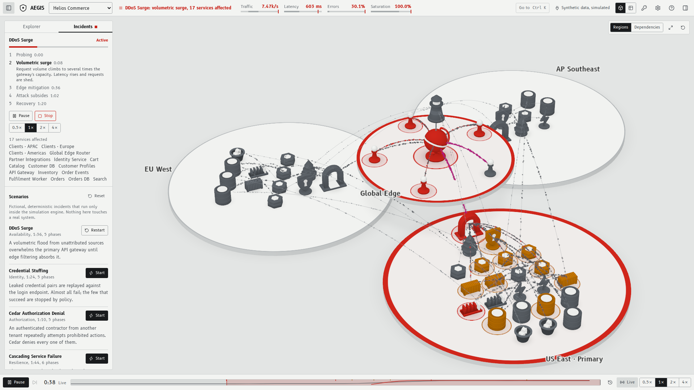
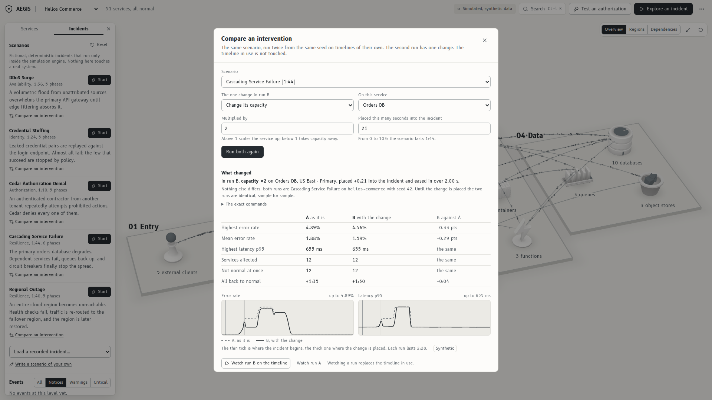

[English](Incidents-and-time-travel) · **Português**

Um incidente no AEGIS é um cenário que o motor executa: um arquivo de fases,
cada uma com os efeitos que valem durante ela e os eventos que anuncia. Como
o motor é determinístico, todo momento de um incidente pode ser revisitado,
lido de volta e executado de novo com uma mudança. Esta página mostra como,
pela interface.

> Num servidor há uma simulação só: o que você inicia, pausa ou reinicia,
> todos os conectados veem. No site estático, a simulação é só da sua aba.

## Os cinco cenários

Eles vêm com o AEGIS (`fixtures/scenarios/*.json`) e nomeiam partes da
plataforma por função (`primaryGateway`, `outageRegion`), não por id, então
rodam nas duas topologias que acompanham o projeto. Os nomes aparecem como o
arquivo os escreveu.

| Id                    | Nome                           | Duração | O que acontece                                                                                                                                            |
| --------------------- | ------------------------------ | ------- | --------------------------------------------------------------------------------------------------------------------------------------------------------- |
| `ddos-surge`          | **DDoS Surge**                 | 1:36    | Uma inundação volumétrica de origens não identificadas sobrecarrega o gateway de API principal até a filtragem na borda absorvê-la                        |
| `credential-stuffing` | **Credential Stuffing**        | 1:24    | Pares de credenciais vazadas são reenviados ao endpoint de login. Quase todos falham; os poucos que funcionam são barrados por política                   |
| `cedar-denial`        | **Cedar Authorization Denial** | 1:10    | Um terceirizado autenticado de outro locatário tenta ações proibidas várias vezes, e o Cedar nega todas                                                   |
| `cascading-failure`   | **Cascading Service Failure**  | 1:44    | O banco de dados principal de pedidos se degrada. Os serviços que dependem dele falham, as filas acumulam e os circuit breakers enfim contêm a propagação |
| `regional-outage`     | **Regional Outage**            | 1:40    | Uma região inteira fica inacessível. As verificações de saúde falham, o tráfego é desviado para a região de failover e a região é restaurada              |

Um cenário que não pode rodar na plataforma em uso avisa, com o motivo:
**Não pode ser executado: …**.

Para escrever o seu, clique em **Escrever o seu próprio cenário**, abaixo da
lista. Isso abre o editor de plataforma na plataforma em uso, na aba
**Incidente**, ao lado de **Plataforma**. As fases ficam numa faixa no lugar
da linha do tempo: arraste uma fase para mudar o início, a alça dela define a
rampa, e um clique duplo a divide em duas. Os efeitos são arrastados de uma
paleta para um serviço, para a raia de uma região ou para uma conexão, e são
aplicados por função primeiro, para que o cenário rode em qualquer
plataforma que tenha a função. Um fluxo é desenhado clicando nos serviços por
onde ele passa, um depois do outro. O motor confere o arquivo enquanto você
escreve e diz onde ele pode rodar; **Salvar o cenário** entrega o arquivo, e
**Executar** o importa com os arquivos em uso e o inicia. Veja
[Sua própria plataforma](Sua-própria-plataforma) para o editor e
[Arquivos do espaço de trabalho](Arquivos-do-espaço-de-trabalho#cenário) para
o formato.

## Iniciando um incidente

Clique em **Explorar um incidente** na barra e em **Iniciar** num cenário. A
linha do tempo sobe ao pé do palco, o tráfego que o cenário injeta vira uma
rota pelo modelo, e o resto recua. A frase da barra nomeia o incidente e
pisca até você clicar nela; ao lado, aparecem os sinais que saíram da faixa
normal.

| Controle                                     | O que faz                                                               |
| -------------------------------------------- | ----------------------------------------------------------------------- |
| **Iniciar** / **Recomeçar**                  | Inicia o cenário, ou o inicia de novo enquanto ele roda                 |
| **Pausar** / **Continuar**                   | Para ou retoma o tempo virtual                                          |
| **Parar**                                    | Para o cenário e deixa a plataforma se recuperar. O histórico é mantido |
| **Velocidade do cenário**                    | 0.5×, 1×, 2× ou 4×                                                      |
| **Comparar uma intervenção**                 | Executa o cenário duas vezes, uma delas com uma mudança (veja abaixo)   |
| **Reiniciar**, depois **Apagar o histórico** | Volta ao estado inicial em 0:00                                         |

Enquanto o incidente roda, o botão da barra vira **Acompanhar o incidente** e
traz as fases dele de volta para a frente.

## O registro de eventos

**Eventos**, abaixo dos cenários, lista todos os eventos, do mais recente ao
mais antigo. **Gravidade mínima** filtra a lista (**Todos**, **Avisos**,
**Atenção**, **Crítico**). Quando uma falha se espalha, as sequências de "este
serviço mudou de estado" se juntam numa linha só ("12 serviços mudaram de
estado"), para a causa continuar visível; clique nela para abrir.

Clique num evento para ver os detalhes: **Gravidade**, **Tipo**, **Relógio da
simulação**, **Desde o início do incidente**, **Sequência** e **Dados** (a
procedência). Numa mudança de estado, ele também diz o porquê. **Ir para este
momento** leva o cursor para logo antes dele.

## Dois relógios

Uma fase é contada a partir do início do seu incidente: `+0:14`. O relógio da
simulação conta a partir de 0:00, quando a linha do tempo começou. Um evento
mostra os dois, que diferem pelo momento em que o incidente começou. As fases
já alcançadas podem ser selecionadas; uma que ainda não começou, não.

## A linha do tempo

A linha do tempo fica na tela enquanto há algo nela: um incidente, uma
pausa, um momento do histórico. **⋯ → Linha do tempo e reprodução** a mostra
a qualquer momento.

### Onde o cursor está

O tempo simulado nunca é chamado de "ao vivo". O rótulo ao lado do relógio
diz onde você está:

| Rótulo                   | Significado                                                                    |
| ------------------------ | ------------------------------------------------------------------------------ |
| **Agora da simulação**   | Histórico novo está sendo feito                                                |
| **Pausado**              | Pausado no agora da simulação: nada avança até você reproduzir                 |
| **Histórico**            | Dentro do histórico gravado: o passado está sendo simulado de novo, exatamente |
| **Pausado no histórico** | Pausado num momento que a simulação recriou com exatidão                       |

Enquanto o cursor está no histórico, a frase da barra diz de que momento ela
fala: "Em 1:16, no histórico: 51 serviços, todos normais".

### Controles

| Controle                                        | O que faz                                                                                                |
| ----------------------------------------------- | -------------------------------------------------------------------------------------------------------- |
| **Reproduzir** / **Pausar** (<kbd>Espaço</kbd>) | Faz o tempo virtual andar ou parar                                                                       |
| **Avançar um passo da simulação**               | Avança um tick (200 ms de tempo virtual) com a reprodução pausada                                        |
| A faixa                                         | Abre num gráfico de tráfego e erros com os incidentes marcados; arraste o indicador para ir a um momento |
| <kbd>←</kbd> / <kbd>→</kbd>                     | Move 5 s; com <kbd>Shift</kbd>, 30 s                                                                     |
| **Rever o incidente**                           | Volta ao início do incidente mais recente e o reproduz de novo                                           |
| **Agora**                                       | Vai para o agora da simulação, o fim do histórico gravado                                                |
| **Velocidade de reprodução**                    | 0.5×, 1×, 2× ou 4×                                                                                       |

Ir a um momento restaura exatamente a topologia, as métricas, a saúde e o
estado do incidente daquele instante; o modelo, os sinais e todos os cartões
acompanham. Reproduzir a partir dali simula o histórico gravado de novo, bit
a bit, sem anunciar nada outra vez.

### Ramificação

Inicie um cenário, ou aplique uma falha, com o cursor no passado e a linha do
tempo se ramifica: o futuro antigo é descartado e um novo é feito a partir
dali.

### Por que é exato

O passo do motor é uma função pura: não lê relógio nenhum e só tira
aleatoriedade de um gerador guardado no próprio estado. A linha do tempo
guarda os comandos que você deu (iniciar um cenário, aplicar uma falha,
avaliar uma requisição), um checkpoint do estado inteiro a cada 25 ticks
(5 s) e os eventos e amostras já produzidos. Ir a um momento restaura o
checkpoint anterior mais próximo e avança até o alvo. O histórico é
limitado: 30 minutos de tempo virtual e 8 000 eventos.

## Incidentes gravados

**Carregar um incidente gravado…**, abaixo dos cenários, carrega um incidente
fictício cujo histórico inteiro já está disponível: percorra-o à vontade. Uma
gravação é só uma semente e uma lista de comandos; o motor a simula de novo,
de forma idêntica, todas as vezes.

| Gravação                         | Duração | O que contém                                                                                  |
| -------------------------------- | ------- | --------------------------------------------------------------------------------------------- |
| **Black Friday Flood**           | 4:20    | Uma inundação volumétrica no pico de vendas e, depois, uma falha de banco de dados em cascata |
| **Insider Probe, Then Darkness** | 5:30    | Uma negação do Cedar entre locatários, depois credential stuffing e uma queda regional        |

## Por que aconteceu

Um incidente pode ser lido de volta a partir do próprio registro. Selecione
uma fase já alcançada, ou um evento, e ele diz o que o cenário escreveu para
ela (**Prescrito pelo cenário**), **O que aconteceu em seguida** no modelo e o
que foi **Observado**. O motor lê isso dos eventos, das amostras, da
topologia e do cenário da execução; ele não simula nem estima nada.

### Tipos de afirmação

Cada linha diz que tipo de afirmação ela é. As marcas são tinta, não alarmes.

| Marca             | De onde vem                                                                                                                                               |
| ----------------- | --------------------------------------------------------------------------------------------------------------------------------------------------------- |
| **Prescrito**     | Escrito no arquivo do cenário: o cenário aplica o efeito por conta própria                                                                                |
| **Modelado**      | Uma relação da topologia que o modelo segue: as falhas de um serviço afetam quem depende dele, e o tráfego adicional segue para os serviços que ele chama |
| **Manual**        | Havia uma falha aplicada manualmente no serviço                                                                                                           |
| **Observado**     | Um evento ou um número que o motor registrou durante a execução                                                                                           |
| **Não explicado** | Nenhuma das relações que o relatório conhece explica a mudança, e ele não adivinha                                                                        |

### Tipos de causa

Um serviço que piorou é atribuído à primeira destas causas que valer, nesta
ordem:

1. **O cenário atua sobre ele** (`prescribed`).
2. **Há uma falha aplicada manualmente nele** (`fault`).
3. **Ele recebe o tráfego adicional que o cenário injeta em outro serviço**
   (`load`).
4. **Ele chama um serviço que já estava fora do normal**, ou quem consome as
   mensagens da fila dele já estava (`dependency`).
5. Senão, **sem causa identificada no relatório** (`unattributed`).

Uma causa nunca é escolhida por parecer plausível.

### O resumo

**Resumo até agora (origem, propagação e pico)** abre enquanto o incidente
roda. Depois, a entrada do incidente em **Nesta linha do tempo** traz o
resumo completo. **Copiar** o leva como texto simples.

| Seção                     | O que contém                                                                                                                 |
| ------------------------- | ---------------------------------------------------------------------------------------------------------------------------- |
| **Momentos**              | Os momentos para onde voltar; clique num deles para ir até lá                                                                |
| **Origem**                | A causa raiz que o cenário nomeia; senão, o primeiro serviço sobre o qual ele atua; senão, o primeiro visto saindo do normal |
| **Propagação**            | A primeira vez que cada serviço saiu do estado normal, e por quê                                                             |
| **Pico do impacto**       | **Maior taxa de erro**, **Maior latência p95**, **Fora do normal ao mesmo tempo**, **Taxa média de erro**                    |
| **Objetivos**             | Por quanto tempo cada objetivo deixou de ser cumprido                                                                        |
| **O que o Cedar decidiu** | As decisões para as requisições que o cenário envia, como esta execução as registrou                                         |
| **Fases**                 | Cada fase, quando começou, com o que prescreveu e o que aconteceu em seguida                                                 |
| **Recuperação**           | Os serviços voltando ao normal, em ordem                                                                                     |

## Objetivos

Um relatório diz por quanto tempo a plataforma ficou fora dos seus dois
objetivos: no máximo 5% das requisições dos clientes falhando, e uma latência
p95 de no máximo duas vezes e meia o valor em repouso. São os limiares em que
as próprias regras de detecção do motor disparam alerta, e o tempo é a
contagem das amostras do incidente, uma por segundo. Não são um acordo de
nível de serviço de ninguém.

**⋯ → Testar os limites da plataforma** faz a mesma pergunta à plataforma em
repouso, sem cenário. **Encontrar o limite** aumenta a demanda de todos os
clientes até um objetivo deixar de ser cumprido: a plataforma que vem com o
AEGIS aguenta ×2 e cede em ×2.04. **Testar todos os serviços** tira cada
serviço do ar, um de cada vez, e os ordena por quantos outros eles derrubam
junto. Cada número é uma execução; nada entre duas execuções é estimado. Veja
[Sua própria plataforma](Sua-própria-plataforma#onde-a-plataforma-cede).

## Comparar uma intervenção

**Comparar uma intervenção** (abaixo de um cenário, ou em **⋯**) executa o
mesmo cenário duas vezes a partir da mesma semente, em linhas do tempo
próprias: a execução A como está, a B com uma mudança. A linha do tempo em
uso não é tocada.

| Campo                                                        | Opções                                                                                                          |
| ------------------------------------------------------------ | --------------------------------------------------------------------------------------------------------------- |
| **Cenário**                                                  | Qualquer cenário que possa rodar na plataforma                                                                  |
| **A única mudança na execução B**                            | **Alterar a capacidade**, **Alterar a latência**, **Provocar falhas em parte das requisições**, **Tirar do ar** |
| **Serviço que recebe a mudança**                             | Começa no serviço de que o cenário trata                                                                        |
| **Multiplicador** / **Percentual de requisições que falham** | O valor da mudança                                                                                              |
| **Segundos desde o início do incidente**                     | De 0 até a duração do cenário                                                                                   |

**Executar as duas** responde com **O que mudou**, até **Os comandos exatos**
em que as execuções diferem, depois erros, latência, serviços afetados e
recuperação lado a lado, os serviços afetados em só uma das execuções e as
duas desenhadas. **Ver a execução B na linha do tempo** (ou **Ver a execução
A**) substitui a linha do tempo em uso por aquela execução, para percorrê-la.

### Uma mudança com vários valores

Um valor é uma resposta. Abaixo do formulário, **Ou teste a mesma mudança com
vários multiplicadores**, ou **Ou teste a mesma mudança com vários
percentuais** para uma parcela que falha, recebe até oito valores do mesmo
número, separados por vírgulas. Os multiplicadores começam como 0.5, 1, 1.5,
2, 3 e os percentuais como 5, 10, 20, 40. **Tirar do ar** não tem valor, então
não tem esse campo. **Executar todas** roda cada valor contra o incidente como
está, a partir da mesma semente, e os organiza por **Valor**, **Maior taxa de
erro**, **Maior latência p95**, **Serviços afetados** e **Tudo de volta ao
normal**, com uma frase dizendo em qual valor a maior taxa de erro foi a
menor. No gráfico, um ponto é uma execução e a linha só os liga; a linha
tracejada é o incidente como está.

Uma mudança que o formulário não faz (outro serviço, outra conexão, uma
capacidade escrita) é uma mudança nos arquivos da plataforma: veja
[Sua própria plataforma](Sua-própria-plataforma#um-incidente-nas-duas-plataformas).

## Experimentar uma falha antes de aplicá-la

**Falhas**, no cartão de um serviço ou de uma conexão, o mantém fora do
normal, independentemente de qualquer cenário.

| Em          | Falhas oferecidas                                                     |
| ----------- | --------------------------------------------------------------------- |
| Um serviço  | Latência ×4, 20% das requisições falham, Capacidade ×0.5, Inacessível |
| Uma conexão | Latência de rede ×4, 20% das chamadas falham                          |

Uma falha permanece até você retirá-la ou reiniciar a simulação. Enquanto a
plataforma está normal de resto, a frase da barra conta as falhas aplicadas
manualmente, e **Falhas aplicadas manualmente**, no painel de incidentes, as
lista com **Retirar todas**.

Para ver antes o que uma falha faria, escolha-a em **Experimentar uma falha
sem aplicá-la**. O motor roda a plataforma em repouso duas vezes, em linhas do
tempo próprias, uma delas com a falha (aplicada aos 4 s e mantida por 60 s),
e lista os serviços que sairiam do normal e quando, com a maior taxa de erro
e a maior latência p95 comparadas aos valores de antes. Esses serviços vêm
para a frente no modelo no seu azul, porque nada aconteceu com eles. Nada vai
para a linha do tempo até você clicar em **Aplicar**; **Fechar** descarta o
experimento.

## Sessões

**⋯ → Salvar ou compartilhar esta sessão** lista o que reproduz o que está na
tela: a plataforma, a semente, cada comando com o seu momento, o instante e a
vista.

- **Salvar como arquivo** grava tudo isso, junto com os arquivos da
  plataforma quando ela não é a que vem com o AEGIS.
- **Copiar link** põe a sessão na parte do endereço depois do `#`, que não é
  enviada a servidor nenhum. Só é oferecido para a plataforma que vem com o
  AEGIS e para um link curto o bastante para compartilhar.
- Uma sessão nunca afirma um resultado: as decisões de autorização que você
  avaliou manualmente ficam de fora, e o diálogo diz quantas.

Abrir um link ou um arquivo (**Escolher um arquivo de sessão**) mostra antes o
que a sessão contém, e nada muda até você clicar em **Abrir esta sessão**. Aí
o motor a simula de novo: nenhum número viaja com uma sessão. Abrir uma
sessão substitui a linha do tempo em uso.

## Rotas por trás desta página

| Rota                                                     | O que faz                                                                                 |
| -------------------------------------------------------- | ----------------------------------------------------------------------------------------- |
| `POST /api/v1/demo/scenarios/start` · `/reset`           | Inicia um cenário, ou reinicia a simulação                                                |
| `POST /api/v1/demo/playback/control`                     | `play`, `pause`, `step`, `seek`, `setSpeed`, `replay`, e `live` para o agora da simulação |
| `POST /api/v1/demo/faults/inject` · `/clear`             | Aplica ou retira uma falha                                                                |
| `GET /api/v1/incidents/{id}/report`                      | Um incidente lido de volta a partir do registro                                           |
| `POST /api/v1/demo/experiments/compare` · `/trial`       | Uma intervenção comparada, uma falha experimentada                                        |
| `GET /api/v1/session` · `POST /api/v1/demo/session/load` | A linha do tempo como o que a reproduz                                                    |

[API HTTP e stream](API-HTTP-e-stream) tem todas as rotas.

## Referência

Estes documentos do repositório estão em inglês.

- [docs/DEMO.md](https://github.com/cleissonbarbosa/csdt/blob/main/docs/DEMO.md): os passos 4 a 7 do passeio
- [docs/ARCHITECTURE.md](https://github.com/cleissonbarbosa/csdt/blob/main/docs/ARCHITECTURE.md): cenários, determinismo e viagem no tempo, a leitura de uma execução
- [docs/DESIGN.md](https://github.com/cleissonbarbosa/csdt/blob/main/docs/DESIGN.md): as palavras para tempo, afirmações, experimentos e objetivos
- [docs/WORKSPACE.md](https://github.com/cleissonbarbosa/csdt/blob/main/docs/WORKSPACE.md): os formatos de cenário e de gravação
- [fixtures/scenarios/](https://github.com/cleissonbarbosa/csdt/tree/main/fixtures/scenarios) e [fixtures/recordings/](https://github.com/cleissonbarbosa/csdt/tree/main/fixtures/recordings): os cenários e as gravações que vêm com o AEGIS
- [apps/server/src/simulation/report.rs](https://github.com/cleissonbarbosa/csdt/blob/main/apps/server/src/simulation/report.rs): o relatório
- [apps/server/src/application/experiment.rs](https://github.com/cleissonbarbosa/csdt/blob/main/apps/server/src/application/experiment.rs): intervenções e experimentos
- [apps/web/src/features/scenarios/ScenarioConsole.tsx](https://github.com/cleissonbarbosa/csdt/blob/main/apps/web/src/features/scenarios/ScenarioConsole.tsx) e [apps/web/src/features/timeline/Timeline.tsx](https://github.com/cleissonbarbosa/csdt/blob/main/apps/web/src/features/timeline/Timeline.tsx): o painel de incidentes e a linha do tempo
- [apps/web/src/features/experiments/ExperimentDialog.tsx](https://github.com/cleissonbarbosa/csdt/blob/main/apps/web/src/features/experiments/ExperimentDialog.tsx): o diálogo de comparação
