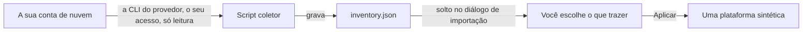

[English](Cloud-inventories) · **Português**

Um inventário de nuvem é o que um provedor lista de uma conta, gravado num
único arquivo por um script que você roda e lido pelo AEGIS como uma
plataforma: os recursos para os quais ele tem uma peça e as conexões que o
próprio provedor declara entre eles. É o jeito rápido de pôr a sua conta
AWS, Google Cloud ou Oracle Cloud no modelo.

> **O AEGIS não acessa nenhuma nuvem.** O servidor, o motor e a página não
> têm SDK de nuvem nem credencial; o arquivo é texto, lido como um arquivo
> Compose é lido. O script que o grava é seu para rodar, na sua máquina, com
> o seu acesso, e ele apenas lê.

O que sai é uma topologia como qualquer outra, e ela é `synthetic`: a
plataforma tem a forma da conta, e tudo o que a simulação mostra sobre ela é
calculado. Leia
[O que um inventário não consegue dizer](#o-que-um-inventário-não-consegue-dizer)
antes de ler o que quebra.

## Da conta à plataforma



1. **Grave o arquivo.** Na aplicação: **⋯**, **Importar ou exportar
   arquivos**, **Obter o inventário de uma conta de nuvem para importar**.
   Escolha o **Provedor**, preencha o que ler e clique em **Copiar o
   comando**. Ou escreva o comando você mesmo ([Os coletores](#os-coletores)).
2. **Solte-o no diálogo.** O arquivo é verificado como qualquer arquivo, e
   um painel diz o que ele contém: quantos recursos, em quais regiões e
   redes, de quais tipos, com quais tags.
3. **Escolha o que trazer e aplique.** Cada escolha é escrita na própria
   `selection` do arquivo, e o arquivo é lido de novo, então as contagens
   são as do servidor. **Aplicar** o torna a plataforma; **Salvar em um
   único arquivo** depois lhe dá a topologia em que ele se transformou, para
   editar à mão.

Antes de aplicar, **Como seria o mesmo incidente em cada plataforma?**, no
mesmo diálogo, roda um cenário do AEGIS na plataforma em uso e na que o
arquivo descreve
([Sua própria plataforma](Sua-própria-plataforma#um-incidente-nas-duas-plataformas)).

O arquivo também funciona sem o diálogo: ponha-o no `topologies/` de um
espaço de trabalho e ele é lido quando o servidor inicia, com uma seleção
escrita à mão. No site estático, o arquivo é lido pelo mesmo código, na
aba, e não vai a lugar nenhum.

```bash
cargo run -p aegis-server -- check-workspace examples/cloud-inventory
AEGIS_WORKSPACE=examples/cloud-inventory cargo run -p aegis-server
```

## O que é lido do arquivo

| Do arquivo                      | Na topologia                                                                                                                                                                           |
| ------------------------------- | -------------------------------------------------------------------------------------------------------------------------------------------------------------------------------------- |
| cada recurso que a seleção traz | um nó com o `id`, o `name` e o `type` do recurso; a descrição dele diz como o provedor o chama e, para um grupo, quantos ele representa                                                |
| a sua `region`                  | a região do nó; `global` é a borda do provedor, para o que não está em nenhuma região                                                                                                  |
| uma relação                     | uma conexão, desenhada como diz a sua base ([abaixo](#bases-das-conexões))                                                                                                             |
| recursos `public`               | por onde `clients` entram: cada recurso público para o qual nenhum outro recurso público roteia; sem nenhum declarado público, cada recurso que leva a algum lugar e ao qual nada leva |
| o `name` do arquivo             | o id e o nome da plataforma                                                                                                                                                            |

Dois nós que o arquivo não lista são acrescentados: `clients`, que
representa quem usa a plataforma e envia as 100 requisições por segundo
padrão, divididas igualmente entre as entradas; e `unknown-sources`, ocioso
em repouso, por onde um cenário envia tráfego hostil.

As funções são definidas onde o arquivo tem algo que possa cumpri-las, então
os cenários do AEGIS rodam onde podem e dizem qual função falta onde não
podem. Uma conta com uma distribuição, um balanceador de carga atrás dela e
um detector de ameaças tem o que o cenário DDoS Surge pede. Os coletores não
leem nenhum autorizador Cedar, então os dois cenários que pedem um não
rodam.

## Bases das conexões

Cada relação do arquivo diz o que a afirma. Essa é a sua `basis`, e uma
conexão só é desenhada a partir de uma relação que o arquivo contém.

| Base       | O que a afirma                                                                                                                       | Desenhada como                                                                                                                                                       |
| ---------- | ------------------------------------------------------------------------------------------------------------------------------------ | -------------------------------------------------------------------------------------------------------------------------------------------------------------------- |
| `routing`  | O provedor envia requisições de um para o outro: o destino de um balanceador, a origem de uma distribuição, a integração de uma API. | `route`; o que um roteador encaminha é dividido igualmente entre as suas rotas                                                                                       |
| `event`    | O provedor entrega de um para o outro quando algo acontece: uma fila que uma função lê, a assinatura de um tópico.                   | `publish` para uma fila, `consume` a partir de uma fila ou de qualquer outra fonte de eventos                                                                        |
| `declared` | A configuração do próprio recurso cita o outro, ou você o declarou quando o arquivo foi gravado (`--relation`).                      | lida pelo destino: `data` para um banco de dados ou armazenamento, `publish` para uma fila, `auth` para um serviço de autenticação, `call` para qualquer outra coisa |
| `network`  | Uma regra de rede admite um no outro.                                                                                                | como `declared`                                                                                                                                                      |

**Uma regra de rede é uma permissão, não uma chamada.** Ela é desenhada
porque nada mais diz quem alcança um banco de dados, mas ninguém viu a
chamada. A descrição da plataforma diz quantas conexões se apoiam numa, e
desligar **Desenhar conexões a partir de regras de rede** não desenha
nenhuma delas.

Duas afirmações da mesma conexão são uma conexão só, lida como diz a mais
forte, na ordem da tabela. Uma topologia é percorrida num só sentido: onde
as conexões afirmadas formam um ciclo, a que o fecharia fica de fora, a de
base mais fraca primeiro e depois na ordem do arquivo, e a descrição da
plataforma cita cada uma.

## Escolhendo o que trazer

Um arquivo pode trazer uma `selection`; sem ela, tudo é trazido. No
diálogo, cada controle escreve um campo dela. Cada campo omitido pede tudo,
e todo campo informado precisa ser atendido.

| Campo           | No diálogo                                             | Traz                                                                                                         |
| --------------- | ------------------------------------------------------ | ------------------------------------------------------------------------------------------------------------ |
| `regions`       | **Regiões**                                            | só recursos nestas regiões                                                                                   |
| `networks`      | **Redes**                                              | só recursos nestas redes; `null` representa os recursos que não estão em nenhuma                             |
| `kinds`         | **Tipos de serviço**                                   | só recursos destes tipos                                                                                     |
| `tags`          | **Tag**                                                | só recursos que têm todas as tags listadas: `{ "key": "env", "values": ["prod", "staging"] }`, ou só a chave |
| `name`          | **Nome contém**                                        | só recursos cujo nome contém isto, sem diferenciar maiúsculas                                                |
| `alongPaths`    | **Também o que leva a eles e aquilo a que eles levam** | também o que leva aos recursos escolhidos e aquilo a que eles levam, seguindo as conexões nos dois sentidos  |
| `connectedOnly` | **Somente o que tem alguma conexão**                   | não o que nenhuma conexão toca; um monitor de segurança fica, porque ele observa e nada o chama              |
| `bases`         | **Desenhar conexões a partir de regras de rede**       | só conexões afirmadas destas formas; as outras não são desenhadas, e a descrição as conta                    |
| `exclude`       | **Recursos, um a um**                                  | não estes recursos, pelo id, seja o que for pedido                                                           |
| `without`       | escrito à mão                                          | não estas conexões: `{ "from": "cdn", "to": "assets" }`                                                      |

O `alongPaths` é o que torna uma tag útil: peça `app=shop` e o balanceador
na frente dela e o banco de dados atrás, que ninguém marcou, vêm junto.
**Trazer tudo** limpa a seleção. Uma seleção que não deixa nada, ou que cita
um recurso que o arquivo não lista, é recusada com o motivo. Mais de 1 998
recursos ou 20 000 conexões é mais do que uma topologia comporta: o arquivo
ainda é examinado, e a resposta diz para reduzir a seleção.

## O que um inventário não consegue dizer

- **Quanto tráfego há, como ele se divide, quão lento algo é.** As 100
  requisições por segundo, as divisões iguais e cada latência são padrões
  do conversor. Para dar à plataforma as taxas de um incidente real, gere um
  rascunho a partir de uma [captura de incidente](Capturas-de-incidente), ou
  salve a topologia e escreva o `baseRps` e os pesos de conexão que você
  conhece.
- **Uma capacidade.** Nenhuma é dada: cada serviço tem a folga padrão do
  modelo sobre a sua carga em repouso. Informe `capacityRps` onde você
  conhece um limite antes de ler "teria evitado".
- **Quem chama quem, onde o provedor não fica entre os dois.** Um serviço
  chamando outro por HTTP não está em nenhum inventário. Declare os que
  você conhece com `--relation`, ou leia-os de traces com um exportador de
  capturas.
- **Que uma permissão é usada.** Veja [Bases das conexões](#bases-das-conexões).
- **O que um serviço faz com a carga.** Um limite de taxa, um filtro de
  tráfego suspeito e o escalonamento automático são informados por um
  arquivo de topologia; um inventário não informa nenhum deles. Acrescente-os
  à topologia salva
  ([Sua própria plataforma](Sua-própria-plataforma#o-que-um-serviço-faz-com-a-carga)).

## Os coletores

O `scripts/export-cloud-inventory.py` é uma ferramenta sua, rodada na sua
máquina. Ele usa só a biblioteca padrão do Python 3 e a CLI do próprio
provedor, que precisa estar instalada e autenticada, e chama a CLI com uma
lista de argumentos, nunca por um shell. Ele grava um arquivo novo e se
recusa a sobrescrever um existente, e sai com 0 quando gravou o arquivo, 1
com `Inventory failed: …` quando não conseguiu, e 2 para um erro de uso.
`<provider> --help` lista as opções e os tipos de um provedor. Todo provedor
aceita estas:

```text
  --name shop-prod            # the platform's name in AEGIS; it need not be the account's
  --tag env=prod              # write only resources carrying this tag; repeatable; --tag env for the key alone
  --tag-key env               # write only this tag key of each resource; repeatable; without it every tag is written
  --type orders-db=database   # declare the kind of the one resource with exactly this name; repeatable
  --relation checkout=orders  # declare a connection between two resources by their names; repeatable
  --no-network-rules          # do not read network rules: no connection is drawn from a permission
  --output inventory.json     # a new file
```

### AWS

Precisa da AWS CLI v2, recente o bastante para listar buckets por região.
Ela é chamada com o perfil que você indicar (`--profile`) ou com a cadeia
de credenciais padrão da CLI. `--region` é obrigatório e pode ser repetido.
O coletor lê balanceadores de carga e os seus target groups, Auto Scaling
groups e instâncias, serviços ECS e clusters EKS, funções Lambda e as suas
fontes de eventos, APIs do API Gateway e user pools do Cognito, SQS, SNS e
Kinesis, RDS, DynamoDB e ElastiCache, buckets S3, distribuições CloudFront,
detectores do GuardDuty, VPCs e security groups, e tags.

```bash
python3 scripts/export-cloud-inventory.py aws \
  --profile readonly \
  --region sa-east-1 \
  --name shop-prod \
  --output inventory.json
```

O acesso mínimo é este conjunto de ações. São listagens e descrições que
não recebem recurso, então `Resource` é `"*"`:

```json
{
  "Version": "2012-10-17",
  "Statement": [
    {
      "Sid": "AegisInventoryRead",
      "Effect": "Allow",
      "Action": [
        "tag:GetResources",
        "ec2:DescribeVpcs",
        "ec2:DescribeSecurityGroups",
        "ec2:DescribeInstances",
        "autoscaling:DescribeAutoScalingGroups",
        "elasticloadbalancing:DescribeLoadBalancers",
        "elasticloadbalancing:DescribeTargetGroups",
        "elasticloadbalancing:DescribeTargetHealth",
        "ecs:ListClusters",
        "ecs:ListServices",
        "ecs:DescribeServices",
        "eks:ListClusters",
        "eks:DescribeCluster",
        "lambda:ListFunctions",
        "lambda:ListEventSourceMappings",
        "apigateway:GET",
        "cognito-idp:ListUserPools",
        "sqs:ListQueues",
        "sqs:GetQueueAttributes",
        "sns:ListTopics",
        "sns:ListSubscriptions",
        "rds:DescribeDBClusters",
        "rds:DescribeDBInstances",
        "dynamodb:ListTables",
        "elasticache:DescribeReplicationGroups",
        "elasticache:DescribeCacheClusters",
        "kinesis:ListStreams",
        "s3:ListAllMyBuckets",
        "guardduty:ListDetectors",
        "cloudfront:ListDistributions"
      ],
      "Resource": "*"
    }
  ]
}
```

### Google Cloud

Precisa da gcloud CLI, autenticada. Ela é chamada com a identidade em que a
gcloud está autenticada, ou com a configuração que você indicar
(`--configuration`), e com `--quiet`, para que não pergunte nem habilite
nada. `--project` é obrigatório e não é gravado no arquivo. `--region` é
opcional e pode ser repetido; sem ele, todas as regiões são mantidas e o
Memorystore não é lido. O coletor lê balanceadores de carga (forwarding
rules, proxies, URL maps, backends), managed instance groups e instâncias,
Cloud Run e Cloud Functions, Pub/Sub, Cloud SQL, Spanner, Firestore,
Memorystore, Cloud Storage, clusters GKE, regras de firewall e labels. Ele
não lê nenhum monitor de segurança e lista um balanceador global como
balanceador de carga, então os cenários do AEGIS que precisam de um
roteador de borda ou de um monitor dizem qual função falta.

```bash
python3 scripts/export-cloud-inventory.py gcp \
  --project shop-prod-1234 \
  --region southamerica-east1 \
  --name shop-gcp \
  --output inventory.json
```

O acesso mínimo é um papel predefinido para cada serviço que tenha um que
não leia dados, e uma permissão num papel personalizado para o Firestore.
Com as suas próprias credenciais de usuário, a gcloud pode precisar também
de `serviceusage.services.use` no projeto em que cobra as chamadas.

```text
roles/compute.viewer
roles/container.clusterViewer
roles/cloudfunctions.viewer
roles/run.viewer
roles/pubsub.viewer
roles/cloudsql.viewer
roles/redis.viewer
roles/spanner.viewer
roles/storage.bucketViewer
datastore.databases.list
```

### Oracle Cloud

Precisa da OCI CLI, configurada. Ela é chamada com o perfil que você
indicar (`--profile`) ou com o perfil padrão da CLI. `--compartment` (o
OCID do compartimento) e `--region` são obrigatórios; os compartimentos
abaixo dele não são lidos, e nenhum dos OCIDs é gravado no arquivo. Onde as
redes ficam num compartimento à parte, indique-o com
`--network-compartment`. O coletor lê balanceadores de carga, instance
pools e instâncias, clusters OKE, container instances, funções, API
gateways, streams e filas, Autonomous Databases, DB systems, MySQL systems
e tabelas NoSQL, buckets do Object Storage, VCNs, sub-redes e network
security groups, e tags. Nenhuma relação `event` ou `declared` vem de uma
leitura da Oracle Cloud: declare as que você conhece com `--relation`.

```bash
python3 scripts/export-cloud-inventory.py oci \
  --profile DEFAULT \
  --compartment ocid1.compartment.oc1..aaaa \
  --region sa-saopaulo-1 \
  --name shop-oci \
  --output inventory.json
```

O acesso mínimo é este conjunto de declarações, com `<group>` o grupo do
usuário do perfil e `<compartment>` o compartimento lido:

```text
Allow group <group> to inspect vcns in compartment <compartment>
Allow group <group> to inspect subnets in compartment <compartment>
Allow group <group> to read network-security-groups in compartment <compartment>
Allow group <group> to use network-security-groups in compartment <compartment> where request.permission='NETWORK_SECURITY_GROUP_LIST_SECURITY_RULES'
Allow group <group> to read instances in compartment <compartment>
Allow group <group> to inspect vnic-attachments in compartment <compartment>
Allow group <group> to inspect vnics in compartment <compartment>
Allow group <group> to read instance-pools in compartment <compartment>
Allow group <group> to inspect clusters in compartment <compartment>
Allow group <group> to read cluster-node-pools in compartment <compartment>
Allow group <group> to inspect compute-container-instances in compartment <compartment>
Allow group <group> to inspect load-balancers in compartment <compartment>
Allow group <group> to inspect network-load-balancers in compartment <compartment>
Allow group <group> to inspect fn-app in compartment <compartment>
Allow group <group> to inspect fn-function in compartment <compartment>
Allow group <group> to read api-gateways in compartment <compartment>
Allow group <group> to read api-deployments in compartment <compartment>
Allow group <group> to inspect streams in compartment <compartment>
Allow group <group> to inspect queues in compartment <compartment>
Allow group <group> to inspect autonomous-databases in compartment <compartment>
Allow group <group> to inspect db-systems in compartment <compartment>
Allow group <group> to inspect mysql-instances in compartment <compartment>
Allow group <group> to inspect nosql-tables in compartment <compartment>
Allow group <group> to inspect buckets in compartment <compartment>
```

As quatro declarações de rede valem também para cada
`--network-compartment`.

## O que os coletores garantem

- **Toda chamada é uma leitura.** Cada coletor lista as operações que pode
  chamar (`READS`), um teste confere o que ele chama com essa lista, e cada
  uma delas é uma listagem, uma descrição ou uma consulta.
- **Uma leitura recusada é anotada, e o resto é lido.** Um perfil que não
  pode listar filas dá um inventário sem filas e uma nota que diz isso, com
  o nome curto que o provedor dá à recusa (`AccessDenied`) e nada mais do
  que ele disse. Se todas as leituras forem recusadas, nada é gravado.
- **Nada identifica a conta.** O arquivo tem nomes de recursos, tags, nomes
  de regiões e de redes e como eles se conectam, mas nenhum id de conta,
  ARN, id de projeto, OCID, endereço ou credencial; um teste de cada
  coletor confere isso. Um nome ou uma tag que você escreveu ainda pode
  dizer mais do que você quer compartilhar: leia o arquivo, ou grave menos
  tags com `--tag-key`.
- **Eles foram escritos a partir das referências dos provedores, não contra
  uma conta.** Os testes respondem nos formatos que as referências
  documentam. Uma primeira execução contra uma conta real pode encontrar um
  formato que eles não cobrem: um campo ausente é tratado como ausente, e
  uma falha diz qual leitura falhou.

O AEGIS nunca executa um coletor, e um coletor não é uma
[integração](Integrações): o servidor e a página nunca o chamam nem chamam
nada que ele lê. Depois de aplicada, uma plataforma é servida a quem
conseguir alcançar a API, como qualquer espaço de trabalho
([Modelo de segurança](Modelo-de-segurança)).

## O formato em resumo

Um único arquivo JSON, versão 1, descrito pelo
[`schemas/v1/inventory.schema.json`](https://github.com/cleissonbarbosa/csdt/blob/main/schemas/v1/inventory.schema.json).
O leitor recusa um arquivo que quebra uma regra, em vez de consertá-lo, e
diz qual é a regra.

| Campo         | Significado                                                                                                            |
| ------------- | ---------------------------------------------------------------------------------------------------------------------- |
| `kind`        | `"aegis-cloud-inventory"`: é o que distingue o arquivo `.json` de uma topologia                                        |
| `version`     | `1`                                                                                                                    |
| `provider`    | `aws`, `gcp` ou `oci`                                                                                                  |
| `name`        | 1 a 64 caracteres: o nome da plataforma e, com tudo o que não for letra, dígito, `.`, `_` ou `-` substituído, o seu id |
| `collectedAt` | opcional, no máximo 64 caracteres: quando foi lido, mostrado como escrito                                              |
| `resources`   | 1 a 10 000 de `{ id, name, type, native, region, network?, tags?, public?, members? }`                                 |
| `relations`   | até 50 000 de `{ from, to, basis, evidence? }`                                                                         |
| `selection`   | opcional: [que parte é trazida](#escolhendo-o-que-trazer)                                                              |
| `notes`       | até 40 textos de no máximo 1 280 caracteres: o que o coletor não conseguiu ler, mostrado como escrito no diálogo       |

O `id` de um recurso é feito a partir do nome dele, nunca do identificador
do próprio provedor; o `type` é um tipo de serviço que não seja
`external-client`, e o `native` é como o provedor o chama
(`AWS::RDS::DBCluster`). Depois de uma importação só a topologia é mantida:
nenhuma tag, rede, seleção ou nota, e o próprio arquivo não é guardado. Três
arquivos de exemplo, um por provedor, estão em
[`examples/cloud-inventory`](https://github.com/cleissonbarbosa/csdt/tree/main/examples/cloud-inventory);
os testes dos próprios coletores os gravam, nunca uma pessoa.

## Referência

Os documentos abaixo estão em inglês.

- [docs/INVENTORY.md](https://github.com/cleissonbarbosa/csdt/blob/main/docs/INVENTORY.md): a referência completa, com o que cada coletor lê e o que não lê
- [docs/WORKSPACE.md](https://github.com/cleissonbarbosa/csdt/blob/main/docs/WORKSPACE.md): espaços de trabalho, funções e o diálogo de importação
- [examples/cloud-inventory](https://github.com/cleissonbarbosa/csdt/tree/main/examples/cloud-inventory): um inventário por provedor
- [scripts/export-cloud-inventory.py](https://github.com/cleissonbarbosa/csdt/blob/main/scripts/export-cloud-inventory.py) e [scripts/cloud_inventory/](https://github.com/cleissonbarbosa/csdt/tree/main/scripts/cloud_inventory): os coletores
- [apps/server/src/workspace/inventory.rs](https://github.com/cleissonbarbosa/csdt/blob/main/apps/server/src/workspace/inventory.rs): o leitor
- [apps/web/src/features/workspace/InventoryFilters.tsx](https://github.com/cleissonbarbosa/csdt/blob/main/apps/web/src/features/workspace/InventoryFilters.tsx) e [CloudCommand.tsx](https://github.com/cleissonbarbosa/csdt/blob/main/apps/web/src/features/workspace/CloudCommand.tsx): as escolhas do diálogo e o comando que ele escreve
