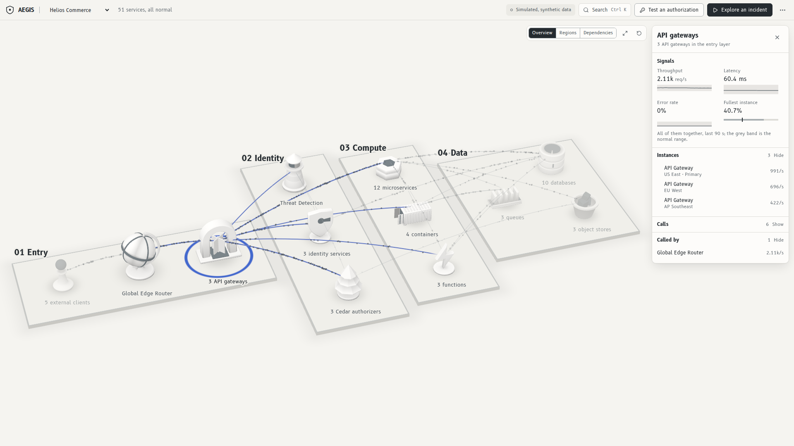

[English](Home) · **Português**

O AEGIS é um gêmeo digital interativo de uma plataforma de nuvem que não
existe. Um motor determinístico em Rust simula a _Helios Commerce_, com 51
serviços em três regiões e uma borda global, tick a tick: carga, saturação,
filas e falha em cascata. As decisões de autorização vêm do motor de
políticas [Cedar](https://www.cedarpolicy.com) de verdade. O resultado é
desenhado como uma maquete que você percorre no navegador: os serviços são
peças sobre placas, as requisições são pontos de tráfego correndo pelos
fios, e a única cor na tela é um problema.



> **A simulação é sintética.** O AEGIS não varre nenhuma rede e não ataca
> nada. Os únicos incidentes reais que ele mostra são capturas de
> incidente: arquivos lidos no seu navegador, identificados como não
> simulados e nunca misturados à simulação.

## Experimente

- **No navegador, sem instalar nada:** o
  [site estático](https://cleissonbarbosa.github.io/csdt/) roda o motor na
  própria aba, compilado para WebAssembly. Ele é publicado manualmente, então
  pode estar atrás da `main`.
- **Na sua máquina:** com Docker; depois abra `http://localhost:8080`.

```bash
git clone https://github.com/cleissonbarbosa/csdt.git aegis
cd aegis
docker compose up --build
```

[Primeiros passos](Primeiros-passos) traz todas as outras formas de rodar e
um primeiro passeio.

## O que dá para fazer

| Para                                                                                        | Leia                                                             |
| ------------------------------------------------------------------------------------------- | ---------------------------------------------------------------- |
| Ver como a plataforma está, seguir uma requisição, examinar um serviço                      | [Usando a interface](Usando-a-interface)                         |
| Iniciar um incidente, voltar no tempo, ler por que aconteceu, rodar de novo com uma mudança | [Incidentes e linha do tempo](Incidentes-e-linha-do-tempo)       |
| Perguntar ao Cedar quem pode fazer o quê, e por que uma requisição foi negada               | [Políticas Cedar](Políticas-Cedar)                               |
| Rodar a simulação numa plataforma sua, a partir de arquivos ou desenhada no navegador       | [Sua própria plataforma](Sua-própria-plataforma)                 |
| Consultar um campo de um arquivo de topologia, cenário, gravação ou política                | [Arquivos do espaço de trabalho](Arquivos-do-espaço-de-trabalho) |
| Trazer os serviços que uma conta AWS, Google Cloud ou Oracle Cloud lista                    | [Inventários de nuvem](Inventários-de-nuvem)                     |
| Ver um incidente real no mesmo modelo                                                       | [Capturas de incidente](Capturas-de-incidente)                   |
| Conectar uma instância local do cedar-agent ou do rinha-backend                             | [Integrações](Integrações)                                       |

## Como é construído

| Página                                       | O que cobre                                                    |
| -------------------------------------------- | -------------------------------------------------------------- |
| [Arquitetura](Arquitetura)                   | O servidor, o motor no navegador, o contrato e o cliente       |
| [API HTTP e stream](API-HTTP-e-stream)       | As rotas sob `/api/v1` e o WebSocket `/stream`                 |
| [Modelo de segurança](Modelo-de-segurança)   | O que o AEGIS não consegue fazer, e como cada parte é limitada |
| [Princípios de design](Princípios-de-design) | Por que a interface tem a aparência e o movimento que tem      |
| [Desempenho](Desempenho)                     | O que foi medido, em quê, e como medir de novo                 |
| [Desenvolvimento](Desenvolvimento)           | Ferramentas, comandos, testes, versões e as regras do projeto  |
| [Perguntas frequentes](Perguntas-frequentes) | Dúvidas comuns e as soluções habituais                         |
| [Glossário](Glossário)                       | As palavras que a interface e estas páginas usam               |

## Com o que você pode contar

- **Nada é inventado.** Todo número na tela é derivado do modelo no mesmo
  tick. Toda decisão do Cedar é o que o `cedar-policy` devolveu. Todo número
  de desempenho e toda captura de tela vêm de um script do repositório,
  rodado contra a aplicação.
- **A procedência é sempre indicada.** Um dado é _sintético_ (a simulação),
  uma _captura_ (um incidente real lido de um arquivo) ou _ao vivo_ (medido
  de um sistema conectado), de onde é produzido até o pixel.
- **Todo momento pode ser revisitado.** O motor é determinístico e o
  histórico é registrado como eventos: voltar a um momento o restaura
  exatamente, e rever o simula de novo bit a bit.

## Sobre este wiki

Este wiki acompanha a branch `main` e é escrito em inglês e em português do
Brasil; a primeira linha de cada página leva à mesma página na outra língua.
A fonte fica em
[`docs/wiki/`](https://github.com/cleissonbarbosa/csdt/tree/main/docs/wiki)
no repositório, então uma correção é um pull request ali: uma edição feita
aqui é substituída na próxima publicação. Cada página termina com os
documentos do repositório que ela resume, que continuam sendo a referência
completa (em inglês).

O AEGIS é software livre, sob a
[GNU Affero General Public License, versão 3 ou posterior](https://github.com/cleissonbarbosa/csdt/blob/main/LICENSE).
