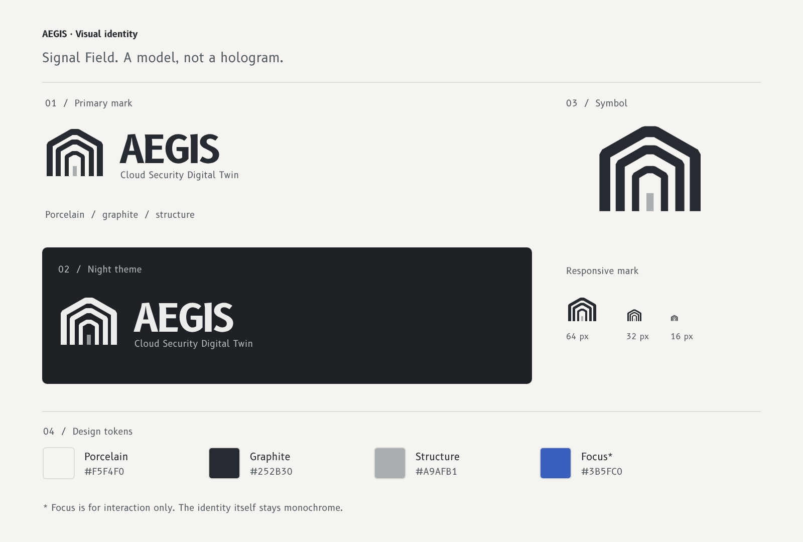

[English](Design-principles) · **Português**

O AEGIS tem a aparência que tem por motivos declarados, para que uma mudança
na interface possa ser julgada por algo mais firme que o gosto. Esta página
os resume; o
[`docs/DESIGN.md`](https://github.com/cleissonbarbosa/csdt/blob/main/docs/DESIGN.md)
(em inglês) é o padrão contra o qual uma mudança é conferida, com as fontes de
onde cada regra vem.

## A ideia: um campo de sinais

A topologia é o produto. Todo o resto é uma ferramenta que aparece quando é
chamada.

O AEGIS é desenhado como um **campo de sinais** (_signal field_): uma maquete
de uma plataforma sobre um campo de porcelana silencioso, onde uma cor só
aparece como resposta. Há dois tipos de resposta. O azul responde a você: isto
é o que você selecionou, esta é a requisição que você está seguindo. As cores
de sinal respondem aos dados: isto desvia, isto falhou, foi aqui que isto foi
barrado. Sem nada perguntado e nada errado, a tela é porcelana, grafite e
cinza.

O modelo é lido em três passos, e a interface é construída em torno deles:
**primeiro a visão geral, depois um caminho, depois o detalhe.**

## As oito regras

1. **A cor é uma resposta.** O foco é azul e responde a quem olha: a seleção e
   as suas conexões, a requisição rastreada, o foco do teclado, os links. Os
   sinais respondem aos dados: âmbar para desvio, um vermelho quente para
   falha e para uma requisição barrada, magenta para tráfego hostil. Nada
   normal tem cor: nada de "verde saudável", de cor de marca ou de tipos de
   serviço coloridos. As ações principais são em tinta, porque um comando não
   é um sinal.
2. **O normal é silencioso.** Um serviço saudável não tem ponto, selo nem
   rótulo dizendo isso. Uma frase na barra superior dá o estado da plataforma;
   enquanto tudo está normal, ela diz **51 serviços, todos normais**. Quando
   algo está errado, ela o nomeia e pisca até ser vista, a única animação em
   laço da interface. Em repouso, a tela tem a barra e o modelo: cartões,
   listas e a linha do tempo vêm quando são necessários. A única exceção é o
   cartão de orientação da primeira visita, mostrado uma vez.
3. **Primeiro a visão geral, depois um caminho, depois o detalhe.** A vista
   inicial tem uma peça por tipo de serviço (doze para a plataforma embutida,
   dezessete no máximo), qualquer que seja o tamanho da plataforma. Os seus
   números são os dos membros, agrupados: taxas somadas, latência e taxa de
   erro ponderadas pelo tráfego, estado tão ruim quanto o do pior membro.
   Selecionar uma peça, rastrear uma requisição ou iniciar um incidente traz
   um caminho para a frente; abrir um serviço leva às disposições detalhadas.
4. **Profundidade é distância ao longo do caminho.** Na visão geral, as quatro
   camadas (entrada, identidade, computação, dados) ficam uma atrás da outra
   no sentido em que uma requisição viaja. Nada é erguido para dar ênfase. A
   câmera usa uma lente longa (14°), e o desenho fica quase paralelo.
5. **Uma maquete, não um holograma.** Peças de porcelana fosca sob uma luz
   fixa, sobre placas baixas que projetam sombras suaves. Nada de bloom,
   brilho, piso quadriculado, linhas de varredura ou mistura aditiva. Os
   cartões flutuam sobre o modelo com uma sombra e nunca desfocam o que está
   atrás.
6. **Um número vem com a sua faixa.** Tráfego, latência, erros e saturação são
   desenhados contra a sua faixa normal, e um valor só ganha cor quando sai
   dela. Na barra superior, um instrumento só aparece enquanto a leitura está
   fora da faixa.
7. **Forma antes da cor.** Cada tipo de tráfego tem uma forma de conta (disco,
   anel, losango, quadrado, moldura; uma barra para uma rejeição, um triângulo
   para tráfego suspeito), e a saúde tem um glifo além de uma cor. Nada
   depende de distinguir duas cores.
8. **O movimento significa algo.** As contas andam porque as requisições
   andam, e cada peça tem uma parte que trabalha no ritmo da vazão do seu
   serviço e fica parada quando nada passa. O jeito como ela se move é o
   estado do serviço. Tudo o mais que se move responde a uma ação ou a uma
   mudança nos dados, uma vez. A câmera nunca se move sozinha depois que você
   assume o controle, e o movimento reduzido desliga tudo isso.

O jeito de a parte que trabalha se mover é o mesmo para todo tipo de peça:

| Estado     | A parte que trabalha                                                                     |
| ---------- | ---------------------------------------------------------------------------------------- |
| Saudável   | Anda de maneira uniforme                                                                 |
| Degradado  | Hesita: o mesmo ciclo, feito aos trancos                                                 |
| Crítico    | Está emperrada: empurra um pouco, tremendo, escorrega de volta e tenta de novo           |
| Fora do ar | Fica parada e torta: uma tampa desalinhada, uma fila caída para a frente, portas abertas |

Um estado é, portanto, dito de três maneiras: uma cor, um glifo ou uma
lâmpada, e um jeito de se mover. A terceira não precisa das outras duas.

## A disposição

Onde uma peça está é a primeira coisa que o modelo diz sobre ela. As três
disposições (`graphics/layout.ts`) seguem as mesmas decisões:

- **Uma camada é uma linha**, e o espaço a desenha: duas camadas
  ficam cerca de duas vezes mais afastadas que dois vizinhos dentro de uma.
- **Uma placa é do tamanho do que está sobre ela**, e nada fica por cima de
  outra coisa.
- **Uma peça com frente encara o seu tráfego**: um portão, um escudo, um
  contêiner e uma fila são girados na direção de quem os chama.
- **Num palco mais alto que largo**, como um celular, a visão geral é vista ao
  longo do caminho, e as camadas ficam uma acima da outra.
- **Um nome é para ser lido, ou não está lá.** Os nomes são desenhados por
  cima da cena na resolução da própria tela, nunca um sobre o outro e nunca
  pela metade; os mais importantes são posicionados primeiro.

| Disposição      | O que mostra                                                                                                 |
| --------------- | ------------------------------------------------------------------------------------------------------------ |
| A visão geral   | Quatro placas baixas, uma por camada, da esquerda para a direita na ordem em que uma requisição as atravessa |
| Por região      | Um eixo e os seus raios: a borda no centro, cada região uma placa redonda com as suas camadas para fora      |
| Por dependência | Raias: as camadas são colunas, e cada região é uma raia que as atravessa                                     |

## Palavras

As palavras fazem parte do design, nas duas línguas (o
[Glossário](Glossário) as lista).

- **O tempo é da simulação.** O cursor está no _agora da simulação_ ou no seu
  _histórico_, e qualquer um dos dois pode estar _pausado_. O tempo simulado
  nunca é chamado de "ao vivo"; essa expressão fica para dados medidos de um
  sistema conectado. Enquanto o cursor está no histórico, a barra superior diz
  de que momento fala: **Em 1:16, no histórico: 51 serviços, todos normais**.
- **Uma afirmação diz de que tipo é**: _prescrito_ (escrito no arquivo do
  cenário), _modelado_ (uma relação da topologia que o modelo segue),
  _observado_ (registrado durante a execução) ou _não explicado_. As marcas
  são em tinta, não em cores.
- **Um resultado pertence ao que foi perguntado.** Uma decisão do Cedar que
  não corresponde mais ao formulário ao lado é marcada como resposta a outra
  coisa, nunca mostrada como atual.
- **Um experimento não é um evento.** O que uma falha faria, mostrado antes de
  ela ser aplicada, não ganha cor de sinal; os serviços que ela alcançaria
  vêm para a frente no azul de quem olha.
- **Um objetivo é o limiar do próprio motor**, nunca um SLO nem um orçamento
  de erro.

## Uma captura de incidente

Uma [captura de incidente](Capturas-de-incidente) é um incidente real lido de
um arquivo, e a única coisa na tela que não é simulada. Tudo o que está acima
vale para ela, com estas exceções:

- **Ela abre no detalhe.** É desenhada só por região e não tem visão geral,
  porque os seus tipos de serviço são, na maioria, presumidos.
- **Desconhecido não é normal.** Um serviço cujo estado a fonte não informa
  fica de pé, um tom mais claro, sobre um anel tracejado sem cor. Em palavras,
  é **Sem dados**, **Taxa de erro não medida** ou **Não informado neste
  momento**.
- **A sua cor são os níveis da simulação, ditos como tais.** Um estado medido
  usa as taxas de erro em que a simulação considera um serviço degradado (4%)
  ou crítico (20%); latência e memória não colorem nada.
- **Sem faixa normal** para requisições, erros, p95 e memória, a única exceção
  declarada à regra 6: a fonte não informa nenhuma.
- **As peças de um relatório ficam em repouso**, porque o relatório de um
  provedor não informa tráfego.
- **A sua barra está sempre lá**, no lugar da linha do tempo, e a sua frase
  nunca pisca.
- **Palavras.** Os seus números são **Capturado, não simulado** ou **Do
  relatório do provedor, não simulado**. Ela nunca é chamada de gravação nem
  de "Rever", e os seus limiares nunca são objetivos.

## Tokens

Os tokens são propriedades CSS em `apps/web/src/index.css`, espelhadas como
literais em `apps/web/src/lib/palette.ts`, porque a cena 3D não lê
propriedades CSS. Uma mudança vai para os dois, nos dois temas.

| Papel               | Claro     | Noturno   |
| ------------------- | --------- | --------- |
| Porcelana (o campo) | `#F5F4F0` | `#1E2226` |
| Grafite (tinta)     | `#252B30` | `#ECEDEA` |
| Foco                | `#3B5FC0` | `#8FABF3` |
| Alerta              | `#8F5A00` | `#FFB224` |
| Incidente (crítico) | `#BF4631` | `#F47C66` |
| Hostil              | `#A81577` | `#F26BC4` |

- **Forma.** Os controles têm raio de 6 px e os cartões de 10 px; nada tem
  formato de pílula. Um cartão sobre o modelo tem uma sombra suave, e nada
  mais projeta sombra.
- **Movimento.** Duas curvas, `--ease-arrive` e `--ease-travel`; as
  transições da interface levam de 140 a 260 ms.
- **Tipografia.** B612, em dois pesos, com dígitos de largura igual; B612 Mono
  só para código literal. Só a primeira letra da frase em maiúscula, em todo
  lugar.

## Identidade

A marca é uma passagem por portais aninhados, as etapas que uma requisição
atravessa, com uma linha parada dentro dela: a rota em repouso, nem
selecionada nem anormal. Ela não tem matiz em nenhum dos temas. Os portais
são tinta e a linha é `--color-logo-line`, o cinza da estrutura no tema
claro e um tom mais claro à noite. Ela fica ao lado do nome na barra do
topo, e sobre uma placa de porcelana como favicon.

Os arquivos ficam em `docs/assets/identity/`, gerados por
`apps/web/scripts/build-identity.py` a partir dos próprios traços da barra e
dos tokens, com as palavras convertidas em contornos para que fiquem iguais
onde a B612 não está instalada.

## Deliberadamente ausente

| Não está aqui                       | Porque                                                                                                         |
| ----------------------------------- | -------------------------------------------------------------------------------------------------------------- |
| Brilho, bloom, gradientes           | Não dizem nada, e fazem o alarme disputar atenção                                                              |
| Uma cor para "saudável"             | Se o normal tem cor, a cor deixa de significar alguma coisa                                                    |
| Um segundo uso para o azul          | O foco é a cor de quem olha; um botão ou selo azul a gastaria                                                  |
| Pontos de estado em cada linha      | Cinquenta e uma marcas dizendo "tudo bem" enterram a que não diz                                               |
| Cartões de números-chave            | Um número que ninguém pediu fica na tela enquanto tudo está normal                                             |
| Desfoque atrás dos painéis          | Medido: custava várias vezes mais que a cena 3D ([Desempenho](Desempenho#uma-regressão-que-o-benchmark-pegou)) |
| Altura para dar ênfase              | Profundidade significa distância ao longo do caminho                                                           |
| Peças que giram, balançam ou pulsam | Movimento que não responde a nada ensina o olho a ignorar movimento                                            |
| Painéis abertos por padrão          | Inclusive a linha do tempo, que não tem nada até algo acontecer                                                |

## Conferindo uma mudança

Antes de acrescentar algo à interface, pergunte:

1. Se tem cor, a que ela responde? O azul responde a quem olha, uma cor de
   sinal responde aos dados. Se não responde a nada, é tinta.
2. Estaria na tela enquanto tudo está normal e nada foi perguntado? Então
   precisa justificar estar ali.
3. A que nível pertence: a visão geral, um caminho ou o detalhe? Deve aparecer
   nesse nível, não antes.
4. Se é um número, onde está a sua faixa normal?
5. Se se move, a que ação ou mudança nos dados responde, e para quando ela
   para?
6. Ainda se lê sem a cor?

A primeira e a última são testadas. Um teste ponta a ponta
(`apps/web/e2e/aegis.spec.ts`) lê de volta o quadro renderizado e verifica que
nenhum pixel amostrado tem cor enquanto a plataforma está saudável e nada está
selecionado, nos dois temas; que a cor vem e vai com uma seleção e uma
requisição rastreada; e que a cor aparece quando um incidente está em curso. A
mesma suíte falha se dois nomes no modelo se sobrepuserem. A suíte do site
estático cobra a primeira regra de uma captura de incidente. Testes unitários
cobram as regras da paleta (`lib/palette.test.ts`), a aritmética da visão
geral (`lib/overview.test.ts`) e os níveis de uma captura contra os do motor
(`lib/thresholds.test.ts`).

## Referência

Os documentos e arquivos abaixo estão em inglês.

- [`docs/DESIGN.md`](https://github.com/cleissonbarbosa/csdt/blob/main/docs/DESIGN.md): o padrão completo, as suas concessões e as suas fontes
- [`AGENTS.md`](https://github.com/cleissonbarbosa/csdt/blob/main/AGENTS.md): "Interface design rules"
- [`apps/web/src/index.css`](https://github.com/cleissonbarbosa/csdt/blob/main/apps/web/src/index.css) e
  [`apps/web/src/lib/palette.ts`](https://github.com/cleissonbarbosa/csdt/blob/main/apps/web/src/lib/palette.ts): os tokens
- [`apps/web/src/graphics/layout.ts`](https://github.com/cleissonbarbosa/csdt/blob/main/apps/web/src/graphics/layout.ts): as disposições
- [`apps/web/src/lib/overview.ts`](https://github.com/cleissonbarbosa/csdt/blob/main/apps/web/src/lib/overview.ts): a aritmética da visão geral
- [`apps/web/e2e/aegis.spec.ts`](https://github.com/cleissonbarbosa/csdt/blob/main/apps/web/e2e/aegis.spec.ts) e
  [`apps/web/src/lib/palette.test.ts`](https://github.com/cleissonbarbosa/csdt/blob/main/apps/web/src/lib/palette.test.ts): os testes que sustentam as regras
