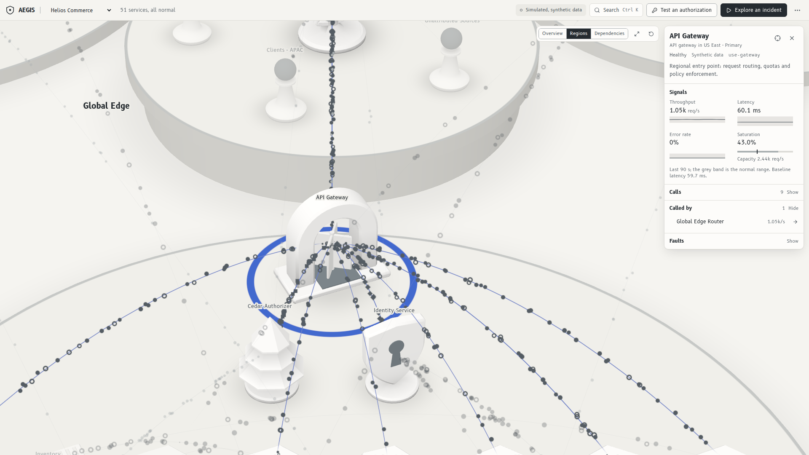
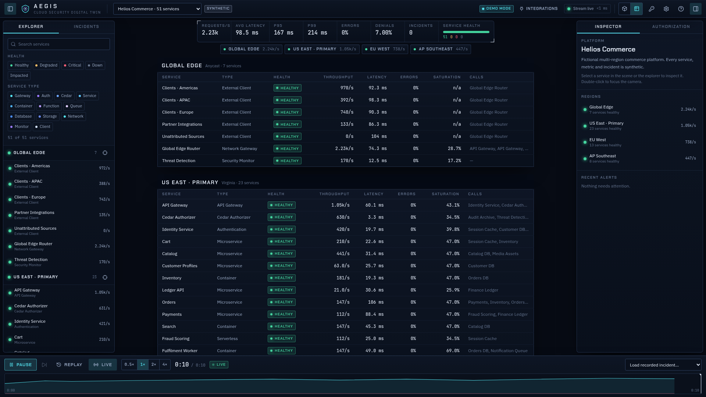

[English](Using-the-interface) · **Português**

O AEGIS é uma tela só: uma barra no alto e, abaixo dela, uma maquete da
plataforma. Esta página explica o que cada parte mostra e como você se move
pelo modelo, seleciona, busca e compartilha. Tudo funciona igual no servidor
e no site estático.

## A tela em repouso

Em repouso, a tela tem a barra e o modelo, e mais nada. Um serviço saudável
não tem ponto, selo nem rótulo, e a barra diz "51 serviços, todos normais".
O resto aparece quando tem algo a dizer.

| Na barra                                  | O que faz                                                                                                                                           |
| ----------------------------------------- | --------------------------------------------------------------------------------------------------------------------------------------------------- |
| O seletor de ambiente, à esquerda         | Troca a plataforma: **Helios Commerce** (51 serviços) ou **Hyperscale Stress** (178 serviços e 648 conexões em seis regiões)                        |
| A frase                                   | Diz como a plataforma está. Quando algo vai mal, ela nomeia o incidente e pisca até você clicar nela                                                |
| Os instrumentos ao lado                   | Um sinal da plataforma só aparece ali enquanto está fora da sua faixa normal, o mais urgente primeiro                                               |
| **Simulado, dados sintéticos**            | Diz de onde vêm os números. Abre as **Integrações**                                                                                                 |
| **Buscar** (<kbd>Ctrl</kbd> <kbd>K</kbd>) | Vai a qualquer serviço, região, cenário ou ação pelo nome                                                                                           |
| **Testar uma autorização**                | Abre o rastreador de requisições. Veja [Políticas Cedar](Políticas-Cedar)                                                                           |
| **Explorar um incidente**                 | Abre os incidentes. Enquanto um está em andamento, vira **Acompanhar o incidente**. Veja [Incidentes e linha do tempo](Incidentes-e-linha-do-tempo) |
| **⋯** (**Mais**)                          | Todo o resto, agrupado pelo que você veio fazer                                                                                                     |

O que aparece e some:

- Um cartão chega com uma seleção e sai com ela.
- A lista de serviços, os cenários e o rastreador de requisições aparecem
  quando você pede.
- A linha do tempo só fica na tela enquanto há algo nela: um incidente, uma
  pausa, um momento do histórico.

## Dois níveis do mesmo modelo

### A visão geral

A aplicação abre na **visão geral**: uma peça por tipo de serviço, doze na
plataforma que vem com o AEGIS e nunca mais de dezessete, por mais serviços
que haja. As quatro placas são as camadas que uma requisição atravessa, nesta
ordem:

1. **Entrada**: os clientes, o roteador de borda, os gateways de API.
2. **Identidade**: a autenticação, os autorizadores Cedar, a detecção de
   ameaças.
3. **Computação**.
4. **Dados**.

Quanto mais ao fundo da imagem uma peça está, mais adiante no caminho ela
fica. Uma peça que representa vários serviços diz quantos são ("3 gateways
de API"), e os números dela são os deles: taxas somadas, latência e taxa de
erro ponderadas pelo tráfego que as viu, estado igual ao do pior membro.
Nada na visão geral é estimado.

### Por região e por camada de dependência

As duas disposições detalhadas desenham cada serviço por si:

- **Regiões**: um centro com seus raios. A borda global fica no centro e
  cada região é uma placa redonda ao lado dela.
- **Dependências**: raias. As camadas são colunas da esquerda para a direita
  e cada região é uma raia que as atravessa.

Troque a disposição em **Disposição da topologia**, na barra de ferramentas
da cena (**Visão geral**, **Regiões**, **Dependências**), com <kbd>L</kbd>
ou em **Configurações**. As peças caminham até os novos lugares. Abrir um
serviço a partir de um tipo, de uma lista ou pelo nome deixa a visão geral e
vai para a última disposição detalhada que você usou. Numa tela mais alta do
que larga, a visão geral é vista ao longo do caminho, e as camadas ficam uma
acima da outra.

## Movendo-se pelo modelo

| Gesto                                           | Efeito                                                     |
| ----------------------------------------------- | ---------------------------------------------------------- |
| Arrastar                                        | Orbitar                                                    |
| Arrastar com o botão direito, ou com dois dedos | Deslocar                                                   |
| Rolar ou fazer pinça                            | Aproximar na direção do ponteiro                           |
| Clicar                                          | Examinar um serviço, um tipo ou uma conexão                |
| Clicar duas vezes                               | Aproximar de um serviço, ou da região de uma placa         |
| Apontar                                         | As conexões ficam azuis: você vê ao que a peça está ligada |

<kbd>R</kbd> redefine a câmera e <kbd>F</kbd> aproxima da seleção. Rastrear
uma requisição, ou um incidente entre todos os serviços, leva a câmera pelo
caminho; assim que você assume a câmera, ela não se move mais sozinha.

## Selecionando e examinando

Selecione uma peça e ela se ergue, as conexões são redesenhadas para fora em
azul, o resto do modelo recua e um cartão entra pela direita. <kbd>Esc</kbd>
limpa a seleção, e o cartão sai junto.

### Um tipo de serviço

Na visão geral, o cartão de um tipo mostra os membros juntos: vazão,
latência, taxa de erro e a **Instância mais saturada**, cada um com os
últimos 90 segundos contra a faixa normal. Os autorizadores Cedar também
mostram quantas verificações são feitas e que parcela é negada.
**Instâncias** lista os serviços por região; **Abrir este serviço no modelo
detalhado** leva você a um deles na disposição detalhada.

### Um serviço

O cartão de um serviço mostra os **Sinais** (vazão, latência, taxa de erro,
saturação e a capacidade), depois **Chama** e **Chamado por**: siga uma
conexão para percorrer o grafo de dependências. Mais abaixo vêm
**Exposição** (veja [Políticas Cedar](Políticas-Cedar#exposição)),
**Falhas** (veja
[Incidentes e linha do tempo](Incidentes-e-linha-do-tempo#experimentar-uma-falha-antes-de-aplicá-la)),
as **Decisões de autorização** tomadas ali, se houver, e os **Eventos**.

### Uma conexão

O cartão de uma conexão diz **De** e **Para**, depois o tráfego, a latência
de rede, a taxa de erro, as parcelas rejeitada e suspeita e as **Chamadas
por requisição**. Ele tem **Falhas** próprias.

## Busca e filtros

- **Ir a qualquer lugar.** <kbd>Ctrl</kbd> <kbd>K</kbd>, ou **Buscar** na
  barra, abre **Ir para um serviço ou executar um comando**. Digite o nome
  de um serviço, de uma região ("Enquadrar EU West"), de um cenário
  ("Iniciar DDoS Surge") ou de uma ação (uma disposição, um tema, o
  rastreador). Nada acontece até você escolher um resultado.
- **A lista de serviços.** <kbd>/</kbd> abre a aba **Serviços** com a caixa
  de busca em foco. Ela procura por nome, tipo ou região: digite
  `database eu-west` e todo o resto fica esmaecido no modelo.
- **Filtros.** **Filtrar** restringe a lista e o modelo por **Estado**,
  **Afetados pelo incidente** e **Tipo de serviço**. O título de uma região
  oferece **Mostrar só esta região**. **Limpar os filtros** traz tudo de
  volta.

## Sinais da plataforma

Clique na frase da barra enquanto tudo está normal, ou escolha **⋯ → Sinais
da plataforma**. O cartão traz os quatro sinais da plataforma em escalas com
as faixas normais, o que **Requer atenção**, as **Regiões** e as **Métricas
da plataforma**. Um valor só ganha cor quando sai da faixa.

| Sinal            | Faixa normal                                             |
| ---------------- | -------------------------------------------------------- |
| Tráfego          | De 60% a 140% da leitura mais antiga que a página guarda |
| Latência p95     | Até 1,6 vez a leitura mais antiga que a página guarda    |
| Erros            | Até 1%                                                   |
| Saturação máxima | Até 70%, lida no serviço mais saturado                   |

## Cor e forma

A cor é uma resposta. O azul responde a você; os outros matizes respondem
aos dados. Nada normal tem matiz, e nada depende de distinguir dois matizes:
cada estado também tem uma forma.

| Matiz    | Significa                                                                           |
| -------- | ----------------------------------------------------------------------------------- |
| Azul     | O que é seu: a seleção e as conexões dela, a requisição rastreada, o foco, os links |
| Âmbar    | Um desvio: degradado, limitado, rejeitado                                           |
| Vermelho | Uma falha, ou o lugar onde uma requisição foi barrada                               |
| Magenta  | Tráfego hostil (suspeito)                                                           |

O estado de um serviço é dito de três formas: uma cor, um glifo e o jeito
como a parte móvel da peça se move. Essa parte trabalha no ritmo do tráfego
e fica parada quando nada passa.

| Estado     | Glifo     | No modelo                                               |
| ---------- | --------- | ------------------------------------------------------- |
| Saudável   | Nenhum    | Peça neutra e sem marca, com movimento regular          |
| Degradado  | Triângulo | Peça âmbar com uma luz acesa e movimento irregular      |
| Crítico    | Quadrado  | Peça vermelha com uma luz acesa e o mecanismo emperrado |
| Fora do ar | Cruz      | Peça esmaecida com a parte móvel inclinada e parada     |

Na visão geral, uma luz acesa sob uma peça neutra quer dizer que alguns
serviços daquele tipo foram afetados; a própria peça ganha a cor quando
todos foram.

Os pontos de tráfego são requisições: a quantidade acompanha a taxa de
requisições. O tráfego comum se distingue pela forma (um disco para uma
requisição, um anel para uma resposta, um losango para autenticação, um
quadrado para autorização, uma moldura para uma mensagem de fila). O tráfego
que deu errado também tem forma (uma barra para uma rejeição, um triângulo
para tráfego suspeito) e só ganha cor quando passa a ter peso: erros acima de
uma requisição em cada cem, rejeições acima de uma em cada dez. **⋯ → Ajuda e
legenda**, ou <kbd>?</kbd>, tem a legenda completa.

## Rastreando uma requisição

**Testar uma autorização** abre o rastreador de requisições. Você escolhe
quem pede o quê, o Cedar decide, e uma requisição azul percorre o modelo até
onde é permitida ou barrada. Um selo vermelho com uma cruz marca onde ela foi
barrada; o vermelho marca o fim da requisição que você escolheu seguir, não
uma falha da plataforma. [Políticas Cedar](Políticas-Cedar) cobre o
rastreador por inteiro.

## A visualização em tabela

<kbd>T</kbd>, ou **⋯ → Visualização em tabela**, mostra a topologia inteira
sem 3D, uma tabela por região, utilizável com um leitor de tela. Os filtros
valem para ela. Uma chamada que sai da região da linha diz para onde vai.
Quando o navegador não consegue iniciar nem WebGPU nem WebGL 2, a aplicação
abre sozinha na visualização em tabela.

## Configurações

**⋯ → Configurações** guarda as suas preferências. Elas ficam salvas apenas
neste navegador; **Restaurar os padrões** as traz de volta.

| Configuração                     | Opções                                                                                            |
| -------------------------------- | ------------------------------------------------------------------------------------------------- |
| **Idioma**                       | **Do navegador**, English, Português (Brasil)                                                     |
| **Tema**                         | **Sistema**, **Claro**, **Noturno**                                                               |
| **Disposição da topologia**      | **Visão geral**, **Regiões**, **Dependências**                                                    |
| **Qualidade de renderização**    | **Auto**, **Baixa**, **Média**, **Alta**, **Ultra**                                               |
| **API gráfica**                  | **WebGPU (auto)**, WebGL 2 (trocar reinicia a cena)                                               |
| **Nomes**                        | Nomes dos serviços e das regiões no modelo                                                        |
| **Rotação automática da câmera** | Gira lentamente em torno do modelo até você mover a câmera; desativada por padrão                 |
| **Movimento**                    | **Sistema**, **Reduzido**, **Completo**                                                           |
| **Painel de desempenho**         | Taxa de quadros, tempo por quadro, chamadas de desenho, número de pontos de tráfego e API gráfica |

- **Temas.** O claro é para um ambiente iluminado, o noturno para um escuro.
  As regras não mudam: em qualquer tema, uma cor é uma resposta.
- **Idioma.** A interface fala inglês e português do Brasil. Por padrão, ela
  segue o primeiro idioma do navegador. Trocar a configuração recarrega a
  página: no site estático, isso inicia de novo a simulação na aba; num
  servidor, a simulação continua como está. Nomes, cenários e eventos
  aparecem como o arquivo ou o motor os escreveu.
- **Movimento reduzido** desativa a animação da câmera, o movimento das
  peças, o piscar de novos alarmes e as transições da interface.

## Teclado

| Tecla                        | Ação                                                                                |
| ---------------------------- | ----------------------------------------------------------------------------------- |
| <kbd>Espaço</kbd>            | Reproduzir ou pausar a simulação                                                    |
| <kbd>R</kbd>                 | Redefinir a câmera                                                                  |
| <kbd>F</kbd>                 | Aproximar a câmera da seleção                                                       |
| <kbd>Esc</kbd>               | Limpar a seleção e, em seguida, fechar os painéis                                   |
| <kbd>Ctrl</kbd> <kbd>K</kbd> | Buscar um serviço, uma região, um cenário ou uma ação                               |
| <kbd>/</kbd>                 | Buscar serviços                                                                     |
| <kbd>L</kbd>                 | Próxima disposição: visão geral, por região, por dependência                        |
| <kbd>T</kbd>                 | Alternar entre o modelo 3D e a tabela                                               |
| <kbd>P</kbd>                 | Mostrar ou ocultar o painel de desempenho                                           |
| <kbd>?</kbd>                 | Abrir a ajuda e a legenda                                                           |
| <kbd>←</kbd> / <kbd>→</kbd>  | Mover 5 s na linha do tempo (mantenha <kbd>Shift</kbd> pressionado para mover 30 s) |

Enquanto uma captura de incidente está aberta, as teclas movem o relógio dela;
veja [Capturas de incidente](Capturas-de-incidente).

## Links e o endereço

O endereço acompanha o que você olha, então a barra de endereço é sempre um
link para a vista. Abrir um link desses não muda nada no servidor: ele só
olha para o mesmo lugar.

| No endereço       | O que faz                                                                                                 |
| ----------------- | --------------------------------------------------------------------------------------------------------- |
| `arrangement=`    | `layers` (a visão geral), `regions` ou `dependencies`; só é escrito quando não é a visão geral            |
| `view=table`      | A visualização em tabela no lugar do modelo                                                               |
| `select=`         | A seleção: `node:<id>`, `edge:<id>` ou `group:<id>`                                                       |
| `?challenge=<id>` | Abre o guia com esse desafio oferecido primeiro. Não o inicia                                             |
| `?embed=1`        | O modelo sem a barra, com uma linha que diz o que é isto e abre a aplicação inteira                       |
| `&scenario=<id>`  | Com `embed=1`, só no site estático: inicia esse incidente. Num servidor, um endereço não inicia nada      |
| `?capture=<id>`   | Abre uma captura de incidente que vem com o AEGIS: `google-cloud-2025-06-12` ou `online-boutique-rcaeval` |
| `#session=…`      | Uma sessão inteira, escrita por **Copiar link**                                                           |

Um modo incorporado (`embed`) não lê o parâmetro `capture`. Um experimento
inteiro (os comandos, a semente, o momento) viaja como sessão: veja
[Incidentes e linha do tempo](Incidentes-e-linha-do-tempo#sessões).

## Desafios guiados

**⋯ → Desafios guiados** faz seis perguntas sobre a plataforma, respondidas
usando-a. A sua resposta é conferida contra o próprio modelo: o registro do
incidente ou a decisão do próprio Cedar. A dica que uma resposta errada
recebe também.

| Id                   | Desafio                                                          | Inicia                                                      |
| -------------------- | ---------------------------------------------------------------- | ----------------------------------------------------------- |
| `cascade-origin`     | **Encontrar a origem da falha em cascata**                       | Cascading Service Failure, a partir de uma simulação limpa  |
| `flood-stopped`      | **Encontrar onde o pico de tráfego é bloqueado**                 | DDoS Surge, a partir de uma simulação limpa                 |
| `region-dark`        | **Encontrar a região que ficou fora do ar**                      | Regional Outage, a partir de uma simulação limpa            |
| `contractor-stopped` | **Encontrar onde as requisições do terceirizado são bloqueadas** | Cedar Authorization Denial, a partir de uma simulação limpa |
| `export-denied`      | **Explicar por que esta exportação foi negada**                  | O rastreador com a requisição; a simulação fica como está   |
| `deletion-denied`    | **Descobrir quando um cliente pode ser excluído**                | O rastreador com a requisição; a simulação fica como está   |

O cartão conta os desafios que você resolveu, no seu navegador e em nenhum
outro lugar. **Copiar link do desafio** dá um endereço com
`?challenge=<id>`.

## A primeira visita

Na primeira vez que você abre o AEGIS, um cartão ao pé do palco diz o que é
isto e oferece três caminhos: **Entender a plataforma**, **Investigar uma
falha** e **Testar uma autorização**, além de um desafio guiado. Escolher um
deles ou fechar o cartão fica lembrado no seu navegador, e ele não volta.
Tudo o que ele oferece continua na barra e no menu dela.

## Referência

Estes documentos do repositório estão em inglês.

- [docs/DEMO.md](https://github.com/cleissonbarbosa/csdt/blob/main/docs/DEMO.md): o passeio de cinco minutos
- [docs/DESIGN.md](https://github.com/cleissonbarbosa/csdt/blob/main/docs/DESIGN.md): as regras, a disposição e as palavras
- [docs/ARCHITECTURE.md](https://github.com/cleissonbarbosa/csdt/blob/main/docs/ARCHITECTURE.md): o cliente web
- [README.md](https://github.com/cleissonbarbosa/csdt/blob/main/README.md): as funcionalidades
- [apps/web/src/features/topnav/TopNav.tsx](https://github.com/cleissonbarbosa/csdt/blob/main/apps/web/src/features/topnav/TopNav.tsx): a barra e o menu dela
- [apps/web/src/features/help/HelpDialog.tsx](https://github.com/cleissonbarbosa/csdt/blob/main/apps/web/src/features/help/HelpDialog.tsx): a legenda e as teclas
- [apps/web/src/features/hud/Hud.tsx](https://github.com/cleissonbarbosa/csdt/blob/main/apps/web/src/features/hud/Hud.tsx): os sinais da plataforma e as faixas deles
- [apps/web/src/features/settings/SettingsDialog.tsx](https://github.com/cleissonbarbosa/csdt/blob/main/apps/web/src/features/settings/SettingsDialog.tsx): as configurações
- [apps/web/src/features/guide/challenges.ts](https://github.com/cleissonbarbosa/csdt/blob/main/apps/web/src/features/guide/challenges.ts): os desafios guiados
- [apps/web/src/app/urlState.ts](https://github.com/cleissonbarbosa/csdt/blob/main/apps/web/src/app/urlState.ts), [apps/web/src/app/embed.ts](https://github.com/cleissonbarbosa/csdt/blob/main/apps/web/src/app/embed.ts) e [apps/web/src/app/captureUrl.ts](https://github.com/cleissonbarbosa/csdt/blob/main/apps/web/src/app/captureUrl.ts): o endereço
